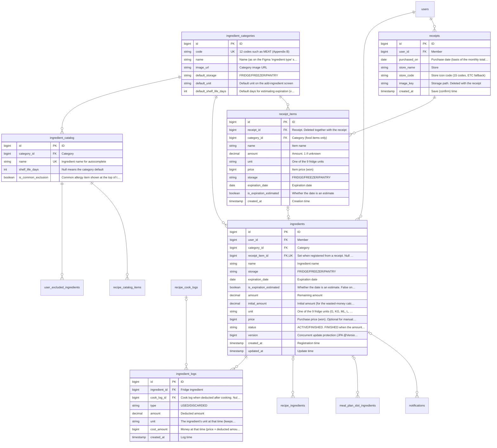
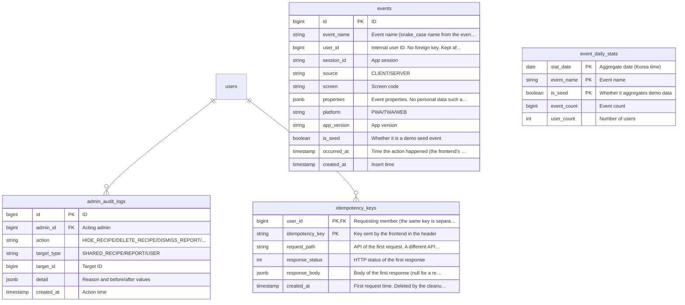

# Remake ERD and Table Definition v3

> Korean version for developers: [`docs/developer/erd.md`](../developer/erd.md)

2026-11-19 · Kim Jongsu (updated 2026-11-20 to policy v3.1: see the "11/20 decision" rows below)

## Changes from v2

| Area | What changed | Why |
| --- | --- | --- |
| New table | `recipe_catalog_items` (replaces `recipe_ingredients.catalog_id`) | Grouped items such as "crustaceans" do not map to one recipe ingredient line, so allergy warnings were missed |
| New table | `meal_plan_slot_ingredients` (replaces the `meal_plan_slots.planned_ingredients` JSON) | Count duplicate assignments in SQL and clean up links when an ingredient is deleted |
| New table | `idempotency_keys` | Storage for the API `Idempotency-Key` rule (in the DB, no Redis) |
| Saving a shared recipe | Saving creates a copy; `saved_recipes.recipe_id` points to the copy. `recipes.origin` gains SHARED_COPY | API v3 says "copy". Pointing at the original would deduct the creator's fridge ingredients when someone else cooks it |
| 11/17 issues | `users.provider_user_id` set to null on withdrawal, `refresh_tokens.token_hash` UK, `usage_logs.status` PENDING, `ingredient_logs.unit` added | Re-signup and de-identification, duplicate tokens, double clicks exceeding the quota, log meaning changing when a unit changes |
| Ingredient deletion | Cannot delete an ingredient that has use/discard logs (add `INGREDIENT_HAS_LOGS` to the API) | Deleting it would change the wasted-money statistics |
| Types and timestamps | `datetime` → `timestamp`. Every table has `created_at`; only the 7 updated tables have `updated_at` | PostgreSQL has no `datetime`. Java `LocalDateTime` |
| Added columns | `ingredients.version`, `saved_recipes.is_favorite` (add a star on/off API), `generation_quota_grants.shared_recipe_id` | Concurrent update error, Figma star, showing the rewarded recipe |
| Removed columns | `recipes.description`, `recipes.difficulty` | Not in Figma or the API |
| NULL and defaults | `recipes.mode` and `receipts.image_key` nullable, `meal_plan_slots.menu_name` NOT NULL, `notification_enabled` default true, `ingredients.unit` default EA | Detail and copied recipes have no mode, images are deleted after one year, alerts work right after signup |
| Events | `events.user_id` has no foreign key and stays after withdrawal | Keeps past statistics. Personal identifiers are cleared in `users` |
| 11/20 decision | New table `shared_recipe_weekly_ranks` (32 tables) | The ranking shows the change from last week (`rankChange`), so the weekly job keeps last week's final TOP 100 |
| 11/20 decision | `users.plan` (BASIC/PREMIUM) added | Limits differ by plan. Release 1 applies BASIC only (premium is UI only) |
| 11/20 decision | `receipts.status` (SCANNED/CONFIRMED) removed. Only confirmed receipts are stored; `receipts.image_key` NOT NULL | The scan API only analyzes and stores nothing. The confirm API saves the receipt, items, and fridge ingredients in one transaction |
| 11/20 decision | `receipts.store_code` added | Store icon (15 codes, `ETC` fallback) |
| 11/20 decision | `receipts.total_price` removed; `receipts` and `receipt_items` drop `updated_at` and extend `BaseCreatedEntity` (5 tables now have `updated_at`) | Spending is always the sum of food items, so the printed total is never used. A confirmed receipt is never edited |
| 11/20 decision | Receipt retention: 6 months by purchase date, then deleted with images and items. The 7-day unconfirmed cleanup and 1-year image retention are removed | Spending comparison uses the last 6 months. Nothing unconfirmed is stored |
| 11/20 decision | `receipt_items` stores food items only; `category_id` NOT NULL | OCR returns food items only (non-food lines are filtered out) |
| 11/20 decision | `notifications.receipt_id` and type `RECEIPT_DONE` removed (EXPIRY_SOON/EXPIRED only) | OCR is synchronous, so there is no "analysis finished" notification |
| 11/20 decision | `generation_quota_grants.expires_at` added (one month after the grant) | Weekly rewards must be used within one month |
| 11/20 decision | OCR counting in `usage_logs` removed from the remaining-count rule | Receipt scans have no limit. OCR rows are kept for monitoring. Decide again if AI is added to OCR |
| 11/20 decision | `shared_recipes.save_count` is the cumulative count for the detail screen; weekly popularity counts `saved_recipes.saved_at` | The ranking is "saves this week" |
| 11/20 decision | `cart_items.meal_plan_slot_id` added (nullable FK, `ON DELETE SET NULL`; [#46](https://github.com/likelion-backendschool-9th/REMAKE/issues/46)) | Identify items by source slot so meal-plan overwrite removes only replaced slots' cart items and preserves those from untouched slots |
| 11/20 decision | Account deletion always uses a 6-digit email code; if the provider gave no email, the client supplies `{ email }` on `POST /user/account/deletion-codes`, which is saved to `users.email` then used for the code ([#54](https://github.com/likelion-backendschool-9th/REMAKE/issues/54) A) | No ops-only deletion path. Same code rules (5 min / 30 s resend / 5 locks) for every account |

## Common rules

- **Types**: quantity `numeric(10,3)`, money `bigint` (won), timestamps `timestamp` (Korea time, Java `LocalDateTime`), JSON `jsonb`.
- **Timestamp columns**: every row the app creates has `created_at` (`BaseCreatedEntity`). Only tables whose values are updated also have `updated_at` (`BaseTimeEntity`). The server `Clock` sets the times; do not use `DEFAULT now()`.
- **Reference data**: `ingredient_categories` and `ingredient_catalog` are filled only by Flyway migrations.

## ERD diagrams

The Mermaid code blocks below render as diagrams on GitHub and in Notion. When you change a table, update the diagram too.

### Overview

```mermaid
erDiagram
  users ||--o{ user_excluded_ingredients : ""
  ingredient_catalog ||--o{ user_excluded_ingredients : ""
  users ||--o{ refresh_tokens : ""
  users ||--o{ account_deletion_requests : ""
  ingredient_categories ||--o{ ingredient_catalog : ""
  users ||--o{ ingredients : ""
  ingredient_categories ||--o{ ingredients : ""
  receipt_items |o--o| ingredients : ""
  ingredients ||--o{ ingredient_logs : ""
  recipe_cook_logs |o--o{ ingredient_logs : ""
  users ||--o{ receipts : ""
  receipts ||--o{ receipt_items : ""
  ingredient_categories ||--o{ receipt_items : ""
  users ||--o{ recipes : ""
  recipes ||--o{ recipe_ingredients : ""
  ingredients |o--o{ recipe_ingredients : ""
  recipes ||--o{ recipe_steps : ""
  recipes ||--o{ recipe_catalog_items : ""
  ingredient_catalog ||--o{ recipe_catalog_items : ""
  users ||--o{ saved_recipes : ""
  recipes ||--o{ saved_recipes : ""
  shared_recipes |o--o{ saved_recipes : ""
  users ||--o{ recipe_cook_logs : ""
  recipes ||--o{ recipe_cook_logs : ""
  users ||--o{ meal_plans : ""
  users ||--o{ meal_plan_slots : ""
  meal_plans |o--o{ meal_plan_slots : ""
  recipes |o--o{ meal_plan_slots : ""
  meal_plan_slots ||--o{ meal_plan_slot_ingredients : ""
  ingredients |o--o{ meal_plan_slot_ingredients : ""
  users ||--o{ cart_items : ""
  recipes |o--o{ cart_items : ""
  meal_plans |o--o{ cart_items : ""
  meal_plan_slots |o--o{ cart_items : ""
  recipes ||--o| shared_recipes : ""
  shared_recipes ||--o{ shared_recipe_photos : ""
  shared_recipes ||--o{ shared_recipe_reports : ""
  shared_recipes ||--o{ shared_recipe_weekly_ranks : ""
  users ||--o{ shared_recipe_reports : "신고자"
  users |o--o{ shared_recipe_reports : "처리"
  users ||--o{ generation_quota_grants : "받음"
  users |o--o{ generation_quota_grants : "조정"
  shared_recipes |o--o{ generation_quota_grants : ""
  users ||--o{ usage_logs : ""
  generation_quota_grants |o--o{ usage_logs : ""
  users ||--o{ notifications : ""
  ingredients |o--o{ notifications : ""
  users ||--o{ push_subscriptions : ""
  users ||--o{ admin_audit_logs : ""
  users ||--o{ idempotency_keys : ""
  events {
    bigint id PK
  }
  event_daily_stats {
    bigint id PK
  }
```

Tables: relationships of all 32 tables (columns omitted)

### Members and settings

```mermaid
erDiagram
  users ||--o{ user_excluded_ingredients : ""
  ingredient_catalog ||--o{ user_excluded_ingredients : ""
  users ||--o{ refresh_tokens : ""
  users ||--o{ account_deletion_requests : ""
  users ||--o{ ingredients : ""
  users ||--o{ receipts : ""
  users ||--o{ recipes : ""
  users ||--o{ saved_recipes : ""
  users ||--o{ recipe_cook_logs : ""
  users ||--o{ meal_plans : ""
  users ||--o{ meal_plan_slots : ""
  users ||--o{ cart_items : ""
  users ||--o{ shared_recipe_reports : "신고자"
  users |o--o{ shared_recipe_reports : "처리"
  users ||--o{ generation_quota_grants : "받음"
  users |o--o{ generation_quota_grants : "조정"
  users ||--o{ usage_logs : ""
  users ||--o{ notifications : ""
  users ||--o{ push_subscriptions : ""
  users ||--o{ admin_audit_logs : ""
  users ||--o{ idempotency_keys : ""
  users {
    bigint id PK "ID"
    string provider "NAVER/KAKAO/GOOGLE"
    string provider_user_id UK "Social provider user ID. UK(provider + th…"
    string email "For sending the account deletion code. Nu…"
    string role "USER/ADMIN"
    string status "ACTIVE/SUSPENDED"
    string plan "BASIC/PREMIUM. Release 1 applies BASIC…"
    int household_size "Household size. Null if skipped"
    boolean onboarding_completed "Whether onboarding was finished or skipped"
    boolean recipe_supplement_enabled "Recipe ingredient supplement (setting). W…"
    boolean notification_enabled "Receive notifications (setting)"
    string last_meal_purpose "Last chosen meal plan purpose"
    timestamp created_at "Signup time"
    timestamp updated_at "Update time"
    timestamp deleted_at "Withdrawal time"
  }
  user_excluded_ingredients {
    bigint user_id PK, FK "Member"
    bigint catalog_id PK, FK "Ingredient to exclude (ingredient diction…"
  }
  refresh_tokens {
    bigint id PK "ID"
    bigint user_id FK "Member"
    string token_hash UK "Token hash. Looked up on every refresh"
    timestamp expires_at "Expiry time (issued + 14 days)"
    timestamp revoked_at "Logout time"
    timestamp created_at "Issue time"
  }
  account_deletion_requests {
    bigint id PK "ID"
    bigint user_id FK "Member"
    string code_hash "Code hash (the code itself is never store…"
    timestamp expires_at "Expiry time (5 minutes after sending)"
    int attempts "Input attempts (locked after more than 5)"
    timestamp verified_at "Verification time"
    timestamp created_at "Send time (used for the resend interval c…"
  }
```

Tables: users, user_excluded_ingredients, refresh_tokens, account_deletion_requests

### Fridge and receipts

Tables: ingredient_categories, ingredient_catalog, ingredients, ingredient_logs, receipts, receipt_items

### Recipes, meal plans, cart, cook logs

```mermaid
erDiagram
  recipe_cook_logs |o--o{ ingredient_logs : ""
  users ||--o{ recipes : ""
  recipes ||--o{ recipe_ingredients : ""
  ingredients |o--o{ recipe_ingredients : ""
  recipes ||--o{ recipe_steps : ""
  recipes ||--o{ recipe_catalog_items : ""
  ingredient_catalog ||--o{ recipe_catalog_items : ""
  users ||--o{ saved_recipes : ""
  recipes ||--o{ saved_recipes : ""
  shared_recipes |o--o{ saved_recipes : ""
  users ||--o{ recipe_cook_logs : ""
  recipes ||--o{ recipe_cook_logs : ""
  users ||--o{ meal_plans : ""
  users ||--o{ meal_plan_slots : ""
  meal_plans |o--o{ meal_plan_slots : ""
  recipes |o--o{ meal_plan_slots : ""
  meal_plan_slots ||--o{ meal_plan_slot_ingredients : ""
  ingredients |o--o{ meal_plan_slot_ingredients : ""
  users ||--o{ cart_items : ""
  recipes |o--o{ cart_items : ""
  meal_plans |o--o{ cart_items : ""
  meal_plan_slots |o--o{ cart_items : ""
  recipes ||--o| shared_recipes : ""
  recipes {
    bigint id PK "ID"
    bigint creator_id FK "Creator (for a copy, the member who saved…"
    string title "Title"
    int servings "Servings"
    int cook_minutes "Cooking time (minutes)"
    string tips "Tips! text"
    string origin "RECIPE_GEN (recipe generation)/MEAL_DETAI…"
    string mode "QUICK/CUSTOM. Only when origin is RECIPE_…"
    jsonb custom_options "Custom choices (ingredients, taste, cooki…"
    boolean supplement_used "Whether it was generated with ingredient …"
    timestamp created_at "Creation time"
  }
  recipe_ingredients {
    bigint id PK "ID"
    bigint recipe_id FK "Recipe"
    bigint ingredient_id FK "Fridge ingredient intended at generation.…"
    string name "Ingredient name"
    decimal amount "Null means 'a little'"
    string unit "One of the 14 recipe units (Appendix A)"
    int sort_order "Order"
    timestamp created_at "Creation time"
  }
  recipe_steps {
    bigint id PK "ID"
    bigint recipe_id FK "Recipe. UK(recipe_id + step_no)"
    int step_no "Step number"
    string content "Text"
    timestamp created_at "Creation time"
  }
  recipe_catalog_items {
    bigint recipe_id PK, FK "Recipe"
    bigint catalog_id PK, FK "Excluded-ingredient item the recipe conta…"
  }
  saved_recipes {
    bigint id PK "ID"
    bigint user_id FK "Member"
    bigint recipe_id FK "Saved recipe. My copy for a shared recipe…"
    bigint shared_recipe_id FK "The shared post when a shared recipe was …"
    boolean is_favorite "Favorite (star). The ★ in Figma's saved l…"
    timestamp saved_at "Save time (latest-saved order, weekly ran…"
  }
  recipe_cook_logs {
    bigint id PK "ID"
    bigint user_id FK "Member who cooked"
    bigint recipe_id FK "Recipe"
    int servings "Servings cooked"
    string feedback "Recommend this recipe LIKE/DISLIKE (behav…"
    timestamp cooked_at "Cooking time"
  }
  meal_plans {
    bigint id PK "ID"
    bigint user_id FK "Member"
    date start_date "Start date"
    string purpose "BALANCED/DIET/HIGH_PROTEIN/SIMPLE/SAVING"
    string meal_types "Meals to include (from BREAKFAST,LUNCH,DI…"
    int servings "Number of people"
    int generated_days "Days actually generated (1–7)"
    timestamp created_at "Creation time"
  }
  meal_plan_slots {
    bigint id PK "ID"
    bigint user_id FK "Member"
    bigint meal_plan_id FK "The meal plan for a generated slot; null …"
    date slot_date "Date"
    string meal_type UK "BREAKFAST/LUNCH/DINNER. UK(user_id + slot…"
    string menu_name "Menu name (the recipe title for a manual …"
    bigint recipe_id FK "Null means a menu-name-only slot (tapping…"
    string source "AI (meal plan generation)/MANUAL (added m…"
    timestamp created_at "Creation time"
    timestamp updated_at "Update time (when detail generation fills…"
  }
  meal_plan_slot_ingredients {
    bigint id PK "ID"
    bigint slot_id FK "Meal plan slot. Deleted with the slot"
    bigint ingredient_id FK "Assigned fridge ingredient. Null for a mi…"
    string name "Ingredient name"
    decimal amount "Amount"
    string unit "Unit"
    timestamp created_at "Creation time"
  }
  cart_items {
    bigint id PK "ID"
    bigint user_id FK "Member"
    bigint recipe_id FK "Recipe the group is based on (null for a …"
    bigint meal_plan_id FK "Set when it came from a meal plan"
    bigint meal_plan_slot_id FK "Source slot; nullable, ON DELETE SET NULL"
    string group_name "Group name on screen (recipe title or men…"
    string name "Ingredient name"
    decimal amount "Amount (editable)"
    string unit "Unit"
    timestamp created_at "Added time"
    timestamp updated_at "Amount change time"
  }
```

Tables: recipes, recipe_ingredients, recipe_steps, recipe_catalog_items, saved_recipes, recipe_cook_logs, meal_plans, meal_plan_slots, meal_plan_slot_ingredients, cart_items

### Shared space, quota, notifications

```mermaid
erDiagram
  shared_recipes |o--o{ saved_recipes : ""
  recipes ||--o| shared_recipes : ""
  shared_recipes ||--o{ shared_recipe_photos : ""
  shared_recipes ||--o{ shared_recipe_reports : ""
  shared_recipes ||--o{ shared_recipe_weekly_ranks : ""
  users ||--o{ shared_recipe_reports : "신고자"
  users |o--o{ shared_recipe_reports : "처리"
  users ||--o{ generation_quota_grants : "받음"
  users |o--o{ generation_quota_grants : "조정"
  shared_recipes |o--o{ generation_quota_grants : ""
  users ||--o{ usage_logs : ""
  generation_quota_grants |o--o{ usage_logs : ""
  users ||--o{ notifications : ""
  ingredients |o--o{ notifications : ""
  users ||--o{ push_subscriptions : ""
  shared_recipes {
    bigint id PK "ID"
    bigint recipe_id FK, UK "Original shared recipe. A recipe can be s…"
    string title "Shared title (required)"
    string status "VISIBLE/HIDDEN/DELETED"
    int save_count "Cumulative save count (detail screen)"
    timestamp created_at "Share time"
    timestamp updated_at "Status or save count change time"
  }
  shared_recipe_photos {
    bigint id PK "ID"
    bigint shared_recipe_id FK "Shared recipe"
    string image_key "Storage path"
    int sort_order "Order (at least one photo required)"
    timestamp created_at "Upload time"
  }
  shared_recipe_reports {
    bigint id PK "ID"
    bigint shared_recipe_id FK "Shared recipe"
    bigint reporter_id FK, UK "Reporter. UK(shared_recipe_id + reporter_…"
    string reason "PHOTO/OFFENSIVE/DANGEROUS/OTHER"
    string reason_detail "Text written for OTHER"
    string status "PENDING/DONE"
    string result "HIDDEN/DELETED/DISMISSED (no problem)"
    bigint handled_by FK "Admin who handled it"
    timestamp handled_at "Handling time"
    timestamp created_at "Report time"
  }
  shared_recipe_weekly_ranks {
    bigint id PK "ID"
    date week_start "Ranking week (Monday). UK(week_start + r…"
    bigint shared_recipe_id FK "Shared recipe"
    int rank_no "Rank 1–100"
    int save_count "Saves in that week"
    timestamp created_at "Save time (weekly job)"
  }
  generation_quota_grants {
    bigint id PK "ID"
    bigint user_id FK "Recipient"
    int amount "Granted count (negative when an admin red…"
    int remaining "Remaining count"
    timestamp expires_at "Expiry (grant time + 1 month)"
    string reason "WEEKLY_REWARD/ADMIN"
    date week_start "Reward week"
    int rank_no UK "1–3. UK(week_start + rank_no), so a rerun…"
    bigint shared_recipe_id FK "Rewarded shared recipe (admin ranking and…"
    bigint admin_id FK "Adjusting admin"
    string memo "Adjustment reason"
    timestamp created_at "Grant time"
  }
  usage_logs {
    bigint id PK "ID"
    bigint user_id FK "Member"
    string type "RECIPE/MEAL_PLAN/MEAL_DETAIL/OCR"
    string status "PENDING/SUCCESS/FAILED. Insert PENDING be…"
    string error_code "Failure code"
    int duration_ms "Response time (ms)"
    bigint grant_id FK "The grant used, if a reward or adjustment…"
    timestamp created_at "Call start time"
  }
  notifications {
    bigint id PK "ID"
    bigint user_id FK "Member"
    bigint ingredient_id FK "Ingredient of an expiring alert. Null aft…"
    string type "EXPIRY_SOON/EXPIRED"
    string dedupe_key UK "UK(user_id + this). Example: EXPIRY_SOON:…"
    string title "Title"
    string body "Body"
    timestamp read_at "Read time"
    timestamp created_at "Notification time (today / N days ago gro…"
  }
  push_subscriptions {
    bigint id PK "ID"
    bigint user_id FK "Member"
    string endpoint UK "Push endpoint"
    string p256dh_key "Push encryption public key"
    string auth_key "Push auth key"
    timestamp created_at "Subscription time"
  }
```

Tables: shared_recipes, shared_recipe_photos, shared_recipe_reports, shared_recipe_weekly_ranks, generation_quota_grants, usage_logs, notifications, push_subscriptions

### Events, admin, common

Tables: events, event_daily_stats, admin_audit_logs, idempotency_keys

## Table list

| No. | Table | Korean name | Description | Feature folder | Base class | Columns |
| --- | --- | --- | --- | --- | --- | --- |
| 1 | users | 회원 | Social-login members. Admins are told apart by role. Also holds settings screen values (household size, notifications, ingredient supplement) and the plan (BASIC/PREMIUM) | user | BaseTimeEntity | 15 |
| 2 | user_excluded_ingredients | 제외 재료(알레르기) | "Ingredients to exclude from recipes" chosen in onboarding and settings (N:N between members and the ingredient dictionary) | user | none | 2 |
| 3 | refresh_tokens | 리프레시 토큰 | Login refresh tokens (stored as hashes), revoked on logout | auth | BaseCreatedEntity | 6 |
| 4 | account_deletion_requests | 계정 삭제 인증 | 6-digit code sent by email (5 minutes, resend, lock after 5 tries) | user | BaseCreatedEntity | 7 |
| 5 | ingredient_categories | 재료 카테고리 | 12 category codes with default storage, unit, and shelf life (reference data) | ingredient | none | 7 |
| 6 | ingredient_catalog | 재료 사전 | Autocomplete, category estimation, excluded-ingredient list (reference data) | ingredient | none | 5 |
| 7 | ingredients | 냉장고 재료 | One ingredient line in the fridge. Kept as FINISHED when used up | ingredient | BaseTimeEntity | 16 |
| 8 | ingredient_logs | 재료 사용·폐기 이력 | "Used" and "Discarded" records. Source of the wasted-money statistics | ingredient | BaseCreatedEntity | 8 |
| 9 | receipts | 영수증 | One confirmed receipt (unconfirmed OCR results are never stored). Kept 6 months by purchase date | receipt | BaseCreatedEntity | 7 |
| 10 | receipt_items | 영수증 품목 | One food line of a confirmed receipt (non-food lines are not stored) | receipt | BaseCreatedEntity | 11 |
| 11 | recipes | 레시피 | AI-generated recipes and copies of shared recipes. Never edited after creation | recipe | BaseCreatedEntity | 11 |
| 12 | recipe_ingredients | 레시피 재료 | Ingredients and amounts in a recipe | recipe | BaseCreatedEntity | 8 |
| 13 | recipe_steps | 레시피 조리 단계 | Cooking steps of a recipe | recipe | BaseCreatedEntity | 5 |
| 14 | recipe_catalog_items | 레시피 알레르기 재료 | Excluded-ingredient items a recipe contains (for allergy warnings) | recipe | none | 2 |
| 15 | saved_recipes | 저장한 레시피 | My saved list. Also records the shared post when a shared recipe is saved (source of save counts) | recipe | none (`saved_at`) | 6 |
| 16 | recipe_cook_logs | 요리 기록 | Records of cooking and deducting ingredients | recipe | none (`cooked_at`) | 6 |
| 17 | meal_plans | 식단표 | One meal plan generation (up to 7 days from the start date) | mealplan | BaseCreatedEntity | 8 |
| 18 | meal_plan_slots | 식단표 칸 | Slots per date and meal. Generated slots (AI) and manually added slots (MANUAL) | mealplan | BaseTimeEntity | 10 |
| 19 | meal_plan_slot_ingredients | 칸별 예정 재료 | Ingredients and amounts planned for each slot. Used to prevent duplicate assignment and compute shortages | mealplan | BaseCreatedEntity | 7 |
| 20 | cart_items | 장바구니 | Missing ingredients grouped by recipe (added automatically only) | cart | BaseTimeEntity | 11 |
| 21 | shared_recipes | 공유 레시피 | Recipes posted to the shared space (fully anonymous) | share | BaseTimeEntity | 7 |
| 22 | shared_recipe_photos | 공유 조리 사진 | Cooking photos uploaded when sharing (one or more) | share | BaseCreatedEntity | 5 |
| 23 | shared_recipe_reports | 공유 레시피 신고 | Reports and the admin's handling result | share | BaseCreatedEntity | 10 |
| 24 | shared_recipe_weekly_ranks | 주간 랭킹 기록 | Last week's final TOP 100 saved by the Monday job (source of `rankChange`) | share | BaseCreatedEntity | 6 |
| 25 | generation_quota_grants | 생성 횟수 지급 | Extra recipe generations granted by the weekly recipe reward or by admins (valid one month) | quota | BaseCreatedEntity | 12 |
| 26 | usage_logs | 호출 이력 | AI and OCR call records. Source of remaining-count calculation and admin call statistics | quota | BaseCreatedEntity | 8 |
| 27 | notifications | 알림 | One notification sent to a member | notification | BaseCreatedEntity | 9 |
| 28 | push_subscriptions | 푸시 구독 | Web push subscription per device | notification | BaseCreatedEntity | 6 |
| 29 | events | 이벤트 | Raw user behavior events (frontend and server) | event | direct (`occurred_at`, `created_at`) | 12 |
| 30 | event_daily_stats | 이벤트 일별 집계 | Events counted per day (for the dashboard) | event | none | 5 |
| 31 | admin_audit_logs | 어드민 조치 이력 | Admin actions such as handling reports, adjusting quota, suspending accounts | admin | BaseCreatedEntity | 7 |
| 32 | idempotency_keys | 중복 요청 방지 키 | `Idempotency-Key` of create, deduct, and confirm POSTs with the first response (kept 24 hours) | global | direct (`created_at`) | 6 |

## Relationships

"On delete" is what happens to the child when the parent row is deleted. Blank means the parent is never deleted (members keep their row after withdrawal).

| Parent | Child | Relation | Description | Link column (child) | On delete |
| --- | --- | --- | --- | --- | --- |
| users | user_excluded_ingredients | 1:N | Excluded ingredients | user_id | |
| ingredient_catalog | user_excluded_ingredients | 1:N | Excluded item | catalog_id | |
| users | refresh_tokens | 1:N | | user_id | |
| users | account_deletion_requests | 1:N | Account deletion code | user_id | |
| ingredient_categories | ingredient_catalog | 1:N | Category | category_id | |
| users | ingredients | 1:N | Owns | user_id | |
| ingredient_categories | ingredients | 1:N | Category | category_id | |
| receipt_items | ingredients | 1:0..1 | Registered from a receipt / none if added manually | receipt_item_id | SET NULL |
| ingredients | ingredient_logs | 1:N | Use and discard | ingredient_id | RESTRICT (cannot delete an ingredient with logs) |
| recipe_cook_logs | ingredient_logs | 1:N | Cooking deduction / may be empty | cook_log_id | |
| users | receipts | 1:N | Scanned | user_id | |
| receipts | receipt_items | 1:N | Items | receipt_id | CASCADE |
| ingredient_categories | receipt_items | 1:N | Category | category_id | |
| users | recipes | 1:N | Created | creator_id | |
| recipes | recipe_ingredients | 1:N | | recipe_id | |
| ingredients | recipe_ingredients | 1:N | Planned fridge ingredient / may be empty | ingredient_id | SET NULL |
| recipes | recipe_steps | 1:N | | recipe_id | |
| recipes | recipe_catalog_items | 1:N | Allergy items | recipe_id | |
| ingredient_catalog | recipe_catalog_items | 1:N | | catalog_id | |
| users | saved_recipes | 1:N | Saved | user_id | |
| recipes | saved_recipes | 1:N | Saved recipe (a copy for shared recipes) | recipe_id | |
| shared_recipes | saved_recipes | 1:N | Shared recipe saved / may be empty | shared_recipe_id | SET NULL |
| users | recipe_cook_logs | 1:N | Cooked | user_id | |
| recipes | recipe_cook_logs | 1:N | Cook log | recipe_id | |
| users | meal_plans | 1:N | | user_id | |
| users | meal_plan_slots | 1:N | | user_id | |
| meal_plans | meal_plan_slots | 1:N | Generated slots / none for manual slots | meal_plan_id | |
| recipes | meal_plan_slots | 1:N | Assigned / may be empty | recipe_id | |
| meal_plan_slots | meal_plan_slot_ingredients | 1:N | Slot ingredients | slot_id | CASCADE |
| ingredients | meal_plan_slot_ingredients | 1:N | Assigned ingredient / may be empty | ingredient_id | SET NULL |
| users | cart_items | 1:N | | user_id | |
| recipes | cart_items | 1:N | Group / may be empty | recipe_id | SET NULL |
| meal_plans | cart_items | 1:N | Missing ingredients / may be empty | meal_plan_id | SET NULL |
| meal_plan_slots | cart_items | 1:N | Source slot / none for recipe saves | meal_plan_slot_id | SET NULL |
| recipes | shared_recipes | 1:0..1 | Shared | recipe_id | |
| shared_recipes | shared_recipe_photos | 1:N | Cooking photos | shared_recipe_id | CASCADE |
| shared_recipes | shared_recipe_reports | 1:N | Reports | shared_recipe_id | |
| shared_recipes | shared_recipe_weekly_ranks | 1:N | Last week's rank | shared_recipe_id | |
| users | shared_recipe_reports | 1:N | Reporter | reporter_id | |
| users | shared_recipe_reports | 1:N | Handling admin / may be empty | handled_by | |
| users | generation_quota_grants | 1:N | Recipient | user_id | |
| users | generation_quota_grants | 1:N | Adjusting admin / may be empty | admin_id | |
| shared_recipes | generation_quota_grants | 1:N | Rewarded recipe / may be empty | shared_recipe_id | |
| users | usage_logs | 1:N | Calls | user_id | |
| generation_quota_grants | usage_logs | 1:N | Reward count used / may be empty | grant_id | |
| users | notifications | 1:N | | user_id | |
| ingredients | notifications | 1:N | Expiring ingredient / may be empty | ingredient_id | SET NULL |
| users | push_subscriptions | 1:N | | user_id | |
| users | admin_audit_logs | 1:N | Admin action | admin_id | |
| users | idempotency_keys | 1:N | Duplicate request prevention | user_id | |

`events.user_id` has no foreign key (bulk inserts; the internal ID keeps statistics after withdrawal).

## Table columns

### 1. users (Members)

Social-login members. Admins are told apart by role. Also holds settings screen values (household size, notifications, ingredient supplement)

| Column | Type | PK/FK | References | Nullable | Default | Description |
| --- | --- | --- | --- | --- | --- | --- |
| id | bigint | PK | | No | | ID |
| provider | varchar | | | No | | NAVER/KAKAO/GOOGLE |
| provider_user_id | varchar | UK | | Yes | | Social provider user ID. UK(provider + this). **Set to null on withdrawal** |
| email | varchar | | | Yes | | For sending the account deletion code. Null if the provider gives none until the user supplies an alternate email at deletion ([#54](https://github.com/likelion-backendschool-9th/REMAKE/issues/54)). Set to null on withdrawal |
| role | varchar | | | No | USER | USER/ADMIN |
| status | varchar | | | No | ACTIVE | ACTIVE/SUSPENDED |
| plan | varchar | | | No | BASIC | BASIC/PREMIUM. Release 1 applies BASIC limits only (the premium screen is UI only) |
| household_size | int | | | Yes | | Household size. Null if skipped |
| onboarding_completed | boolean | | | No | false | Whether onboarding was finished or skipped |
| recipe_supplement_enabled | boolean | | | No | false | Recipe ingredient supplement (setting). When ON, recipes may include ingredients not in the fridge |
| notification_enabled | boolean | | | No | true | Receive notifications (setting) |
| last_meal_purpose | varchar | | | Yes | | Last chosen meal plan purpose |
| created_at | timestamp | | | No | | Signup time |
| updated_at | timestamp | | | No | | Update time |
| deleted_at | timestamp | | | Yes | | Withdrawal time |

- Withdrawal: keep the row, fill `deleted_at`, and clear `provider_user_id` and `email`. The row stays because shared recipes and copies point to it through `recipes.creator_id`. After clearing, the person cannot be identified, and the same social account can sign up again (PostgreSQL does not treat nulls as duplicates).

### 2. user_excluded_ingredients (Excluded ingredients, allergies)

| Column | Type | PK/FK | References | Nullable | Default | Description |
| --- | --- | --- | --- | --- | --- | --- |
| user_id | bigint | PK,FK | users | No | | Member |
| catalog_id | bigint | PK,FK | ingredient_catalog | No | | Ingredient to exclude (ingredient dictionary) |

### 3. refresh_tokens (Refresh tokens)

| Column | Type | PK/FK | References | Nullable | Default | Description |
| --- | --- | --- | --- | --- | --- | --- |
| id | bigint | PK | | No | | ID |
| user_id | bigint | FK | users | No | | Member |
| token_hash | varchar | UK | | No | | Token hash. Looked up on every refresh |
| expires_at | timestamp | | | No | | Expiry time (issued + 14 days) |
| revoked_at | timestamp | | | Yes | | Logout time |
| created_at | timestamp | | | No | | Issue time |

### 4. account_deletion_requests (Account deletion codes)

| Column | Type | PK/FK | References | Nullable | Default | Description |
| --- | --- | --- | --- | --- | --- | --- |
| id | bigint | PK | | No | | ID |
| user_id | bigint | FK | users | No | | Member |
| code_hash | varchar | | | No | | Code hash (the code itself is never stored) |
| expires_at | timestamp | | | No | | Expiry time (5 minutes after sending) |
| attempts | int | | | No | 0 | Input attempts (locked after more than 5) |
| verified_at | timestamp | | | Yes | | Verification time |
| created_at | timestamp | | | No | | Send time (used for the resend interval check) |

- A resend creates a new row; verification uses only the latest row.

### 5. ingredient_categories (Ingredient categories, reference data)

| Column | Type | PK/FK | References | Nullable | Default | Description |
| --- | --- | --- | --- | --- | --- | --- |
| id | bigint | PK | | No | | ID |
| code | varchar | UK | | No | | 12 codes such as MEAT (Appendix B) |
| name | varchar | | | No | | Name (as on the Figma "ingredient type" screen) |
| image_url | varchar | | | No | | Category image URL |
| default_storage | varchar | | | No | | FRIDGE/FREEZER/PANTRY |
| default_unit | varchar | | | No | | Default unit on the add-ingredient screen |
| default_shelf_life_days | int | | | No | | Default days for estimating expiration (values not final) |

### 6. ingredient_catalog (Ingredient dictionary, reference data)

| Column | Type | PK/FK | References | Nullable | Default | Description |
| --- | --- | --- | --- | --- | --- | --- |
| id | bigint | PK | | No | | ID |
| category_id | bigint | FK | ingredient_categories | No | | Category |
| name | varchar | UK | | No | | Ingredient name for autocomplete |
| shelf_life_days | int | | | Yes | | Null means the category default |
| is_common_exclusion | boolean | | | No | false | Common allergy item shown at the top of the excluded-ingredient screen (eggs, crustaceans, etc.) |

### 7. ingredients (Fridge ingredients)

| Column | Type | PK/FK | References | Nullable | Default | Description |
| --- | --- | --- | --- | --- | --- | --- |
| id | bigint | PK | | No | | ID |
| user_id | bigint | FK | users | No | | Member |
| category_id | bigint | FK | ingredient_categories | No | | Category |
| receipt_item_id | bigint | FK,UK | receipt_items | Yes | | Set when registered from a receipt. Null means added manually. Set to null when the receipt is deleted |
| name | varchar | | | No | | Ingredient name |
| storage | varchar | | | No | | FRIDGE/FREEZER/PANTRY |
| expiration_date | date | | | No | | Expiration date |
| is_expiration_estimated | boolean | | | No | false | Whether the date is an estimate. False once the user edits it |
| amount | numeric(10,3) | | | No | | Remaining amount |
| initial_amount | numeric(10,3) | | | No | | Initial amount (for the wasted-money calculation) |
| unit | varchar | | | No | EA | One of the 9 fridge units (G, KG, ML, L, EA, PACK, BUNCH, PIECE, SHEET) |
| price | bigint | | | Yes | | Purchase price (won). Optional for manually added items; null if not entered |
| status | varchar | | | No | ACTIVE | ACTIVE/FINISHED. FINISHED when the amount reaches 0 |
| version | bigint | | | No | 0 | Concurrent update protection (JPA `@Version`, API `CONCURRENT_UPDATE`) |
| created_at | timestamp | | | No | | Registration time |
| updated_at | timestamp | | | No | | Update time |

- Deletion (API DELETE) is allowed only for ingredients **without** use/discard logs. With logs, block it (`INGREDIENT_HAS_LOGS`) and ask the user to record the rest as "used" or "discarded", because deleting would change this month's wasted money.

### 8. ingredient_logs (Ingredient use and discard logs)

| Column | Type | PK/FK | References | Nullable | Default | Description |
| --- | --- | --- | --- | --- | --- | --- |
| id | bigint | PK | | No | | ID |
| ingredient_id | bigint | FK | ingredients | No | | Fridge ingredient |
| cook_log_id | bigint | FK | recipe_cook_logs | Yes | | Cook log when deducted after cooking. Null when recorded directly in the fridge |
| type | varchar | | | No | | USED/DISCARDED |
| amount | numeric(10,3) | | | No | | Deducted amount |
| unit | varchar | | | No | | The ingredient's unit at that time (keeps the log meaning if the unit changes later) |
| cost_amount | bigint | | | Yes | | Money at that time (price × deducted amount ÷ initial amount). Null if there is no price |
| created_at | timestamp | | | No | | Log time |

### 9. receipts (Receipts)

| Column | Type | PK/FK | References | Nullable | Default | Description |
| --- | --- | --- | --- | --- | --- | --- |
| id | bigint | PK | | No | | ID |
| user_id | bigint | FK | users | No | | Member |
| purchased_on | date | | | No | | Purchase date (basis of the monthly total and the 6-month retention) |
| store_name | varchar | | | No | | Store |
| store_code | varchar | | | Yes | | Store icon code (15 codes: CU, GS25, SEVEN_ELEVEN, EMART24, EMART, HOMEPLUS, LOTTE_MART, COSTCO, TRADERS, HANARO, GS_FRESH, LOTTE_SUPER, EMART_EVERYDAY, HOMEPLUS_EXPRESS, ETC). `ETC` if not matched; the screen then shows `store_name` (the confirmed store name) with the default icon |
| image_key | varchar | | | No | | Storage path. Deleted together with the receipt |
| created_at | timestamp | | | No | | Save (confirm) time |

- Spending amounts are always the sum of food items (`receipt_items.price`), not the total printed on the receipt.
- Only confirmed receipts are stored. `POST /receipts/scan` analyzes and stores nothing; `POST /receipts` saves the receipt, its items, and the registered fridge ingredients in one transaction. A confirmed receipt cannot be edited, only deleted.
- Purchase date and store name are required at final registration. The user enters any value OCR could not read on the review screen.
- Retention: 6 months from `purchased_on`. A daily job deletes older receipts with their images and items. A purchase date older than 6 months cannot be registered (`INVALID_INPUT`). Index `(user_id, purchased_on)` for spending queries.

### 10. receipt_items (Receipt items)

| Column | Type | PK/FK | References | Nullable | Default | Description |
| --- | --- | --- | --- | --- | --- | --- |
| id | bigint | PK | | No | | ID |
| receipt_id | bigint | FK | receipts | No | | Receipt. Deleted together with the receipt |
| category_id | bigint | FK | ingredient_categories | No | | Category. Only food items are stored (OCR filters out non-food lines) |
| name | varchar | | | No | | Item name |
| amount | numeric(10,3) | | | No | 1 | Amount. 1 if unknown |
| unit | varchar | | | No | EA | One of the 9 fridge units |
| price | bigint | | | Yes | | Item price (won) |
| storage | varchar | | | No | | FRIDGE/FREEZER/PANTRY |
| expiration_date | date | | | Yes | | Expiration date |
| is_expiration_estimated | boolean | | | No | false | Whether the date is an estimate |
| created_at | timestamp | | | No | | Creation time |

### 11. recipes (Recipes)

| Column | Type | PK/FK | References | Nullable | Default | Description |
| --- | --- | --- | --- | --- | --- | --- |
| id | bigint | PK | | No | | ID |
| creator_id | bigint | FK | users | No | | Creator (for a copy, the member who saved it). Never shown to other users |
| title | varchar | | | No | | Title |
| servings | int | | | No | | Servings |
| cook_minutes | int | | | No | | Cooking time (minutes) |
| tips | varchar | | | Yes | | Tips! text |
| origin | varchar | | | No | | RECIPE_GEN (recipe generation)/MEAL_DETAIL (meal slot detail)/SHARED_COPY (copy of a saved shared recipe) |
| mode | varchar | | | Yes | | QUICK/CUSTOM. Only when origin is RECIPE_GEN, otherwise null |
| custom_options | jsonb | | | Yes | | Custom choices (ingredients, taste, cooking time, tools, method, cuisine, excluded ingredients). Null for QUICK |
| supplement_used | boolean | | | No | false | Whether it was generated with ingredient supplement ON |
| created_at | timestamp | | | No | | Creation time |

### 12. recipe_ingredients (Recipe ingredients)

| Column | Type | PK/FK | References | Nullable | Default | Description |
| --- | --- | --- | --- | --- | --- | --- |
| id | bigint | PK | | No | | ID |
| recipe_id | bigint | FK | recipes | No | | Recipe |
| ingredient_id | bigint | FK | ingredients | Yes | | Fridge ingredient intended at generation. Null for copies. Set to null when the ingredient is deleted |
| name | varchar | | | No | | Ingredient name |
| amount | numeric(10,3) | | | Yes | | Null means "a little" |
| unit | varchar | | | No | | One of the 14 recipe units (Appendix A) |
| sort_order | int | | | No | | Order |
| created_at | timestamp | | | No | | Creation time |

- Deduction order for "cooked it": (1) if `ingredient_id` is set and it is an ACTIVE ingredient of the cooking user, use it; (2) otherwise use the cooking user's fridge ingredient with the same name, nearest expiration first; (3) otherwise the user chooses. Convert automatically only between units of the same kind; never deduct "a pinch" or "a little".

### 13. recipe_steps (Recipe steps)

| Column | Type | PK/FK | References | Nullable | Default | Description |
| --- | --- | --- | --- | --- | --- | --- |
| id | bigint | PK | | No | | ID |
| recipe_id | bigint | FK | recipes | No | | Recipe. UK(recipe_id + step_no) |
| step_no | int | | | No | | Step number |
| content | varchar | | | No | | Text |
| created_at | timestamp | | | No | | Creation time |

### 14. recipe_catalog_items (Recipe allergy items)

| Column | Type | PK/FK | References | Nullable | Default | Description |
| --- | --- | --- | --- | --- | --- | --- |
| recipe_id | bigint | PK,FK | recipes | No | | Recipe |
| catalog_id | bigint | PK,FK | ingredient_catalog | No | | Excluded-ingredient item the recipe contains (an `is_common_exclusion` item) |

- The warning is computed by intersecting with the viewer's `user_excluded_ingredients`. Some excluded items are groups such as "crustaceans" or "eggs" rather than ingredient names, so the recipe lists the items it contains instead of linking each ingredient line to the dictionary. The AI picks from the excluded list and the server double-checks by ingredient name.

### 15. saved_recipes (Saved recipes)

| Column | Type | PK/FK | References | Nullable | Default | Description |
| --- | --- | --- | --- | --- | --- | --- |
| id | bigint | PK | | No | | ID |
| user_id | bigint | FK | users | No | | Member |
| recipe_id | bigint | FK | recipes | No | | Saved recipe. **My copy** for a shared recipe. UK(user_id + recipe_id) |
| shared_recipe_id | bigint | FK | shared_recipes | Yes | | The shared post when a shared recipe was saved. Null for my own recipes. UK(user_id + shared_recipe_id) |
| is_favorite | boolean | | | No | false | Favorite (star). The ★ in Figma's saved list, recipe detail, and meal plan |
| saved_at | timestamp | | | No | | Save time (latest-saved order, weekly ranking) |

- Saving a shared recipe (1) creates my copy of the recipe and (2) inserts a row here with the copy's `recipe_id` and the original `shared_recipe_id`. Save counts and this week's ranking count by `shared_recipe_id` (the author's own saves excluded). Unsaving deletes only this row.

### 16. recipe_cook_logs (Cook logs)

| Column | Type | PK/FK | References | Nullable | Default | Description |
| --- | --- | --- | --- | --- | --- | --- |
| id | bigint | PK | | No | | ID |
| user_id | bigint | FK | users | No | | Member who cooked |
| recipe_id | bigint | FK | recipes | No | | Recipe |
| servings | int | | | No | | Servings cooked |
| feedback | varchar | | | Yes | | Recommend this recipe LIKE/DISLIKE (behavior not final) |
| cooked_at | timestamp | | | No | | Cooking time |

### 17. meal_plans (Meal plans)

| Column | Type | PK/FK | References | Nullable | Default | Description |
| --- | --- | --- | --- | --- | --- | --- |
| id | bigint | PK | | No | | ID |
| user_id | bigint | FK | users | No | | Member |
| start_date | date | | | No | | Start date |
| purpose | varchar | | | No | BALANCED | BALANCED/DIET/HIGH_PROTEIN/SIMPLE/SAVING |
| meal_types | varchar | | | No | | Meals to include (from BREAKFAST,LUNCH,DINNER, comma-separated) |
| servings | int | | | No | | Number of people |
| generated_days | int | | | No | | Days actually generated (1–7) |
| created_at | timestamp | | | No | | Creation time |

### 18. meal_plan_slots (Meal plan slots)

| Column | Type | PK/FK | References | Nullable | Default | Description |
| --- | --- | --- | --- | --- | --- | --- |
| id | bigint | PK | | No | | ID |
| user_id | bigint | FK | users | No | | Member |
| meal_plan_id | bigint | FK | meal_plans | Yes | | The meal plan for a generated slot; null for a manually added slot |
| slot_date | date | | | No | | Date |
| meal_type | varchar | UK | | No | | BREAKFAST/LUNCH/DINNER. UK(user_id + slot_date + meal_type) |
| menu_name | varchar | | | No | | Menu name (the recipe title for a manual slot) |
| recipe_id | bigint | FK | recipes | Yes | | Null means a menu-name-only slot (tapping it generates the detail) |
| source | varchar | | | No | AI | AI (meal plan generation)/MANUAL (added meal) |
| created_at | timestamp | | | No | | Creation time |
| updated_at | timestamp | | | No | | Update time (when detail generation fills recipe_id) |

- Generation skips dates and meals that already have a slot (manual slots). Overwrite (`overwrite`) deletes only the AI slots on overlapping dates and regenerates them. There is no delete API.

### 19. meal_plan_slot_ingredients (Planned ingredients per slot)

| Column | Type | PK/FK | References | Nullable | Default | Description |
| --- | --- | --- | --- | --- | --- | --- |
| id | bigint | PK | | No | | ID |
| slot_id | bigint | FK | meal_plan_slots | No | | Meal plan slot. Deleted with the slot |
| ingredient_id | bigint | FK | ingredients | Yes | | Assigned fridge ingredient. Null for a missing ingredient or after the ingredient is deleted |
| name | varchar | | | No | | Ingredient name |
| amount | numeric(10,3) | | | No | | Amount |
| unit | varchar | | | No | | Unit |
| created_at | timestamp | | | No | | Creation time |

- Every slot has planned ingredients. AI slots get them from generation; manual slots from the added recipe's `recipe_ingredients`.
- **Why a table instead of JSON**
  - Preventing duplicate assignment and computing shortages (the PRD's "hardest technical problem") means counting "how much of this ingredient is already assigned across slots". A table does this in one SQL line (`SUM(amount) ... WHERE ingredient_id = ?`). With JSON, every slot must be loaded and parsed in Java.
  - When a fridge ingredient is deleted, the foreign key cleans up the link (SET NULL). JSON keeps the deleted ingredient ID.
  - It is a table inside the same `mealplan` feature, so it maps as a normal JPA entity with no JSON conversion setup.
  - The PRD and API only say "store per-slot ingredients" and do not fix the storage method, so this does not conflict with the plan.

### 20. cart_items (Cart)

| Column | Type | PK/FK | References | Nullable | Default | Description |
| --- | --- | --- | --- | --- | --- | --- |
| id | bigint | PK | | No | | ID |
| user_id | bigint | FK | users | No | | Member |
| recipe_id | bigint | FK | recipes | Yes | | Recipe the group is based on (null for a menu-name-only slot) |
| meal_plan_id | bigint | FK | meal_plans | Yes | | Set when it came from a meal plan |
| meal_plan_slot_id | bigint | FK | meal_plan_slots | Yes | | Source slot (null for recipe saves). ON DELETE SET NULL |
| group_name | varchar | | | No | | Group name on screen (recipe title or menu name) |
| name | varchar | | | No | | Ingredient name |
| amount | numeric(10,3) | | | No | | Amount (editable) |
| unit | varchar | | | No | | Unit |
| created_at | timestamp | | | No | | Added time |
| updated_at | timestamp | | | No | | Amount change time |

- There is no API to add items directly; items are always added automatically. The same ingredient is kept separately per recipe.
- Decision [#46](https://github.com/likelion-backendschool-9th/REMAKE/issues/46): add through `AddCartItemsUseCase.add(Long userId, CartSource source, List<CartGroup> groups)` in `cart/application/port/in`; return the number of inserted rows as `int` for the caller's `cartAddedCount`.
- `CartGroup`: nullable `recipeId`, `mealPlanId`, `mealPlanSlotId`, plus `groupName` and `items`. Each `CartItem` has `name`, `amount` (`BigDecimal`), and `unit` (the existing 14 unit codes). `CartSource`: `MEAL_PLAN`, `RECIPE_SAVE`, `SHARED_RECIPE_SAVE`.
- For meal plans, pass one group per slot: `recipeId = null`, `mealPlanId`, `mealPlanSlotId`, and the menu name as `groupName`. For recipe saves, pass `recipeId`, the recipe title as `groupName`, and `mealPlanSlotId = null`.
- Skip empty lists and groups without items. Return 0 if nothing is inserted and emit no event. Otherwise emit `cart_item_added` once per call from the cart UseCase only, with `cart_source` and the total inserted-row count as `item_count`; never record a rolled-back add as a successful event.
- Join the caller's transaction with `REQUIRED`, never `REQUIRES_NEW`; roll back cart changes together with meal-plan or recipe saving. Meal-plan generation retries use the common `Idempotency-Key` handling; do not add separate retry deduplication inside the add UseCase.
- On meal-plan overwrite, call `RemoveCartItemsByMealPlanSlotsUseCase.remove(userId, slotIds)` to delete only that user's items linked to the replaced slots, including items whose amounts the user edited. In one transaction: delete those cart items → delete the old slots → save new slots → add new cart items. Preserve items from untouched slots and emit no user-deletion event for this automatic cleanup.
- Keep `meal_plan_slot_id` nullable with `ON DELETE SET NULL`, like the cart's `recipe_id` and `meal_plan_id`. Explicit UseCase cleanup happens before slot deletion during overwrite; the FK action does not replace that cleanup.

### 21. shared_recipes (Shared recipes)

| Column | Type | PK/FK | References | Nullable | Default | Description |
| --- | --- | --- | --- | --- | --- | --- |
| id | bigint | PK | | No | | ID |
| recipe_id | bigint | FK,UK | recipes | No | | Original shared recipe. A recipe can be shared once. Only RECIPE_GEN and MEAL_DETAIL (copies cannot be shared) |
| title | varchar | | | No | | Shared title (required) |
| status | varchar | | | No | VISIBLE | VISIBLE/HIDDEN/DELETED |
| save_count | int | | | No | 0 | Cumulative save count (detail screen). Weekly popularity counts `saved_recipes.saved_at` |
| created_at | timestamp | | | No | | Share time |
| updated_at | timestamp | | | No | | Status or save count change time |

- The author is known only through `recipes.creator_id` and is never returned in responses.
- Hiding or deleting changes only the shared post; copies already saved by others stay.

### 22. shared_recipe_photos (Shared cooking photos)

| Column | Type | PK/FK | References | Nullable | Default | Description |
| --- | --- | --- | --- | --- | --- | --- |
| id | bigint | PK | | No | | ID |
| shared_recipe_id | bigint | FK | shared_recipes | No | | Shared recipe |
| image_key | varchar | | | No | | Storage path |
| sort_order | int | | | No | | Order (at least one photo required) |
| created_at | timestamp | | | No | | Upload time |

### 23. shared_recipe_reports (Shared recipe reports)

| Column | Type | PK/FK | References | Nullable | Default | Description |
| --- | --- | --- | --- | --- | --- | --- |
| id | bigint | PK | | No | | ID |
| shared_recipe_id | bigint | FK | shared_recipes | No | | Shared recipe |
| reporter_id | bigint | FK,UK | users | No | | Reporter. UK(shared_recipe_id + reporter_id) |
| reason | varchar | | | No | | PHOTO/OFFENSIVE/DANGEROUS/OTHER |
| reason_detail | varchar | | | Yes | | Text written for OTHER |
| status | varchar | | | No | PENDING | PENDING/DONE |
| result | varchar | | | Yes | | HIDDEN/DELETED/DISMISSED (no problem) |
| handled_by | bigint | FK | users | Yes | | Admin who handled it |
| handled_at | timestamp | | | Yes | | Handling time |
| created_at | timestamp | | | No | | Report time |

### 24. shared_recipe_weekly_ranks (Weekly ranking records)

| Column | Type | PK/FK | References | Nullable | Default | Description |
| --- | --- | --- | --- | --- | --- | --- |
| id | bigint | PK | | No | | ID |
| week_start | date | | | No | | Ranking week (Monday). UK(week_start + rank_no) |
| shared_recipe_id | bigint | FK | shared_recipes | No | | Shared recipe |
| rank_no | int | | | No | | Rank (1–100) |
| save_count | int | | | No | | Saves in that week |
| created_at | timestamp | | | No | | Save time (weekly job) |

- **Aggregation is the reset point.** Every Monday at 00:00, right after the week ends, the weekly job fixes last week's ranking. It counts `saved_recipes` rows whose `saved_at` is in last week and that still exist when the job runs (a save cancelled before the job is not counted), and saves the TOP 100 here. The new week's ranking starts from zero at the same moment.
- **Aggregation comes first.** Count, save the ranks, and grant the rewards (`generation_quota_grants`, to the authors of the top 3 recipes) in one transaction that reads one consistent snapshot (for example `REPEATABLE READ`). Saves and cancellations made while the job runs do not change the result; they belong to the new week.
- `UK(week_start + rank_no)` prevents recording the same week and rank twice. If the week's ranks already exist, a rerun does not recount; it uses the saved ranks and grants only the rewards that are missing (`generation_quota_grants` has the same UK).
- `rankChange` = last week's rank − this week's rank (null if there is no rank last week or it is the same).

### 25. generation_quota_grants (Generation quota grants)

| Column | Type | PK/FK | References | Nullable | Default | Description |
| --- | --- | --- | --- | --- | --- | --- |
| id | bigint | PK | | No | | ID |
| user_id | bigint | FK | users | No | | Recipient |
| amount | int | | | No | | Granted count (negative when an admin reduces it) |
| remaining | int | | | No | | Remaining count |
| expires_at | timestamp | | | No | | Expiry (grant time + 1 month). Expired grants are not used |
| reason | varchar | | | No | | WEEKLY_REWARD/ADMIN |
| week_start | date | | | Yes | | Reward week |
| rank_no | int | UK | | Yes | | 1–3. UK(week_start + rank_no), so a rerun of the reward job never grants twice |
| shared_recipe_id | bigint | FK | shared_recipes | Yes | | Rewarded shared recipe (admin ranking and reward screen) |
| admin_id | bigint | FK | users | Yes | | Adjusting admin |
| memo | varchar | | | Yes | | Adjustment reason |
| created_at | timestamp | | | No | | Grant time |

- Counts granted as rewards or adjustments are valid for **one month** (`expires_at`). After the 2 daily base generations are used, unexpired grants are used until `remaining` runs out.

### 26. usage_logs (Call logs)

| Column | Type | PK/FK | References | Nullable | Default | Description |
| --- | --- | --- | --- | --- | --- | --- |
| id | bigint | PK | | No | | ID |
| user_id | bigint | FK | users | No | | Member |
| type | varchar | | | No | | RECIPE/MEAL_PLAN/MEAL_DETAIL/OCR |
| status | varchar | | | No | PENDING | PENDING/SUCCESS/FAILED. Insert PENDING **before** the call and update it afterwards |
| error_code | varchar | | | Yes | | Failure code |
| duration_ms | int | | | Yes | | Response time (ms) |
| grant_id | bigint | FK | generation_quota_grants | Yes | | The grant used, if a reward or adjustment count was spent |
| created_at | timestamp | | | No | | Call start time |

- Remaining counts are computed, not stored: for recipes, base count if today's (Korea time) RECIPE rows with SUCCESS+PENDING are fewer than 2, otherwise unexpired grants (oldest first). Meal plans use this month's MEAL_PLAN rows. MEAL_DETAIL is not counted (proposal).
- OCR rows are recorded for cost and success-rate monitoring only. Receipt scans have no limit (decide again if AI is added to OCR).

### 27. notifications (Notifications)

| Column | Type | PK/FK | References | Nullable | Default | Description |
| --- | --- | --- | --- | --- | --- | --- |
| id | bigint | PK | | No | | ID |
| user_id | bigint | FK | users | No | | Member |
| ingredient_id | bigint | FK | ingredients | Yes | | Ingredient of an expiring alert. Null after the ingredient is deleted (tapping opens the fridge) |
| type | varchar | | | No | | EXPIRY_SOON/EXPIRED (there is no "receipt analysis finished" notification) |
| dedupe_key | varchar | UK | | No | | UK(user_id + this). Example: `EXPIRY_SOON:501:2026-11-20`, `EXPIRED:2026-11-19` |
| title | varchar | | | No | | Title |
| body | varchar | | | No | | Body |
| read_at | timestamp | | | Yes | | Read time |
| created_at | timestamp | | | No | | Notification time (today / N days ago grouping, kept 30 days) |

### 28. push_subscriptions (Push subscriptions)

| Column | Type | PK/FK | References | Nullable | Default | Description |
| --- | --- | --- | --- | --- | --- | --- |
| id | bigint | PK | | No | | ID |
| user_id | bigint | FK | users | No | | Member |
| endpoint | varchar | UK | | No | | Push endpoint |
| p256dh_key | varchar | | | No | | Push encryption public key |
| auth_key | varchar | | | No | | Push auth key |
| created_at | timestamp | | | No | | Subscription time |

### 29. events (Events)

| Column | Type | PK/FK | References | Nullable | Default | Description |
| --- | --- | --- | --- | --- | --- | --- |
| id | bigint | PK | | No | | ID |
| event_name | varchar | | | No | | Event name (snake_case name from the event definition) |
| user_id | bigint | | | Yes | | Internal user ID. **No foreign key**. Kept after withdrawal (de-identified because `users` clears personal identifiers) |
| session_id | varchar | | | Yes | | App session |
| source | varchar | | | No | | CLIENT/SERVER |
| screen | varchar | | | Yes | | Screen code |
| properties | jsonb | | | Yes | | Event properties. No personal data such as email or allergies |
| platform | varchar | | | Yes | | PWA/TWA/WEB |
| app_version | varchar | | | Yes | | App version |
| is_seed | boolean | | | No | false | Whether it is a demo seed event |
| occurred_at | timestamp | | | No | | Time the action happened (the frontend's +09:00 value converted to Korea time) |
| created_at | timestamp | | | No | | Insert time |

- Indexes: (event_name, occurred_at), (user_id, occurred_at). Raw events older than 180 days are deleted every early morning.

### 30. event_daily_stats (Daily event aggregates)

| Column | Type | PK/FK | References | Nullable | Default | Description |
| --- | --- | --- | --- | --- | --- | --- |
| stat_date | date | PK | | No | | Aggregate date (Korea time) |
| event_name | varchar | PK | | No | | Event name |
| is_seed | boolean | PK | | No | false | Whether it aggregates demo data |
| event_count | bigint | | | No | | Event count |
| user_count | int | | | No | | Number of users |

### 31. admin_audit_logs (Admin action logs)

| Column | Type | PK/FK | References | Nullable | Default | Description |
| --- | --- | --- | --- | --- | --- | --- |
| id | bigint | PK | | No | | ID |
| admin_id | bigint | FK | users | No | | Acting admin |
| action | varchar | | | No | | HIDE_RECIPE/DELETE_RECIPE/DISMISS_REPORT/ADJUST_QUOTA/SUSPEND_USER/RESTORE_USER |
| target_type | varchar | | | No | | SHARED_RECIPE/REPORT/USER |
| target_id | bigint | | | No | | Target ID |
| detail | jsonb | | | Yes | | Reason and before/after values |
| created_at | timestamp | | | No | | Action time |

### 32. idempotency_keys (Duplicate request keys)

Table that makes a request processed only once even if it arrives twice by mistake. Storage for the API common rule "create, deduct, and confirm POSTs accept an `Idempotency-Key` header (the same key returns the same response, 24 hours)".

| Column | Type | PK/FK | References | Nullable | Default | Description |
| --- | --- | --- | --- | --- | --- | --- |
| user_id | bigint | PK,FK | users | No | | Requesting member (the same key is separate per member) |
| idempotency_key | varchar | PK | | No | | Key sent by the frontend in the header |
| request_path | varchar | | | No | | API of the first request. A different API with the same key is rejected |
| response_status | int | | | No | | HTTP status of the first response |
| response_body | jsonb | | | Yes | | Body of the first response (null for a response without a body) |
| created_at | timestamp | | | No | | First request time. Deleted by the cleanup job after 24 hours |

- Flow: (1) if the key is new, process the request and store the response; (2) if the key exists, do not process it and return the stored response.
- **Why a DB table instead of Redis:** the current stack and deployment have no Redis, and running one more server is too much for a 4-week project. Server memory does not work because the old and new versions run together during a deploy and cannot share keys. PostgreSQL is fast enough at our scale.
- Header handling is one shared filter (or interceptor) in `global`, not built per feature.

## Implementation rules

Rules kept in code while the ERD stays as is.

| Area | Rule | Why |
| --- | --- | --- |
| Common | Run the server (JVM) in Asia/Seoul (already set for production and tests). Read the time only from `Clock` | Timestamp columns are `timestamp` (no time zone) |
| Members | On withdrawal, clear `provider_user_id` and `email`, and delete ingredients, receipts, meal plans, cart, and notifications. Keep the `users` row and recipes | De-identification + re-signup + keeping shared recipes |
| Recipes | Give the AI prompt the excluded list (`is_common_exclusion` items) and let it pick only from that list. The server matches ingredient names against the dictionary and adds missing items to `recipe_catalog_items` | If the AI misses one, the allergy warning does not show |
| Recipes | Do not cook directly from a shared recipe detail; save it (copy) and cook from my recipe | So it never points at someone else's fridge |
| Quota | A scheduled job sets `usage_logs` rows that stay PENDING for more than 2 minutes to FAILED (AI timeout is 60 seconds) | If the server dies mid-call, the count stays reduced |
| Quota | Reduce a grant with `UPDATE ... SET remaining = remaining - 1 WHERE id = ? AND remaining > 0`; if no row changed, use the next grant | Prevents two concurrent generations from spending the same grant |
| Shared space | Change `save_count` in the same transaction as save and unsave | Keeps the save count consistent |
| Shared space | Hiding or deleting changes only the shared post; copies stay | Copies may already be used in meal plan slots or cook logs |
| Cleanup jobs | Every early morning: receipts older than 6 months by purchase date with images and items, notifications (30 days), raw events (180 days), deletion codes (older than a day), duplicate request keys (24 hours) | Tables that keep growing |
