# Remake ERD and Table Definition v4 (Figma-based)

> Korean version for developers: [`docs/developer/erd.md`](../developer/erd.md)

2026-11-22 · 이준호. Source: Notion "ERD v4" (Figma-based, with a screen-evidence column). This file carries the same content for development; see the source for the Figma node evidence.

- Tables documented here: 29 — 26 Figma-based tables (including `user_sanctions`, added 11/26), the unit dictionary `ingredient_catalog`, manual ingredient expense history added in #73, and the internal weekly settlement record added in #92.
- 11/26, from the Figma "운영자 페이지" (operator page): added `user_sanctions`, report handling results (`result`, `handled_by`, `handled_at`), operator quota adjustments (`grant_type`, `reason`, `admin_id`), and the shared post status `DELETED`. The planning ERD counts 26 tables, 219 columns, and 42 relationships; it numbers `user_sanctions` 26, while this file keeps the repo numbering (29).
- Notifications are in-app only (no device push).

## Common rules

- **Types**: amounts `numeric(10,3)`, money `bigint` (KRW), time `timestamp` (Korea time, Java `LocalDateTime`), JSON `jsonb`.
- **Time columns**: every row the app creates has `created_at` (`BaseCreatedEntity`). Only tables whose values change also have `updated_at` (`BaseTimeEntity`). The server `Clock` sets times; do not use `DEFAULT now()`.
- **Reference data**: `ingredient_categories` and `ingredient_catalog` are inserted only by Flyway migrations. Never edit a merged migration file; add a new numbered one.
- **Code values**: Appendix C. Enum names equal the code values.

## Table list

| No. | Table | Name | Description | Area | Owner | Columns |
| --- | --- | --- | --- | --- | --- | --- |
| 1 | `users` | Members | Social login members and settings screen values | 1 login/settings | 이준호 | 14 |
| 2 | `user_excluded_ingredients` | Excluded ingredients (allergies) | "Ingredients to exclude from recipes" chosen in onboarding/settings | 1 login/settings | 이준호 | 2 |
| 3 | `refresh_tokens` | Refresh tokens | Login refresh tokens (hash). Deleted on logout | 1 login/settings | 이준호 | 5 |
| 4 | `account_deletion_requests` | Account deletion codes | 6-digit email codes for Kakao/Google withdrawal | 1 login/settings | 이준호 | 7 |
| 5 | `subscriptions` | Subscriptions | Premium subscription (Toss Payments card auto-billing). One row per subscription; at most one unfinished subscription per member | 1 login/settings | 이준호 | 12 |
| 6 | `subscription_payments` | Subscription payments | One row per first payment and per monthly auto-payment (success or failure). A failed first payment does not create a row (E85 only) | 1 login/settings | 이준호 | 12 |
| 7 | `ingredient_categories` | Ingredient categories | 12 categories (image, default storage, default shelf life) | 2 fridge | 김재연 | 7 |
| 8 | `ingredients` | Fridge ingredients | One fridge ingredient. Deleted when the amount reaches 0. Registrations without a receipt also record their origin | 2 fridge | 김재연 | 13 |
| 9 | `ingredient_logs` | Ingredient use and discard logs | "Used / discarded" and cook deductions. Source of the discarded cost | 2 fridge | 김재연 | 10 |
| 10 | `receipts` | Receipts | One registered receipt. Kept 6 months. Deleting removes it from spending and patterns (fridge ingredients stay) | 3 receipts | 이동준 | 9 |
| 11 | `receipt_items` | Receipt items | One food line of a receipt | 3 receipts | 이동준 | 9 |
| 12 | `recipes` | Recipes | AI-generated recipe. Never edited after creation | 4 AI recipes | 김종수 | 9 |
| 13 | `recipe_ingredients` | Recipe ingredients | Ingredients and amounts | 4 AI recipes | 김종수 | 8 |
| 14 | `recipe_steps` | Recipe steps | Cooking steps | 4 AI recipes | 김종수 | 5 |
| 15 | `saved_recipes` | Saved recipes | My saved list. Saving a shared recipe points at the original (no copy) | 4 AI recipes | 김종수 | 6 |
| 16 | `usage_logs` | Generation usage | One row per successful recipe or meal-plan generation. Source of remaining counts | 4 AI recipes | 김종수 | 5 |
| 17 | `meal_plans` | Meal plans | One meal-plan generation request and its result (generating, done, failed) | 5 meal plan | 한윤수 | 9 |
| 18 | `meal_plan_slots` | Meal plan slots | One recipe per date and meal | 5 meal plan | 한윤수 | 8 |
| 19 | `cart_items` | Cart | Missing ingredients (added automatically by saving a shared recipe, saving my recipe with supplemented ingredients, and meal-plan generation) | 7 sharing/cart | 최유리 | 10 |
| 20 | `shared_recipes` | Shared recipes | Posts in the shared space (fully anonymous) | 7 sharing/cart | 최유리 | 7 |
| 21 | `shared_recipe_reports` | Shared recipe reports | One report and the operator's handling result | 7 sharing/cart | 최유리 | 9 |
| 22 | `shared_recipe_weekly_ranks` | Weekly ranking records | Last week's final ranks (for rank change arrows) | 7 sharing/cart | 최유리 | 6 |
| 23 | `generation_quota_grants` | Reward generation grants | Extra recipe generations from the weekly top 1-3 reward and from operator adjustments | 7 sharing/cart | 최유리 | 12 |
| 24 | `notifications` | Notifications | One notification for a member | 6 notifications | 이상호 | 8 |
| 25 | `events` | Events | Raw behavior events (frontend and server). Names and properties in `spec/events.md` | common (events) | 이준호 | 12 |
| 26 | `ingredient_catalog` | Ingredient unit dictionary | Ingredient name -> unit, category, shelf life. Used only inside the server to pick units (API 14, 15, 16, 21). Never exposed by screens or APIs | 2 fridge | 김재연 | 6 |
| 27 | `manual_ingredient_expenses` | Manual ingredient expenses | Registration snapshots for ingredients added without a receipt | 3 receipts | 이동준 | 9 |
| 28 | `shared_recipe_weekly_settlements` | Weekly settlement completion | One completion record per week, including empty weeks; prevents duplicate rank/reward settlement | 7 sharing/cart | 최유리 | 2 |
| 29 | `user_sanctions` | Sanctions | One row per violation confirmed by report handling (1st-4th sanction) | admin operations | 이상호 | 9 |

## ERD diagram

The Mermaid block below renders on GitHub and Notion. Update it when tables change.

```mermaid
erDiagram
  users ||--o{ user_excluded_ingredients : "user_id"
  users ||--o{ refresh_tokens : "user_id"
  users ||--o{ account_deletion_requests : "user_id"
  users ||--o{ subscriptions : "user_id"
  subscriptions ||--o{ subscription_payments : "subscription_id"
  users ||--o{ subscription_payments : "user_id"
  users ||--o{ ingredients : "user_id"
  ingredient_categories ||--o{ ingredients : "category_id"
  receipt_items |o--o| ingredients : "receipt_item_id"
  users ||--o{ ingredient_logs : "user_id"
  ingredients |o--o{ ingredient_logs : "ingredient_id"
  ingredient_categories ||--o{ ingredient_logs : "category_id"
  users ||--o{ receipts : "user_id"
  receipts ||--o{ receipt_items : "receipt_id"
  ingredient_categories ||--o{ receipt_items : "category_id"
  users ||--o{ manual_ingredient_expenses : "user_id"
  ingredient_categories ||--o{ manual_ingredient_expenses : "category_id"
  users ||--o{ recipes : "user_id"
  recipes ||--o{ recipe_ingredients : "recipe_id"
  ingredients |o--o{ recipe_ingredients : "ingredient_id"
  recipes ||--o{ recipe_steps : "recipe_id"
  users ||--o{ saved_recipes : "user_id"
  recipes ||--o{ saved_recipes : "recipe_id"
  shared_recipes |o--o{ saved_recipes : "shared_recipe_id"
  users ||--o{ usage_logs : "user_id"
  generation_quota_grants |o--o{ usage_logs : "grant_id"
  users ||--o{ meal_plans : "user_id"
  meal_plans ||--o{ meal_plan_slots : "meal_plan_id"
  recipes ||--o{ meal_plan_slots : "recipe_id"
  users ||--o{ cart_items : "user_id"
  recipes |o--o{ cart_items : "recipe_id"
  meal_plan_slots |o--o{ cart_items : "meal_plan_slot_id"
  ingredient_categories ||--o{ cart_items : "category_id"
  recipes ||--o{ shared_recipes : "recipe_id"
  shared_recipes ||--o{ shared_recipe_reports : "shared_recipe_id"
  users ||--o{ shared_recipe_reports : "reporter_id"
  shared_recipes ||--o{ shared_recipe_weekly_ranks : "shared_recipe_id"
  users ||--o{ generation_quota_grants : "user_id"
  shared_recipes |o--o{ generation_quota_grants : "shared_recipe_id"
  users ||--o{ notifications : "user_id"
  ingredients |o--o{ notifications : "ingredient_id"
  meal_plans |o--o{ notifications : "meal_plan_id"
  ingredient_categories ||--o{ ingredient_catalog : "category_id"
  users ||--o{ user_sanctions : "user_id"
  users ||--o{ user_sanctions : "admin_id"
  shared_recipes ||--o{ user_sanctions : "shared_recipe_id"
  users |o--o{ shared_recipe_reports : "handled_by"
  users |o--o{ generation_quota_grants : "admin_id"
  shared_recipe_weekly_settlements {
    date week_start PK
    timestamp created_at
  }
  users {
    bigint id PK
    varchar provider
    varchar provider_user_id UK
    varchar email
    varchar role
    varchar plan
    int household_size
    boolean onboarding_completed
    boolean recipe_supplement_enabled
    boolean notification_enabled
    varchar last_meal_purpose
    timestamp created_at
    timestamp updated_at
    timestamp deleted_at
  }
  user_excluded_ingredients {
    bigint user_id PK, FK
    varchar allergen_code PK
  }
  refresh_tokens {
    bigint id PK
    bigint user_id FK
    varchar token_hash UK
    timestamp expires_at
    timestamp created_at
  }
  account_deletion_requests {
    bigint id PK
    bigint user_id FK
    varchar code_hash
    timestamp expires_at
    int attempts
    timestamp verified_at
    timestamp created_at
  }
  subscriptions {
    bigint id PK
    bigint user_id FK
    varchar status
    varchar customer_key UK
    varchar billing_key
    bigint price
    date current_period_start
    date next_billing_date
    timestamp canceled_at
    timestamp ended_at
    timestamp created_at
    timestamp updated_at
  }
  subscription_payments {
    bigint id PK
    bigint subscription_id FK
    bigint user_id FK
    varchar order_id UK
    varchar payment_key
    bigint amount
    varchar status
    varchar failure_code
    date period_start
    date period_end
    timestamp approved_at
    timestamp created_at
  }
  ingredient_categories {
    bigint id PK
    varchar code UK
    varchar name
    varchar image_url
    varchar default_storage
    int default_shelf_life_days
    int sort_order
  }
  ingredients {
    bigint id PK
    bigint user_id FK
    bigint category_id FK
    bigint receipt_item_id FK, UK
    varchar name
    varchar storage
    date expiration_date
    numeric amount
    numeric initial_amount
    varchar unit
    bigint price
    timestamp created_at
    timestamp updated_at
  }
  ingredient_logs {
    bigint id PK
    bigint user_id FK
    bigint ingredient_id FK
    bigint category_id FK
    varchar type
    varchar name
    numeric amount
    varchar unit
    bigint cost_amount
    timestamp created_at
  }
  receipts {
    bigint id PK
    bigint user_id FK
    varchar store_code
    varchar store_name
    date purchased_on
    time purchased_time
    varchar receipt_number
    varchar image_key
    timestamp created_at
  }
  receipt_items {
    bigint id PK
    bigint receipt_id FK
    bigint category_id FK
    varchar name
    varchar storage
    numeric amount
    varchar unit
    bigint price
    timestamp created_at
  }
  recipes {
    bigint id PK
    bigint user_id FK
    varchar source
    varchar title
    int servings
    int cook_minutes
    varchar tips
    jsonb custom_options
    timestamp created_at
  }
  recipe_ingredients {
    bigint id PK
    bigint recipe_id FK
    bigint ingredient_id FK
    varchar name
    numeric amount
    varchar unit
    varchar category_code
    int sort_order
    timestamp created_at
  }
  recipe_steps {
    bigint id PK
    bigint recipe_id FK
    int step_no
    varchar content
    timestamp created_at
  }
  saved_recipes {
    bigint id PK
    bigint user_id FK
    bigint recipe_id FK
    bigint shared_recipe_id FK
    boolean is_favorite
    timestamp saved_at
  }
  usage_logs {
    bigint id PK
    bigint user_id FK
    varchar type
    bigint grant_id FK
    timestamp created_at
  }
  meal_plans {
    bigint id PK
    bigint user_id FK
    date start_date
    varchar purpose
    varchar meal_types
    int servings
    int generated_days
    varchar status
    timestamp created_at
    timestamp updated_at
  }
  meal_plan_slots {
    bigint id PK
    bigint meal_plan_id FK
    date slot_date
    varchar meal_type
    bigint recipe_id FK
    timestamp cooked_at
    timestamp created_at
    timestamp updated_at
  }
  cart_items {
    bigint id PK
    bigint user_id FK
    bigint recipe_id FK
    bigint meal_plan_slot_id FK
    bigint category_id FK
    varchar name
    numeric amount
    varchar unit
    timestamp created_at
    timestamp updated_at
  }
  shared_recipes {
    bigint id PK
    bigint recipe_id FK
    varchar title
    varchar image_key
    varchar status
    timestamp created_at
    timestamp updated_at
  }
  shared_recipe_reports {
    bigint id PK
    bigint shared_recipe_id FK
    bigint reporter_id FK
    varchar reason
    varchar status
    varchar result
    bigint handled_by FK
    timestamp handled_at
    timestamp created_at
  }
  shared_recipe_weekly_ranks {
    bigint id PK
    date week_start
    bigint shared_recipe_id FK
    int rank_no
    int save_count
    timestamp created_at
  }
  generation_quota_grants {
    bigint id PK
    bigint user_id FK
    bigint shared_recipe_id FK
    varchar grant_type
    date week_start
    int rank_no
    int amount
    int remaining
    timestamp expires_at
    varchar reason
    bigint admin_id FK
    timestamp created_at
  }
  notifications {
    bigint id PK
    bigint user_id FK
    varchar type
    bigint ingredient_id FK
    bigint meal_plan_id FK
    varchar message
    timestamp read_at
    timestamp created_at
  }
  events {
    bigint id PK
    varchar event_name
    bigint user_id
    varchar session_id
    varchar source
    varchar screen
    jsonb properties
    varchar platform
    varchar app_version
    boolean is_seed
    timestamp occurred_at
    timestamp created_at
  }
  user_sanctions {
    bigint id PK
    bigint user_id FK
    bigint shared_recipe_id FK
    int level
    varchar type
    timestamp starts_at
    timestamp ends_at
    bigint admin_id FK
    timestamp created_at
  }
  ingredient_catalog {
    bigint id PK
    bigint category_id FK
    varchar name UK
    varchar unit
    int shelf_life_days
    boolean is_common_exclusion
  }
```

## Table columns

Notation: PK primary key, FK foreign key, UK unique. Null "yes" means the column may be empty.

### 1. `users` (Members)

Social login members and settings screen values. Owner 이준호 (1 login/settings).

| Column | Type | Key | Ref | Null | Default | Description |
| --- | --- | --- | --- | --- | --- | --- |
| `id` | bigint | PK |  | no |  | ID |
| `provider` | varchar |  |  | no |  | KAKAO/NAVER/GOOGLE |
| `provider_user_id` | varchar | UK |  | yes |  | Social ID. UK(provider + this). Cleared on withdrawal |
| `email` | varchar |  |  | yes |  | Address for the Kakao/Google withdrawal code (Kakao requires email consent at login, Google always provides it). May be empty for Naver. Cleared on withdrawal |
| `role` | varchar |  |  | no | USER | USER/ADMIN. Only ADMIN may use `/api/v1/admin/**` |
| `plan` | varchar |  |  | no | BASIC | BASIC/PREMIUM. PREMIUM while the subscription is ACTIVE or CANCELED (cancel scheduled), BASIC once it ends. Used for quota limits |
| `household_size` | int |  |  | yes |  | Household size 1-50. Empty before onboarding |
| `onboarding_completed` | boolean |  |  | no | false | Whether onboarding is done |
| `recipe_supplement_enabled` | boolean |  |  | no | false | Recipe supplement. When on, recipes can be generated with ingredients not in the fridge |
| `notification_enabled` | boolean |  |  | no | true | Receive notifications (in-app only). When off, no expiry notifications are created. Meal-plan notifications are always created |
| `last_meal_purpose` | varchar |  |  | yes |  | Last chosen meal-plan purpose (default for the next generation) |
| `created_at` | timestamp |  |  | no |  | Signup time |
| `updated_at` | timestamp |  |  | no |  | Update time |
| `deleted_at` | timestamp |  |  | yes |  | Withdrawal time |

### 2. `user_excluded_ingredients` (Excluded ingredients, allergies)

"Ingredients to exclude from recipes" chosen in onboarding/settings. Owner 이준호 (1 login/settings).

| Column | Type | Key | Ref | Null | Default | Description |
| --- | --- | --- | --- | --- | --- | --- |
| `user_id` | bigint | PK,FK | users | no |  | Member |
| `allergen_code` | varchar | PK |  | no |  | One of the 19 chip codes (Appendix B) |

### 3. `refresh_tokens` (Refresh tokens)

Login refresh tokens (stored as a hash). The row is deleted on logout. Owner 이준호 (1 login/settings).

| Column | Type | Key | Ref | Null | Default | Description |
| --- | --- | --- | --- | --- | --- | --- |
| `id` | bigint | PK |  | no |  | ID |
| `user_id` | bigint | FK | users | no |  | Member |
| `token_hash` | varchar | UK |  | no |  | Token hash |
| `expires_at` | timestamp |  |  | no |  | Expiry (issued + 14 days) |
| `created_at` | timestamp |  |  | no |  | Issued time |

### 4. `account_deletion_requests` (Account deletion codes)

6-digit email codes for Kakao/Google withdrawal. Owner 이준호 (1 login/settings).

| Column | Type | Key | Ref | Null | Default | Description |
| --- | --- | --- | --- | --- | --- | --- |
| `id` | bigint | PK |  | no |  | ID |
| `user_id` | bigint | FK | users | no |  | Member |
| `code_hash` | varchar |  |  | no |  | Code hash (never store the code) |
| `expires_at` | timestamp |  |  | no |  | Expiry (5 minutes after sending) |
| `attempts` | int |  |  | no | 0 | Wrong attempts (locked after more than 5). No screen text for it |
| `verified_at` | timestamp |  |  | yes |  | Successful verification time |
| `created_at` | timestamp |  |  | no |  | Sent time. A resend creates a new row |

### 5. `subscriptions` (Subscriptions)

Premium membership subscription (Toss Payments card auto-billing). One row per subscription; at most one unfinished subscription per member. Owner 이준호 (1 login/settings).

| Column | Type | Key | Ref | Null | Default | Description |
| --- | --- | --- | --- | --- | --- | --- |
| `id` | bigint | PK |  | no |  | ID |
| `user_id` | bigint | FK | users | no |  | Member |
| `status` | varchar |  |  | no |  | ACTIVE subscribed / CANCELED cancel scheduled (benefits until the day before the next billing date) / ENDED |
| `customer_key` | varchar | UK |  | no |  | Toss customer key. Random value made by the server (never the user id or email) |
| `billing_key` | varchar |  |  | yes |  | Toss billing key (stored encrypted). Cleared when the subscription ends |
| `price` | bigint |  |  | no | 9900 | Monthly price (KRW) |
| `current_period_start` | date |  |  | no |  | Start of the current period |
| `next_billing_date` | date |  |  | no |  | Next billing date (start + 1 month; if that day does not exist, the last day of that month). If cancel is scheduled, the subscription ends on this day |
| `canceled_at` | timestamp |  |  | yes |  | Cancel request time |
| `ended_at` | timestamp |  |  | yes |  | End time |
| `created_at` | timestamp |  |  | no |  | Subscription start time |
| `updated_at` | timestamp |  |  | no |  | Update time |

### 6. `subscription_payments` (Subscription payments)

One row per payment attempt: the first payment and each monthly auto-payment, success or failure. A failed first payment does not create a row — there is no subscription yet so `subscription_id` (NOT NULL) cannot be filled; record it with event E85 only. Owner 이준호 (1 login/settings).

| Column | Type | Key | Ref | Null | Default | Description |
| --- | --- | --- | --- | --- | --- | --- |
| `id` | bigint | PK |  | no |  | ID |
| `subscription_id` | bigint | FK | subscriptions | no |  | Subscription |
| `user_id` | bigint | FK | users | no |  | Member |
| `order_id` | varchar | UK |  | no |  | Order number made by the server (Toss orderId) |
| `payment_key` | varchar |  |  | yes |  | Toss payment key (received on success) |
| `amount` | bigint |  |  | no |  | Amount (KRW) |
| `status` | varchar |  |  | no |  | DONE / FAILED |
| `failure_code` | varchar |  |  | yes |  | Toss error code on failure |
| `period_start` | date |  |  | no |  | Start of the period this payment covers |
| `period_end` | date |  |  | no |  | End of the period (next billing date) |
| `approved_at` | timestamp |  |  | yes |  | Approval time |
| `created_at` | timestamp |  |  | no |  | Attempt time |

### 7. `ingredient_categories` (Ingredient categories, reference data)

12 categories (image, default storage, default shelf life). Owner 김재연 (2 fridge).

| Column | Type | Key | Ref | Null | Default | Description |
| --- | --- | --- | --- | --- | --- | --- |
| `id` | bigint | PK |  | no |  | ID |
| `code` | varchar | UK |  | no |  | VEGETABLE etc., 12 codes (Appendix A) |
| `name` | varchar |  |  | no |  | Display name (middle-dot style, e.g. 달걀·유제품) |
| `image_url` | varchar |  |  | no |  | Category image |
| `default_storage` | varchar |  |  | no |  | Storage used when an item goes into the fridge without input (cart -> fridge) |
| `default_shelf_life_days` | int |  |  | no |  | Days used to estimate the expiry date |
| `sort_order` | int |  |  | no |  | Order shown in the category sheet |

### 8. `ingredients` (Fridge ingredients)

One fridge ingredient. The row is deleted when the amount reaches 0. Owner 김재연 (2 fridge).

| Column | Type | Key | Ref | Null | Default | Description |
| --- | --- | --- | --- | --- | --- | --- |
| `id` | bigint | PK |  | no |  | ID |
| `user_id` | bigint | FK | users | no |  | Member |
| `category_id` | bigint | FK | ingredient_categories | no |  | Category (required; no "all" except in custom recipe) |
| `receipt_item_id` | bigint | FK,UK | receipt_items | yes |  | Receipt item it came from. Empty for manual and cart additions |
| `name` | varchar |  |  | no |  | Ingredient name (not the product name) |
| `storage` | varchar |  |  | no |  | FRIDGE/FREEZER/PANTRY |
| `expiration_date` | date |  |  | no |  | Expiry date |
| `amount` | numeric(10,3) |  |  | no |  | Remaining amount. Decimals only for kg/L in 0.5 steps |
| `initial_amount` | numeric(10,3) |  |  | no |  | Initial amount (for the discarded cost). Same as `amount` at registration. An amount edit changes both; it is rejected once a use/discard log exists (#128) |
| `unit` | varchar |  |  | no |  | Unit code (Appendix C). The backend picks it from the ingredient name and picks it again when the name changes, also when logs exist (logs keep their own unit) |
| `price` | bigint |  |  | yes |  | Price (KRW). Empty when not entered or when it came from the cart |
| `created_at` | timestamp |  |  | no |  | Registered time |
| `updated_at` | timestamp |  |  | no |  | Update time |

### 9. `ingredient_logs` (Ingredient use and discard logs)

"Used / discarded" and cook-deduction records. Source of the discarded cost. Owner 김재연 (2 fridge).

| Column | Type | Key | Ref | Null | Default | Description |
| --- | --- | --- | --- | --- | --- | --- |
| `id` | bigint | PK |  | no |  | ID |
| `user_id` | bigint | FK | users | no |  | Member (counted by month even after the ingredient is deleted) |
| `ingredient_id` | bigint | FK | ingredients | yes |  | Ingredient. Cleared when it is deleted |
| `category_id` | bigint | FK | ingredient_categories | no |  | Category at logging time. V25 added it nullable so the old version could still write logs during the deploy; V29 filled the remaining NULLs (ingredient's category, else `ETC`) and set NOT NULL. Never changes when the ingredient is deleted or its category is edited (read by the discarded-ingredients list) |
| `type` | varchar |  |  | no |  | USED/DISCARDED |
| `name` | varchar |  |  | no |  | Ingredient name at logging time |
| `amount` | numeric(10,3) |  |  | no |  | Amount taken out |
| `unit` | varchar |  |  | no |  | Unit at logging time |
| `cost_amount` | bigint |  |  | yes |  | Discarded cost (price x amount / initial amount). Empty without a price |
| `created_at` | timestamp |  |  | no |  | Logged time |

### 10. `receipts` (Receipts)

One registered receipt. Kept 6 months. Deleting it also removes it from spending and consumption patterns (fridge ingredients stay). Owner 이동준 (3 receipts).

| Column | Type | Key | Ref | Null | Default | Description |
| --- | --- | --- | --- | --- | --- | --- |
| `id` | bigint | PK |  | no |  | ID |
| `user_id` | bigint | FK | users | no |  | Member |
| `store_code` | varchar |  |  | yes |  | Store logo code (14 codes; empty when not matched) |
| `store_name` | varchar |  |  | no |  | Branch name |
| `purchased_on` | date |  |  | no |  | Receipt date (printed date, else the registration date). Basis for month/week groups and the 6-month retention |
| `purchased_time` | time |  |  | yes |  | Purchase time on the receipt (OCR; empty when unreadable). For duplicate checks |
| `receipt_number` | varchar |  |  | yes |  | Receipt number (OCR; empty when unreadable). For duplicate checks, INDEX(user_id + store_name + receipt_number) |
| `image_key` | varchar |  |  | no |  | Original image path |
| `created_at` | timestamp |  |  | no |  | Registered time |

### 11. `receipt_items` (Receipt items)

One food line of a receipt. Owner 이동준 (3 receipts).

| Column | Type | Key | Ref | Null | Default | Description |
| --- | --- | --- | --- | --- | --- | --- |
| `id` | bigint | PK |  | no |  | ID |
| `receipt_id` | bigint | FK | receipts | no |  | Receipt |
| `category_id` | bigint | FK | ingredient_categories | no |  | Category (required) |
| `name` | varchar |  |  | no |  | Item name |
| `storage` | varchar |  |  | no |  | FRIDGE/FREEZER/PANTRY |
| `amount` | numeric(10,3) |  |  | no |  | Amount |
| `unit` | varchar |  |  | no |  | Unit |
| `price` | bigint |  |  | yes |  | Item price (KRW) |
| `created_at` | timestamp |  |  | no |  | Created time |

### 12. `recipes` (Recipes)

AI-generated recipe. Never edited after creation. Owner 김종수 (4 AI recipes).

| Column | Type | Key | Ref | Null | Default | Description |
| --- | --- | --- | --- | --- | --- | --- |
| `id` | bigint | PK |  | no |  | ID |
| `user_id` | bigint | FK | users | no |  | Member who generated it |
| `source` | varchar |  |  | no |  | QUICK/CUSTOM/MEAL_PLAN |
| `title` | varchar |  |  | no |  | Recipe name |
| `servings` | int |  |  | no |  | Servings |
| `cook_minutes` | int |  |  | no |  | Cooking time (minutes). Shown as "within N minutes" |
| `tips` | varchar |  |  | yes |  | Tips text |
| `custom_options` | jsonb |  |  | yes |  | Custom selections (servings, ingredients, taste, time, tool, method, cuisine, allergens). Reused for "regenerate" |
| `created_at` | timestamp |  |  | no |  | Created time |

### 13. `recipe_ingredients` (Recipe ingredients)

Ingredients and amounts of a recipe. Owner 김종수 (4 AI recipes).

| Column | Type | Key | Ref | Null | Default | Description |
| --- | --- | --- | --- | --- | --- | --- |
| `id` | bigint | PK |  | no |  | ID |
| `recipe_id` | bigint | FK | recipes | no |  | Recipe |
| `ingredient_id` | bigint | FK | ingredients | yes |  | My fridge ingredient used at generation (cook-deduction target). Cleared when the ingredient is deleted |
| `name` | varchar |  |  | no |  | Ingredient name |
| `amount` | numeric(10,3) |  |  | yes |  | Amount. Empty means "to taste" |
| `unit` | varchar |  |  | no |  | Unit |
| `category_code` | varchar |  |  | yes |  | Ingredient category (12 codes) for adding missing ingredients to the cart (#76). Decided at generation: catalog name match, else the fridge ingredient's category, else the AI's pick. Empty for rows made before this column or when the AI gave no valid code |
| `sort_order` | int |  |  | no |  | Order |
| `created_at` | timestamp |  |  | no |  | Created time |

### 14. `recipe_steps` (Recipe steps)

Cooking steps. Owner 김종수 (4 AI recipes).

| Column | Type | Key | Ref | Null | Default | Description |
| --- | --- | --- | --- | --- | --- | --- |
| `id` | bigint | PK |  | no |  | ID |
| `recipe_id` | bigint | FK | recipes | no |  | Recipe. UK(recipe_id + step_no) |
| `step_no` | int |  |  | no |  | Step number |
| `content` | varchar |  |  | no |  | Text (read aloud by "play steps") |
| `created_at` | timestamp |  |  | no |  | Created time |

### 15. `saved_recipes` (Saved recipes)

My saved list. Saving a shared recipe points at the original; no copy. Owner 김종수 (4 AI recipes).

| Column | Type | Key | Ref | Null | Default | Description |
| --- | --- | --- | --- | --- | --- | --- |
| `id` | bigint | PK |  | no |  | ID |
| `user_id` | bigint | FK | users | no |  | Member |
| `recipe_id` | bigint | FK | recipes | no |  | Saved recipe. UK(user_id + recipe_id). Shared recipes point at the original too |
| `shared_recipe_id` | bigint | FK | shared_recipes | yes |  | The shared post it was saved from (source of heart count and popularity) |
| `is_favorite` | boolean |  |  | no | false | Favorite (star) |
| `saved_at` | timestamp |  |  | no |  | Saved time |

### 16. `usage_logs` (Generation usage)

One row only per successful recipe or meal-plan generation. Source of the remaining-count calculation. Owner 김종수 (4 AI recipes).

| Column | Type | Key | Ref | Null | Default | Description |
| --- | --- | --- | --- | --- | --- | --- |
| `id` | bigint | PK |  | no |  | ID |
| `user_id` | bigint | FK | users | no |  | Member |
| `type` | varchar |  |  | no |  | RECIPE (quick, custom, regenerate, meal-slot replace) / MEAL_PLAN |
| `grant_id` | bigint | FK | generation_quota_grants | yes |  | Reward grant used, if any |
| `created_at` | timestamp |  |  | no |  | Success time (failures are never inserted = not charged) |

### 17. `meal_plans` (Meal plans)

One meal-plan generation request and its result. Created as `GENERATING` when API 38 accepts the request; the server job sets `COMPLETED` or `FAILED`. One `GENERATING` plan per member (partial unique index `uk_meal_plans_user_generating`). Owner 한윤수 (5 meal plan).

| Column | Type | Key | Ref | Null | Default | Description |
| --- | --- | --- | --- | --- | --- | --- |
| `id` | bigint | PK |  | no |  | ID |
| `user_id` | bigint | FK | users | no |  | Member |
| `start_date` | date |  |  | no |  | Start date (today or later only) |
| `purpose` | varchar |  |  | no | BALANCED | BALANCED/DIET/HIGH_PROTEIN/SIMPLE/SAVING |
| `meal_types` | varchar |  |  | no |  | Several meals (BREAKFAST,LUNCH,DINNER comma separated) |
| `servings` | int |  |  | no |  | Servings |
| `generated_days` | int |  |  | yes |  | Days actually generated (basic max 5, premium max 7; fewer when ingredients run short). Empty until `COMPLETED` |
| `status` | varchar |  |  | no | GENERATING | GENERATING/COMPLETED/FAILED |
| `created_at` | timestamp |  |  | no |  | Created time |
| `updated_at` | timestamp |  |  | no |  | Time the job set `status` and `generated_days` |

### 18. `meal_plan_slots` (Meal plan slots)

One recipe per date and meal. Owner 한윤수 (5 meal plan).

| Column | Type | Key | Ref | Null | Default | Description |
| --- | --- | --- | --- | --- | --- | --- |
| `id` | bigint | PK |  | no |  | ID |
| `meal_plan_id` | bigint | FK | meal_plans | no |  | Meal plan |
| `slot_date` | date |  |  | no |  | Date. UK(meal_plan_id + slot_date + meal_type) |
| `meal_type` | varchar |  |  | no |  | BREAKFAST/LUNCH/DINNER |
| `recipe_id` | bigint | FK | recipes | no |  | Recipe |
| `cooked_at` | timestamp |  |  | yes |  | Time the recipe was cooked from today's slot. If set, the meal stays with this recipe even when a new plan overwrites the day |
| `created_at` | timestamp |  |  | no |  | Created time |
| `updated_at` | timestamp |  |  | no |  | Recipe replace time |

### 19. `cart_items` (Cart)

Missing-ingredient list (added automatically when saving a shared recipe, saving my recipe that got missing ingredients through the recipe supplement, and generating a meal plan). Owner 최유리 (7 sharing/cart).

| Column | Type | Key | Ref | Null | Default | Description |
| --- | --- | --- | --- | --- | --- | --- |
| `id` | bigint | PK |  | no |  | ID |
| `user_id` | bigint | FK | users | no |  | Member |
| `recipe_id` | bigint | FK | recipes | yes |  | Source recipe |
| `meal_plan_slot_id` | bigint | FK | meal_plan_slots | yes |  | Initial meal-slot source (#57). SET NULL on slot deletion; keep recipe and cart quantity. Reusing an existing cart row does not replace its source |
| `category_id` | bigint | FK | ingredient_categories | no |  | Category estimated when added (used when moving to the fridge) |
| `name` | varchar |  |  | no |  | Ingredient name |
| `amount` | numeric(10,3) |  |  | no |  | Amount |
| `unit` | varchar |  |  | no |  | Unit |
| `created_at` | timestamp |  |  | no |  | Added time |
| `updated_at` | timestamp |  |  | no |  | Amount change time |

Cart identity (#89): a partial unique index on `(user_id, recipe_id, name, unit)` where `recipe_id IS NOT NULL` prevents concurrent duplicate additions. New additions always use an original recipe ID. Existing quantities and initial slot sources are preserved. `amount` is positive. On cart-to-fridge movement, preserve the nine fridge units and convert only TBSP/TSP/CUP to ML (15/5/200); reject numeric overflow with `INVALID_INPUT`.

### 20. `shared_recipes` (Shared recipes)

Posts in the shared space (fully anonymous). Owner 최유리 (7 sharing/cart).

| Column | Type | Key | Ref | Null | Default | Description |
| --- | --- | --- | --- | --- | --- | --- |
| `id` | bigint | PK |  | no |  | ID |
| `recipe_id` | bigint | FK | recipes | no |  | Shared recipe (the same recipe once per week) |
| `title` | varchar |  |  | no |  | Title |
| `image_key` | varchar |  |  | no |  | Path of the single cooking photo |
| `status` | varchar |  |  | no | VISIBLE | VISIBLE/HIDDEN (hidden by a violation decision)/DELETED (deleted by an operator; the row stays and is shown nowhere) |
| `created_at` | timestamp |  |  | no |  | Shared time |
| `updated_at` | timestamp |  |  | no |  | Status change time |

### 21. `shared_recipe_reports` (Shared recipe reports)

One report and the operator's handling result. Owner 최유리 (7 sharing/cart).

| Column | Type | Key | Ref | Null | Default | Description |
| --- | --- | --- | --- | --- | --- | --- |
| `id` | bigint | PK |  | no |  | ID |
| `shared_recipe_id` | bigint | FK | shared_recipes | no |  | Reported post |
| `reporter_id` | bigint | FK | users | no |  | Reporter. UK(reporter_id + shared_recipe_id): one report per post |
| `reason` | varchar |  |  | no |  | OFFENSIVE_IMAGE/AD_TITLE/DANGEROUS_RECIPE/OTHER |
| `status` | varchar |  |  | no | PENDING | PENDING/DONE |
| `result` | varchar |  |  | yes |  | Handling result VIOLATION (violation, hidden)/NO_ISSUE/DELETED (post deleted). The operator handles a post at once, so all of its pending reports get the same value |
| `handled_by` | bigint | FK | users | yes |  | Operator who handled it |
| `handled_at` | timestamp |  |  | yes |  | Handled time |
| `created_at` | timestamp |  |  | no |  | Reported time |

### 22. `shared_recipe_weekly_ranks` (Weekly ranking records)

Last week's final ranking (for the rank change arrows). Owner 최유리 (7 sharing/cart).

| Column | Type | Key | Ref | Null | Default | Description |
| --- | --- | --- | --- | --- | --- | --- |
| `id` | bigint | PK |  | no |  | ID |
| `week_start` | date |  |  | no |  | Monday of the counted week. UK(week_start + shared_recipe_id) |
| `shared_recipe_id` | bigint | FK | shared_recipes | no |  | Shared recipe |
| `rank_no` | int |  |  | no |  | Final rank that week |
| `save_count` | int |  |  | no |  | Saves received that week |
| `created_at` | timestamp |  |  | no |  | Stored time (weekly batch) |

### 23. `generation_quota_grants` (Reward generation grants)

Extra recipe generations from the weekly top 1-3 reward and from operator adjustments. Owner 최유리 (7 sharing/cart).

| Column | Type | Key | Ref | Null | Default | Description |
| --- | --- | --- | --- | --- | --- | --- |
| `id` | bigint | PK |  | no |  | ID |
| `user_id` | bigint | FK | users | no |  | Member who received it |
| `shared_recipe_id` | bigint | FK | shared_recipes | yes |  | Rewarded shared recipe |
| `grant_type` | varchar |  |  | no | WEEKLY_REWARD | WEEKLY_REWARD (weekly recipe reward)/ADMIN_ADJUST (operator adjustment) |
| `week_start` | date |  |  | yes |  | Reward week (Monday). UK(week_start + rank_no). Empty for operator adjustments |
| `rank_no` | int |  |  | yes |  | 1-3. Empty for operator adjustments |
| `amount` | int |  |  | no |  | Granted count 10/6/3. For an operator adjustment, the increase (+) or decrease (-) |
| `remaining` | int |  |  | no |  | Remaining count. A row for an operator decrease is 0 (the decrease is taken from other reward rows, nearest expiry first) |
| `expires_at` | timestamp |  |  | no |  | Expiry (grant + 1 month) |
| `reason` | varchar |  |  | yes |  | Adjustment reason. Required for operator adjustments |
| `admin_id` | bigint | FK | users | yes |  | Operator who adjusted it |
| `created_at` | timestamp |  |  | no |  | Granted time |

### 24. `notifications` (Notifications)

One notification created for a member. Owner 이상호 (6 notifications).

| Column | Type | Key | Ref | Null | Default | Description |
| --- | --- | --- | --- | --- | --- | --- |
| `id` | bigint | PK |  | no |  | ID |
| `user_id` | bigint | FK | users | no |  | Member |
| `type` | varchar |  |  | no |  | EXPIRY_SOON/EXPIRED/MEAL_PLAN_COMPLETED/MEAL_PLAN_FAILED |
| `ingredient_id` | bigint | FK | ingredients | yes |  | Ingredient of an expiring-soon notification. Cleared when the ingredient is deleted |
| `meal_plan_id` | bigint | FK | meal_plans | yes |  | Plan of a `MEAL_PLAN_COMPLETED` notification; tapping opens p5 at its start date. Cleared when the plan is deleted |
| `message` | varchar |  |  | no |  | Text to show |
| `read_at` | timestamp |  |  | yes |  | Read time. Opening the notification screen marks all unread ones as read |
| `created_at` | timestamp |  |  | no |  | Notification time |

### 25. `events` (Events)

Raw user behavior events (frontend and server). Names and properties are in `spec/events.md`. Owner 이준호 (common, events).

| Column | Type | Key | Ref | Null | Default | Description |
| --- | --- | --- | --- | --- | --- | --- |
| `id` | bigint | PK |  | no |  | ID |
| `event_name` | varchar |  |  | no |  | Event name |
| `user_id` | bigint |  |  | yes |  | Member number (no FK, kept after withdrawal) |
| `session_id` | varchar |  |  | yes |  | App session |
| `source` | varchar |  |  | no |  | CLIENT/SERVER |
| `screen` | varchar |  |  | yes |  | Screen code (`spec/events.md`). Server events take it from the `X-Screen` header; scheduled jobs leave it empty |
| `properties` | jsonb |  |  | yes |  | Event properties. No personal data |
| `platform` | varchar |  |  | yes |  | TWA/PWA/WEB (header `X-Client-Platform`) |
| `app_version` | varchar |  |  | yes |  | App version (header `X-App-Version`) |
| `is_seed` | boolean |  |  | no | false | Demo event. Only the demo seed script sets true |
| `occurred_at` | timestamp |  |  | no |  | Time the action happened |
| `created_at` | timestamp |  |  | no |  | Stored time |

### 26. `ingredient_catalog` (Ingredient unit dictionary)

Internal reference data that maps an ingredient name to a unit, category and shelf life. Owner 김재연 (2 fridge). 11/22 decision: keep the dictionary table from PR #140 as a unit dictionary only (no autocomplete API).

| Column | Type | Key | Ref | Null | Default | Description |
| --- | --- | --- | --- | --- | --- | --- |
| `id` | bigint | PK |  | no |  | ID |
| `category_id` | bigint | FK | ingredient_categories | no |  | Category of this ingredient |
| `name` | varchar(50) | UK |  | no |  | Ingredient name (each spelling of the same ingredient is its own row, e.g. 달걀 and 계란) |
| `unit` | varchar |  |  | no |  | Default unit of this ingredient (one of the 9 fridge units, Appendix C) |
| `shelf_life_days` | int |  |  | yes |  | Shelf life. Empty means the category default |
| `is_common_exclusion` | boolean |  |  | no | false | Representative-allergen flag added in PR #140. Allergies are stored as `user_excluded_ingredients.allergen_code` (19 chips), so screens and APIs do not use it |

- The server picks the unit for an ingredient name in this order (decided in #145): (1) the name equals a dictionary name exactly, so use its unit; (2) otherwise the dictionary names contained in the name, in the same category only, two characters or more, the longest one wins, so use its unit; (3) otherwise `EA`. A unit printed on a receipt (for example the `g` in "300g") does not override the dictionary unit.

### 27. `manual_ingredient_expenses` (Manual ingredient expenses)

Direct registration and cart-to-fridge moves record the original values in the same transaction, even without a price. Only priced records contribute to expenses. The record survives inventory deletion and the receipt module removes it on withdrawal. Existing rows are not imported.

| Column | Type | Key | Ref | Null | Default | Description |
| --- | --- | --- | --- | --- | --- | --- |
| `ingredient_id` | bigint | PK | - | no | - | Original ingredient ID, retained after inventory deletion |
| `user_id` | bigint | FK | users | no | - | Member |
| `category_id` | bigint | FK | ingredient_categories | no | - | Category at registration |
| `name` | varchar(50) | | | no | - | Name at registration |
| `storage` | varchar(10) | | | no | - | Storage at registration |
| `amount` | numeric(10,3) | | | no | - | Quantity at registration |
| `unit` | varchar(10) | | | no | - | Unit at registration |
| `price` | bigint | | | yes | - | Price at registration (KRW), if supplied |
| `created_at` | timestamp | | | no | - | Registration time (KST) |

An index on `(user_id, created_at)` supports period queries.

### 28. `shared_recipe_weekly_settlements` (Weekly settlement completion, #92)

Use one row per completed week, including weeks with no eligible posts. Insert this row, final ranks, and reward grants in the same transaction. A unique week key serializes concurrent executions; rollback removes the claim so a failed run can retry. This is a job completion record, not a public API resource.

| Column | Type | Key | Null | Description |
| --- | --- | --- | --- | --- |
| `week_start` | date | PK | no | Monday of the counted week |
| `created_at` | timestamp | | no | Execution time from the server Clock |

- #92 implementation: `FinalizeWeeklyRankingUseCase.finalizePreviousWeek()` settles the immediately preceding KST week. Count currently retained saves in `[week_start 00:00, next Monday 00:00)` from VISIBLE posts, using the same own-save exclusion and tie-order proposals as #88. Exclude zero-save posts (confirmed). Proposed: retain withdrawn authors in ranks but skip their reward without promoting lower ranks.
- Store up to 100 ranks and grant +10/+6/+3 per recipe, including multiple wins by one author. Grant expiry is actual payment time plus one calendar month (clamp to month end). Consume base quota first, then unexpired grants by expiry and ID; save the consumed `grant_id` in `usage_logs` in the same transaction.
- An empty week is final too: use `shared_recipe_weekly_settlements` rather than inferring completion from rank rows. E75 is submitted after commit through EventTracker; tracking remains best effort and is not retried by re-running a settled week.
- Timing limitation: deleted saves have no historical record. A delayed first execution counts the retained rows at execution time; it cannot reconstruct saves removed after the boundary. There is no automatic missed-week backfill. Do not claim exact historical recovery. Author deletion and post-settlement reward policy remain open in #230.

### 29. `user_sanctions` (Sanctions)

One row per violation confirmed by report handling (1st-4th sanction). Owner 이상호 (admin operations). Source: operator page a4.1 report detail and a5 user management (11/26), sanction steps from the 11/24 terms decision. The planning ERD numbers this table 26.

| Column | Type | Key | Ref | Null | Default | Description |
| --- | --- | --- | --- | --- | --- | --- |
| `id` | bigint | PK |  | no |  | ID |
| `user_id` | bigint | FK | users | no |  | Sanctioned member (author of the reported post) |
| `shared_recipe_id` | bigint | FK | shared_recipes | no |  | Reported post that caused the sanction |
| `level` | int |  |  | no |  | 1st-4th. UK(user_id + level). The number of this member's rows = confirmed violations, at most 4 (violations after the 4th ban add no row) |
| `type` | varchar |  |  | no |  | SHARE_BAN (recipe sharing ban, 1st and 2nd)/ACCOUNT_BAN (account ban, 3rd and 4th) |
| `starts_at` | timestamp |  |  | no |  | Sanction start (handling time) |
| `ends_at` | timestamp |  |  | yes |  | End time. Empty for the 4th (permanent) ban |
| `admin_id` | bigint | FK | users | no |  | Operator who handled it |
| `created_at` | timestamp |  |  | no |  | Created time |

## Relationships

| Parent | Child | Column | Relation | Parent optional | On parent delete |
| --- | --- | --- | --- | --- | --- |
| `users` | `user_excluded_ingredients` | user_id | 1:N | no | - (the app deletes them on withdrawal) |
| `users` | `refresh_tokens` | user_id | 1:N | no | - (users rows are never deleted; see withdrawal) |
| `users` | `account_deletion_requests` | user_id | 1:N | no | - (users rows are never deleted; see withdrawal) |
| `users` | `subscriptions` | user_id | 1:N | no | - (users rows are never deleted; see withdrawal) |
| `subscriptions` | `subscription_payments` | subscription_id | 1:N | no | RESTRICT (payment records are never deleted) |
| `users` | `subscription_payments` | user_id | 1:N | no | - (users rows are never deleted; see withdrawal) |
| `users` | `ingredients` | user_id | 1:N | no | - (users rows are never deleted; see withdrawal) |
| `ingredient_categories` | `ingredients` | category_id | 1:N | no | RESTRICT (reference data, never deleted) |
| `receipt_items` | `ingredients` | receipt_item_id | 1:1 | yes | SET NULL |
| `users` | `ingredient_logs` | user_id | 1:N | no | - (users rows are never deleted; see withdrawal) |
| `ingredients` | `ingredient_logs` | ingredient_id | 1:N | yes | SET NULL |
| `ingredient_categories` | `ingredient_logs` | category_id | 1:N | no | RESTRICT (reference data, never deleted) |
| `users` | `receipts` | user_id | 1:N | no | - (users rows are never deleted; see withdrawal) |
| `users` | `manual_ingredient_expenses` | user_id | 1:N | no | CASCADE (the app deletes on withdrawal) |
| `ingredient_categories` | `manual_ingredient_expenses` | category_id | 1:N | no | RESTRICT |
| `receipts` | `receipt_items` | receipt_id | 1:N | no | CASCADE (deleted together by the 6-month cleanup) |
| `ingredient_categories` | `receipt_items` | category_id | 1:N | no | RESTRICT |
| `users` | `recipes` | user_id | 1:N | no | - (users rows are never deleted; see withdrawal) |
| `recipes` | `recipe_ingredients` | recipe_id | 1:N | no | CASCADE |
| `ingredients` | `recipe_ingredients` | ingredient_id | 1:N | yes | SET NULL |
| `recipes` | `recipe_steps` | recipe_id | 1:N | no | CASCADE |
| `users` | `saved_recipes` | user_id | 1:N | no | - (users rows are never deleted; see withdrawal) |
| `recipes` | `saved_recipes` | recipe_id | 1:N | no | RESTRICT (recipes are never deleted) |
| `shared_recipes` | `saved_recipes` | shared_recipe_id | 1:N | yes | SET NULL |
| `users` | `usage_logs` | user_id | 1:N | no | - (users rows are never deleted; see withdrawal) |
| `generation_quota_grants` | `usage_logs` | grant_id | 1:N | yes | SET NULL |
| `users` | `meal_plans` | user_id | 1:N | no | - (users rows are never deleted; see withdrawal) |
| `meal_plans` | `meal_plan_slots` | meal_plan_id | 1:N | no | CASCADE |
| `recipes` | `meal_plan_slots` | recipe_id | 1:N | no | RESTRICT (recipes are never deleted) |
| `users` | `cart_items` | user_id | 1:N | no | - (users rows are never deleted; see withdrawal) |
| `recipes` | `cart_items` | recipe_id | 1:N | yes | SET NULL |
| `meal_plan_slots` | `cart_items` | meal_plan_slot_id | 1:N | yes | SET NULL |
| `ingredient_categories` | `cart_items` | category_id | 1:N | no | RESTRICT |
| `recipes` | `shared_recipes` | recipe_id | 1:N | no | RESTRICT (recipes are never deleted) |
| `shared_recipes` | `shared_recipe_reports` | shared_recipe_id | 1:N | no | CASCADE |
| `users` | `shared_recipe_reports` | reporter_id | 1:N | no | - (users rows are never deleted; see withdrawal) |
| `shared_recipes` | `shared_recipe_weekly_ranks` | shared_recipe_id | 1:N | no | CASCADE |
| `users` | `generation_quota_grants` | user_id | 1:N | no | - (users rows are never deleted; see withdrawal) |
| `shared_recipes` | `generation_quota_grants` | shared_recipe_id | 1:N | yes | SET NULL |
| `users` | `notifications` | user_id | 1:N | no | - (users rows are never deleted; see withdrawal) |
| `ingredients` | `notifications` | ingredient_id | 1:N | yes | SET NULL |
| `meal_plans` | `notifications` | meal_plan_id | 1:N | yes | SET NULL |
| `ingredient_categories` | `ingredient_catalog` | category_id | 1:N | no | RESTRICT (reference data) |
| `users` | `user_sanctions` | user_id | 1:N | no | - (users rows are never deleted; see withdrawal) |
| `users` | `user_sanctions` | admin_id | 1:N | no | - (users rows are never deleted) |
| `shared_recipes` | `user_sanctions` | shared_recipe_id | 1:N | no | RESTRICT (shared posts stay with the DELETED status) |
| `users` | `shared_recipe_reports` | handled_by | 1:N | yes | - (users rows are never deleted) |
| `users` | `generation_quota_grants` | admin_id | 1:N | yes | - (users rows are never deleted) |

## Screen values computed instead of stored

These values appear on screens but have no column. They are computed from the sources below.

| Screen | Value | Source |
| --- | --- | --- |
| p2 fridge | N ingredients, danger/soon/ok counts, D-day badge | `ingredients.expiration_date` |
| p3 receipts | Month total, week totals, per-receipt amount and "N food items" | Sum and count of `receipt_items.price` (by `receipts.purchased_on`) |
| p3 receipts | "N won more than my average" | Compare with the average monthly total of the last 6 months |
| p3.4 consumption pattern | This month's spending, vs average, category share, per-day amount and items | `receipt_items` + ingredients added without a receipt (`ingredients.receipt_item_id` empty and `price` set, by registration date). An empty price means fridge-only |
| Discarded food screen (p3.4.1, API proposed in #248) | Discarded food cost this month | Sum of `ingredient_logs.cost_amount` |
| p1.3 settings | N allergies | Count of `user_excluded_ingredients` |
| p4.1 recipes | N saved recipes, "ready now" filter | Count of `saved_recipes`; compare `recipe_ingredients.name` with my `ingredients.name` |
| p4.1.4.1 shared detail | Heart (save) count, red-bordered ingredients (ones I do not have) | Count of `saved_recipes` by `shared_recipe_id`; name comparison |
| p4.1, p4.1.4 | Weekly TOP 3, popular rank, rank change arrows | Count of this week's `saved_recipes.saved_at` + `shared_recipe_weekly_ranks` (last week) |
| p4.1.1 kebab sheet | "Share" disabled | Whether a `shared_recipes` row with the same `recipe_id` exists this week |
| p4.1 modal, p4.1.3, p5 | Remaining recipe generations (today), remaining meal plans (this month) | Count of `usage_logs` + `users.plan` limits + `generation_quota_grants.remaining` |
| Common header | Notification banner text, red count | Latest `notifications.message`, count with empty `read_at` |
| p7 cart | Select all (N) | Count of `cart_items` |
| p1 login | "Recent login" bubble | Not in the DB. Stored on the device (localStorage) |
| p1.3.4 before subscribing | Next billing date (if subscribing today) | Today + 1 month. Not stored |
| a4 report management | Report count, count per reason, and latest report per post; pending count (side-menu number) | `shared_recipe_reports` grouped by `shared_recipe_id` (`status` = PENDING) |
| a4.1, a5 | Author's confirmed violation count, current sanction, next sanction step | Count of `user_sanctions` rows; the highest level among rows whose `ends_at` has not passed or is empty; row count + 1 (none after the 4th) |
| a5 user management | Sanction status (sharing ban, account ban, permanent), withdrawal, remaining generation count | `user_sanctions` + `users.deleted_at`; `usage_logs` + `generation_quota_grants.remaining` |

## Processing rules

| Case | Rule |
| --- | --- |
| Withdrawal | Clear `provider_user_id` and `email`, set `deleted_at`. Delete excluded ingredients, tokens, deletion codes, fridge ingredients, use logs, receipts, meal plans, cart, and notifications. Keep the `users` row, recipes, and the shared recipes the author has not deleted (anonymous) (11/24 terms decision). Events keep only the member number |
| Amount reaches 0 | When "used / discarded" or cooking brings the amount to 0, delete the `ingredients` row. The record stays in `ingredient_logs` with the name |
| Amount edit | Editing the amount (input mistake) sets `amount` and `initial_amount` together. Reject with `INVALID_INPUT` if the ingredient has any `ingredient_logs` row (#128) |
| Ingredient delete | The delete icon on the edit screen (to be added) deletes the row. Links from logs, recipe ingredients, and notifications are only cleared |
| Receipt registration | OCR results are not stored before registration. "Register N food items" creates `receipts`, `receipt_items`, and `ingredients` at once |
| Duplicate receipt | Block registration if one of my receipts has the same store (branch name), receipt number, and purchase time (if the number is unreadable compare store, purchase date, and the list of food names; if the time is unreadable compare by purchase date). Check at scan and again at registration |
| Cart -> fridge | Fill storage and expiry from the category's `default_storage` and `default_shelf_life_days`; leave the price empty. The category was set when the item was added. Delete moved items from `cart_items` |
| Receipt cart deduction (#57) | Only explicitly selected cart rows, using the final registered name and identical unit. Sum deductions per target, reject totals above the remaining amount, subtract and delete only at zero. Skip leaves the cart unchanged. Join the receipt/fridge transaction; failures roll back all changes |
| Meal delete / replace | Delete removes the `meal_plan_slots` row. Replace generates a new recipe, changes `recipe_id`, and uses one daily recipe generation (one `usage_logs` RECIPE row). Only slots from today on; past slots cannot be changed |
| Meal-plan generation | API 38 checks the start date, quota, and overlap, creates `meal_plans` as `GENERATING`, and replies 202. A server job fills the slots and the cart, sets `COMPLETED`, charges one `usage_logs` row, and creates a `MEAL_PLAN_COMPLETED` notification. Too few ingredients, AI error, or timeout set `FAILED`, charge nothing, and create `MEAL_PLAN_FAILED`. Meal-plan notifications ignore `notification_enabled`. A new request while one is `GENERATING` → `MEAL_PLAN_IN_PROGRESS` (409). `MEAL_PLAN_COMPLETED` sets `notifications.meal_plan_id` (tap opens p5 at the start date); `MEAL_PLAN_FAILED` opens the setup screen. No failure-reason column. Overwrite deletes the old overlapping slots when the job completes, so a failed job keeps the existing plan. (deferred, #144): whether `GENERATING`/`FAILED` plans show in the calendar (39) or count for overlap |
| Meal-plan overwrite | The start date can only be today or later, so past days never change. Delete existing slots on dates in the requested period (start date through the maximum days, including days not made for lack of ingredients, #78), except today's meals already cooked (`cooked_at` set): they keep their recipe and the new plan does not fill them. The delete happens when the generation job completes, not at acceptance |
| Cooked mark | Cooking a recipe opened from today's slot sets that slot's `cooked_at` (never for other days) |
| Receipt delete | Delete the `receipts` and `receipt_items` rows (image included). It leaves spending and patterns; registered fridge ingredients stay (only `receipt_item_id` is cleared) |
| Recipe "delete" | Remove only from the saved list (`saved_recipes`). Shared posts and others' saves stay |
| Withdrawal and subscription | End the subscription immediately on withdrawal (ENDED, clear `billing_key`, no more payments). Keep `subscription_payments` (payment records). No refund for the remaining period (11/24 terms decision; resolves policy ch. 12 item 13) |
| Cleanup jobs | Every early morning: receipts older than 6 months by purchase date (with images), notifications older than 30 days, deletion codes older than a day |
| Subscription start | Toss card registration -> the server issues a billingKey -> on first payment success create `subscriptions` (ACTIVE) and `subscription_payments` (DONE) and set `users.plan` = PREMIUM. If the first payment fails, do not create a subscription and do not insert a `subscription_payments` row (E85 only). Premium limits apply at once (recipes 4 per day, meal plans 4 this month and 7 days) |
| Subscription renewal | Every early morning, charge ACTIVE subscriptions whose `next_billing_date` is today with the billingKey. On success extend the period by a month. On failure end the subscription at once (ENDED, clear `billing_key`, `users.plan` = BASIC); to subscribe again, register a card again (11/24 terms decision; resolves policy ch. 12 item 11) |
| Subscription cancel | Cancel request sets `status` = CANCELED and `canceled_at`. PREMIUM stays until the day before the next billing date; on that date's early morning do not charge, set ENDED, clear `billing_key`, set `users.plan` = BASIC. Basic limits apply afterwards (counts already used this month still count) |
| Report handling (operator) | Handle per post. Set all of the post's PENDING reports to DONE and record `result`, `handled_by`, `handled_at`. VIOLATION sets `shared_recipes.status` = HIDDEN and DELETED sets DELETED; both add one `user_sanctions` row at the next step (1st SHARE_BAN 7 days, 2nd SHARE_BAN 30 days, 3rd ACCOUNT_BAN 30 days, 4th ACCOUNT_BAN permanent). NO_ISSUE leaves the post and sanctions unchanged. No pending report -> 409 (already handled). Lock the author's `users` row while deciding the level (`UK(user_id + level)` is the last guard). A new sanction starts at the handling time, not after the previous one. After the 4th ban, VIOLATION and DELETED only change the post. Weekly rewards already granted are not taken back (11/26, PR #292 review) |
| Generation count adjustment (operator) | An increase adds an ADMIN_ADJUST row (`remaining` = `amount`, valid one month). A decrease keeps a row with a negative `amount` and `remaining` 0, and subtracts from the remaining reward rows, nearest expiry first (cannot exceed the remaining reward) |
| Common | Amounts `numeric(10,3)`, money `bigint` (KRW), time `timestamp` (Korea time), JSON `jsonb`. `created_at` on every app-created row, `updated_at` only on tables whose values change |

## Differences from the current code

Tables already in `dev` Flyway V1-V4 and in open PR #140 (V5). Never edit merged migrations; match this ERD with new numbered migrations. `ingredient_categories` and `ingredients` already match (V11, #71).

| Table | Current code | To match this ERD |
| --- | --- | --- |
| `users` | Has `status` (ACTIVE/SUSPENDED); `AuthService` login and token refresh return `ACCOUNT_SUSPENDED` for SUSPENDED | Drop `status` and those checks with a new migration (#171). No API sets SUSPENDED, so this changes no current behavior. Blocking `ACCOUNT_BAN` members (`user_sanctions`) in the app is on hold as "added page 15"; until then account bans are recorded but not enforced in the app |
| `refresh_tokens` | Has `revoked_at` (logout = mark revoked) | Drop `revoked_at`. Logout deletes the row |
| `ingredient_catalog` | PR #140 (V5): no `unit`, has autocomplete API `GET /user/ingredient-catalog` | Add `unit`, remove the autocomplete API |
| `events` | Same | Nothing to change |
| `user_sanctions` | Not in code | Create the table with `UK(user_id + level)` and its FKs in a new migration |
| `shared_recipe_reports` | V14: no `result`, `handled_by`, `handled_at` | Add the three nullable columns in a new migration |
| `generation_quota_grants` | V26: no `grant_type`, `reason`, `admin_id`; `week_start` and `rank_no` NOT NULL; checks `ck_quota_grants_reward` (rank-based amounts) and `ck_quota_grants_remaining` (0 to `amount`) | New migration: add the columns (`grant_type` default WEEKLY_REWARD), make `week_start` and `rank_no` nullable, and limit the two checks to WEEKLY_REWARD rows so ADMIN_ADJUST rows (negative `amount`, `remaining` 0) are allowed |
| `shared_recipes` | V12: `ck_shared_recipes_status` allows VISIBLE/HIDDEN | Allow `DELETED` in a new migration |

## Differences from ERD v3 (32 tables)

Summary: 17 changed, 7 kept, 8 removed, 3 added -> 27 tables in the new ERD. The new tables are `subscriptions` and `subscription_payments` (subscription, 11/22) and `user_sanctions` (operator page, 11/26); `admin_audit_logs` moved from on hold to removed (11/26). The planning ERD writes "16 changed, 7 kept, 9 removed, 3 added -> 26" because it does not list `ingredient_catalog`.

Later additions in #73 (`manual_ingredient_expenses`) and #92 (`shared_recipe_weekly_settlements`) bring the table inventory documented above to 29.

| Previous table | Status | Added columns | Removed columns | Reason |
| --- | --- | --- | --- | --- |
| `users` | changed | - | status | `status` removed; restrictions are the `user_sanctions` table (operator page, 11/26). `plan` follows the subscription (11/22) |
| `user_excluded_ingredients` | changed | allergen_code | catalog_id | catalog_id (dictionary) -> allergen_code. The 19 chips are a fixed list, stored as codes |
| `refresh_tokens` | changed | - | revoked_at | Logout deletes the row |
| `account_deletion_requests` | kept | - | - | The 11/21 rollback brings back email codes for Kakao/Google |
| `ingredient_categories` | changed | sort_order | default_unit | The backend picks units per ingredient; `sort_order` for the sheet order |
| `ingredient_catalog` | changed | unit | - | No autocomplete screen, so no API; used only as an internal dictionary to pick units from names (11/22 decision). Allergies use chip codes |
| `ingredients` | changed | - | is_expiration_estimated, status, version | No "estimated" display, the row is deleted at 0, no basis for `version` |
| `ingredient_logs` | changed | user_id, name | cook_log_id | Cook log table removed. `user_id` and `name` keep the record after the ingredient is deleted |
| `receipts` | changed | purchased_time, receipt_number | - | For duplicate-receipt checks. Deleting removes it from spending and patterns |
| `receipt_items` | changed | - | expiration_date, is_expiration_estimated | The receipt detail has no expiry; expiry is only on fridge ingredients |
| `recipes` | changed | user_id, source | creator_id, origin, mode, supplement_used | origin and mode -> one `source` (QUICK/CUSTOM/MEAL_PLAN). No shared copies; meal slots get full recipes from the start. No screen for supplement_used |
| `recipe_ingredients` | kept | - | - | Same structure |
| `recipe_steps` | kept | - | - | Same structure |
| `recipe_catalog_items` | removed | - | (whole table) | No recipe allergy warning screen |
| `saved_recipes` | kept | - | - | Same structure, but saving a shared recipe stores the original `recipe_id`, not a copy |
| `recipe_cook_logs` | removed | - | (whole table) | No cook history screen. Cook deduction is `ingredient_logs` (USED); cooking is recorded as events. The recommend question is a fridge bottom sheet after the cook deduction, collected only as event E50 (no table) |
| `meal_plans` | kept | - | - | Same structure |
| `meal_plan_slots` | changed | cooked_at | user_id, menu_name, source | Slots always belong to a plan and get a full recipe (no manual slots). `meal_plan_id` and `recipe_id` required. `cooked_at` keeps cooked meals on overwrite |
| `meal_plan_slot_ingredients` | removed | - | (whole table) | No per-slot planned-ingredient screen |
| `cart_items` | changed | category_id | meal_plan_id, group_name | v4 initially removed the slot key; #57 restores nullable meal_plan_slot_id with SET NULL. p7 shows the source recipe name; category_id is used for moving to the fridge |
| `shared_recipes` | changed | image_key | save_count | `recipe_id` no longer unique (can be shared again each week). Save count is computed. One photo, so `image_key` lives here |
| `shared_recipe_photos` | removed | - | (whole table) | One shared photo -> `shared_recipes.image_key` |
| `shared_recipe_reports` | changed | - | reason_detail | `reason_detail` removed (no "other" text input, 11/21). `result`, `handled_by`, `handled_at` were removed on 11/21 and restored for the operator page (a4 handled list, 11/26). UK(reporter_id + shared_recipe_id) kept |
| `shared_recipe_weekly_ranks` | kept | - | - | UK is week_start + shared_recipe_id |
| `generation_quota_grants` | changed | grant_type | memo | `reason` and `admin_id` restored and `grant_type` added for the operator page (a5 generation count adjustment, 11/26). `memo` removed (not on any screen) |
| `usage_logs` | changed | - | status, error_code, duration_ms | Successes only (failures are not charged). OCR and MEAL_DETAIL removed from `type` (no OCR limit) |
| `notifications` | changed | message | dedupe_key, title, body | title/body -> one `message` line |
| `push_subscriptions` | removed | - | (whole table) | In-app notifications only, no device push |
| `events` | kept | - | - | Same structure (screen, platform, app_version, is_seed kept) |
| `event_daily_stats` | removed | - | (whole table) | Admin metrics query `events` directly (APIs 61-63). Whether a daily aggregate table is needed is decided during development (11/26) |
| `admin_audit_logs` | removed | - | (whole table) | The operator page (11/26) has no action-history screen. The handler and reason are kept in `shared_recipe_reports`, `user_sanctions`, and `generation_quota_grants` |
| `idempotency_keys` | removed | - | (whole table) | No screen or decision basis |
| `subscriptions` | added | id, user_id, status, customer_key, billing_key, price, current_period_start, next_billing_date, canceled_at, ended_at, created_at, updated_at | - | p1.3.4 subscription management (added to Figma 11/22), Toss auto-billing |
| `subscription_payments` | added | id, subscription_id, user_id, order_id, payment_key, amount, status, failure_code, period_start, period_end, approved_at, created_at | - | First payment and auto-payment records |
| `user_sanctions` | added | id, user_id, shared_recipe_id, level, type, starts_at, ends_at, admin_id, created_at | - | Operator page a4.1 and a5 sanctions (11/26); sanction steps from the 11/24 terms decision |

## Appendix A. 12 ingredient categories

Codes from PRD appendix B, names follow the middle-dot rule (11/21), shelf life is the PRD appendix B draft. Default storage is a draft (used for cart -> fridge).

| Code | Name | Default shelf life | Default storage (draft) |
| --- | --- | --- | --- |
| VEGETABLE | 채소 | 7 days | FRIDGE |
| MEAT | 육류 | 3 days | FRIDGE |
| FRUIT | 과일 | 7 days | FRIDGE |
| SEAFOOD | 해산물 | 2 days | FRIDGE |
| DAIRY_EGG | 달걀·유제품 | 10 days | FRIDGE |
| GRAIN | 곡류·면·빵 | 30 days | PANTRY |
| BEAN_TOFU | 두부·콩류 | 5 days | FRIDGE |
| PROCESSED | 가공·냉동식품 | 30 days | FREEZER |
| SIDE_DISH | 김치·반찬 | 14 days | FRIDGE |
| SEASONING | 양념 | 180 days | PANTRY |
| BEVERAGE | 음료 | 30 days | FRIDGE |
| ETC | 기타 | 7 days | FRIDGE |

## Appendix B. 19 excluded-ingredient (allergy) chips

In the p1.2 chip order.

| Code | Display name |
| --- | --- |
| EGG | 난류 |
| MILK | 우유 |
| BUCKWHEAT | 메밀 |
| PEANUT | 땅콩 |
| SOYBEAN | 대두 |
| WHEAT | 밀 |
| MACKEREL | 고등어 |
| CRUSTACEAN | 갑각류 |
| PORK | 돼지고기 |
| SHRIMP | 새우 |
| SULFITE | 아황산류 |
| PEACH | 복숭아 |
| SQUID | 오징어 |
| CHICKEN | 닭고기 |
| BEEF | 쇠고기 |
| OYSTER | 굴 |
| CRAB | 게 |
| PINE_NUT | 잣 |
| SHELLFISH | 어패류 |

## Appendix C. Code values

| Column | Values |
| --- | --- |
| users.provider | KAKAO / NAVER / GOOGLE |
| users.plan | BASIC / PREMIUM |
| subscriptions.status | ACTIVE subscribed / CANCELED cancel scheduled / ENDED |
| subscription_payments.status | DONE / FAILED |
| storage (ingredients, items) | FRIDGE refrigerated / FREEZER frozen / PANTRY room temperature |
| ingredient_logs.type | USED used or cooked / DISCARDED |
| recipes.source | QUICK / CUSTOM / MEAL_PLAN (meal-plan generation and replace) |
| usage_logs.type | RECIPE (quick, custom, regenerate, meal replace) / MEAL_PLAN |
| meal_plans.purpose | BALANCED / DIET / HIGH_PROTEIN / SIMPLE / SAVING |
| meal_plans.status | GENERATING generating / COMPLETED done / FAILED failed |
| meal_type | BREAKFAST / LUNCH / DINNER |
| shared_recipes.status | VISIBLE / HIDDEN hidden by a violation / DELETED deleted by an operator |
| shared_recipe_reports.reason | OFFENSIVE_IMAGE / AD_TITLE / DANGEROUS_RECIPE / OTHER |
| shared_recipe_reports.status | PENDING / DONE |
| shared_recipe_reports.result | VIOLATION violation, hidden / NO_ISSUE no issue / DELETED post deleted |
| user_sanctions.type | SHARE_BAN recipe sharing ban / ACCOUNT_BAN account ban |
| generation_quota_grants.grant_type | WEEKLY_REWARD weekly recipe reward / ADMIN_ADJUST operator adjustment |
| notifications.type | EXPIRY_SOON / EXPIRED / MEAL_PLAN_COMPLETED meal plan done / MEAL_PLAN_FAILED meal plan failed |
| receipts.store_code | CU / GS25 / SEVEN_ELEVEN / EMART24 / EMART / HOMEPLUS / LOTTE_MART / COSTCO / TRADERS / HANARO / GS_FRESH / LOTTE_SUPER / EMART_EVERYDAY / HOMEPLUS_EXPRESS (empty when not matched) |
| unit | PRD appendix A: 9 fridge units (G, KG, ML, L, EA, PACK, BUNCH, PIECE, SHEET); recipes add TBSP, TSP, CUP, PINCH, TO_TASTE. The backend picks the value per ingredient |
