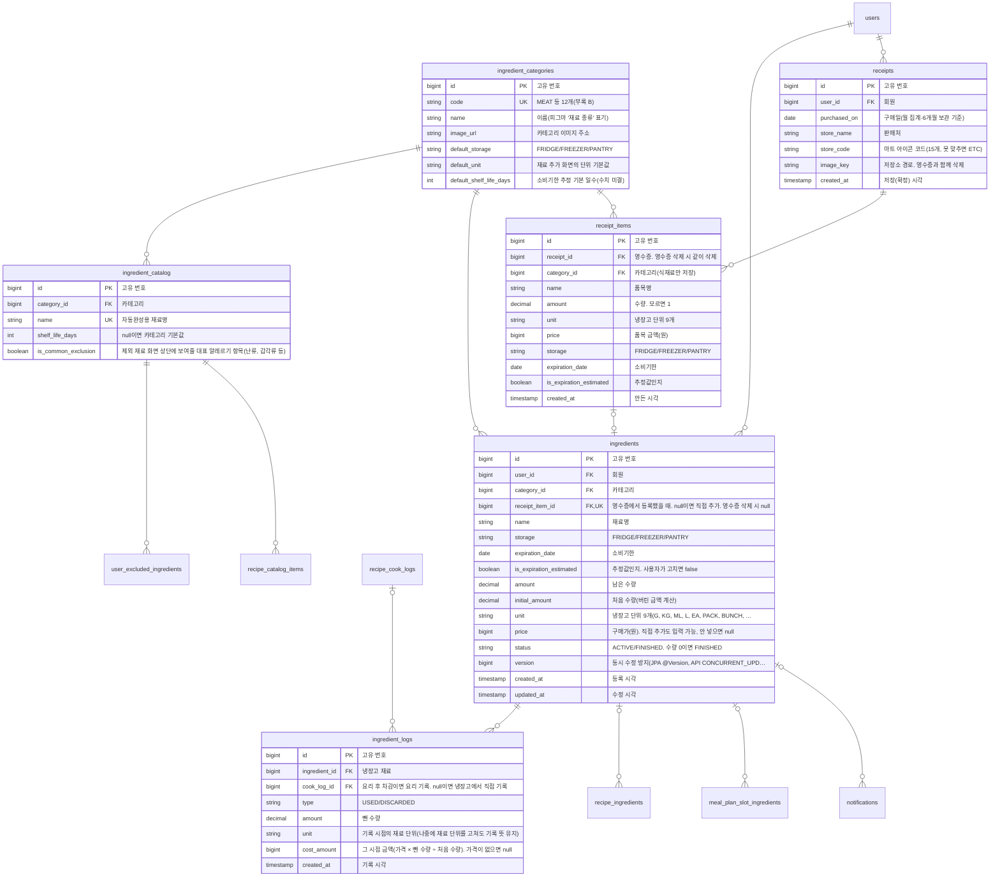
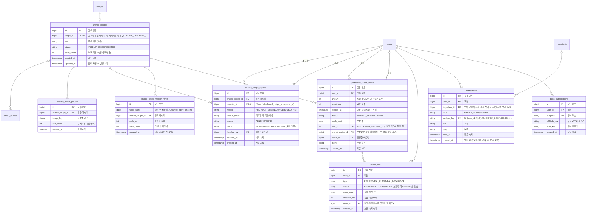
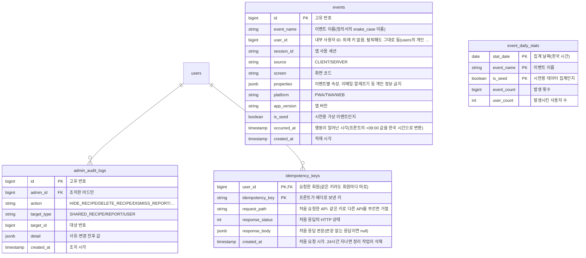

# Remake ERD·테이블 정의서 v3

> 에이전트용 영문판: [`docs/agent/erd.md`](../agent/erd.md)

2026-11-19 · 김종수 (2026-11-20 정책 v3.1 반영: 아래 표의 "11/20 결정" 줄)

## v2에서 바뀐 점

| 구분 | 바뀐 것 | 이유 |
| --- | --- | --- |
| 테이블 추가 | `recipe_catalog_items` (← `recipe_ingredients.catalog_id` 삭제) | "갑각류" 같은 묶음 항목은 재료 한 줄과 연결되지 않아 알레르기 경고가 빠짐 |
| 테이블 추가 | `meal_plan_slot_ingredients` (← `meal_plan_slots.planned_ingredients` JSON 삭제) | 중복 배정을 SQL로 계산하고, 재료 삭제 시 연결을 정리 |
| 테이블 추가 | `idempotency_keys` | API의 `Idempotency-Key` 규칙을 지킬 저장소(Redis 없이 DB) |
| 공유 레시피 저장 | 저장하면 사본을 만들고 `saved_recipes.recipe_id`가 사본을 가리킴. `recipes.origin`에 SHARED_COPY | API v3 "사본". 원본을 가리키면 요리할 때 만든 사람의 재료가 차감됨 |
| 11/17 문제점 | `users.provider_user_id` 탈퇴 시 null, `refresh_tokens.token_hash` UK, `usage_logs.status` PENDING, `ingredient_logs.unit` 추가 | 재가입·비식별, 토큰 중복, 동시 클릭으로 횟수 초과, 단위 변경 시 기록 뜻 바뀜 |
| 재료 삭제 | 사용·폐기 기록이 있으면 삭제 불가(API에 `INGREDIENT_HAS_LOGS` 추가) | 지우면 버린 금액 통계가 바뀜 |
| 타입·시각 | `datetime` → `timestamp`. `created_at`은 전부, `updated_at`은 수정되는 7개 테이블에만 | PostgreSQL에 `datetime` 없음. Java `LocalDateTime` |
| 컬럼 추가 | `ingredients.version`, `saved_recipes.is_favorite`(API에 별 켜기/끄기 추가), `generation_quota_grants.shared_recipe_id` | 동시 수정 오류, 피그마 별표, 보상 레시피 표시 |
| 컬럼 삭제 | `recipes.description`, `recipes.difficulty` | 피그마·API에 없음 |
| NULL·기본값 | `recipes.mode`·`receipts.image_key` NULL 허용, `meal_plan_slots.menu_name` NOT NULL, `notification_enabled` 기본 true, `ingredients.unit` 기본 EA | 상세·사본 레시피엔 mode 없음, 1년 뒤 이미지 삭제, 가입 직후에도 알림 |
| 이벤트 | `events.user_id` 외래 키 없음, 탈퇴해도 유지 | 지난 통계 유지. 개인 식별값은 `users`에서 비움 |
| 11/20 결정 | 테이블 추가 `shared_recipe_weekly_ranks`(32개) | 랭킹에 지난주 대비 순위 변동(`rankChange`)을 보여 주려면 주간 작업이 지난주 최종 TOP 100을 남겨 둬야 함 |
| 11/20 결정 | `users.plan`(BASIC/PREMIUM) 추가 | 요금제별 한도가 다름. 1차는 BASIC만 적용(프리미엄은 UI만) |
| 11/20 결정 | `receipts.status`(SCANNED/CONFIRMED) 삭제. 확정한 영수증만 저장, `receipts.image_key` NOT NULL | 스캔 API는 분석만 하고 저장하지 않음. 확정 API가 영수증·품목·냉장고 재료를 한 트랜잭션으로 저장 |
| 11/20 결정 | `receipts.store_code` 추가 | 마트 아이콘(15개 코드, 못 맞추면 `ETC`) |
| 11/20 결정 | `receipts.total_price` 삭제. `receipts`·`receipt_items`는 `updated_at`을 지우고 `BaseCreatedEntity`로 변경(`updated_at`이 있는 테이블은 이제 5개) | 식비는 항상 식재료 품목 합계라 영수증에 적힌 총액을 쓰지 않음. 확정한 영수증은 수정하지 않음 |
| 11/20 결정 | 영수증 보관: 구매일 기준 6개월, 지나면 이미지·품목과 함께 삭제. 미확정 7일 정리·이미지 1년 보관 삭제 | 식비 비교가 최근 6개월 기준. 미확정은 저장하지 않음 |
| 11/20 결정 | `receipt_items`는 식재료만 저장, `category_id` NOT NULL | OCR이 식재료만 돌려줌(비식재료는 걸러짐) |
| 11/20 결정 | `notifications.receipt_id`와 `RECEIPT_DONE` 종류 삭제(EXPIRY_SOON/EXPIRED만) | OCR이 동기라 "분석 완료" 알림이 없음 |
| 11/20 결정 | `generation_quota_grants.expires_at` 추가(지급 후 한 달) | 주간 보상은 한 달 안에 써야 함 |
| 11/20 결정 | 남은 횟수 계산에서 `usage_logs`로 OCR 횟수를 세는 부분 삭제 | 영수증 스캔은 횟수 제한 없음. OCR 기록은 모니터링용으로만 남김. OCR에 AI를 붙이면 다시 정함 |
| 11/20 결정 | `shared_recipes.save_count`는 상세 화면용 누적값, 주간 인기순은 `saved_recipes.saved_at`으로 셈 | 랭킹은 "이번 주 저장 수" 기준 |
| 11/20 결정 | `cart_items.meal_plan_slot_id` 추가(nullable FK, `ON DELETE SET NULL`; [#46](https://github.com/likelion-backendschool-9th/REMAKE/issues/46)) | 식단표 덮어쓰기 시 출처 칸으로 항목을 구분해 교체되는 칸의 장바구니 항목만 삭제하고 유지되는 칸의 항목은 보존 |
| 11/20 결정 | 계정 삭제: **카카오·네이버는 소셜 재인증**(OAuth 콜백 재사용 후 연결 끊기, 실패해도 서비스 탈퇴는 진행). **구글은 이메일 인증번호 6자리**(`account_deletion_requests`). 식별은 `(provider, provider_user_id)`만 ([#54](https://github.com/likelion-backendschool-9th/REMAKE/issues/54)). 소프트 삭제(`deleted_at`, 개인정보 비움)는 동일 | 카카오·네이버는 이메일을 보장하지 않지만 재로그인을 강제할 수 있음. 구글은 인증된 이메일을 항상 주지만 재로그인을 강제할 수 없음(`auth_time`이 오래된 채로 남음) |

## 공통 규칙

- **타입**: 수량 `numeric(10,3)`, 금액 `bigint`(원), 시각 `timestamp`(한국 시간, Java `LocalDateTime`), JSON `jsonb`.
- **시각 컬럼**: 앱이 만드는 행은 모두 `created_at`을 가짐(`BaseCreatedEntity`). 값이 수정되는 테이블만 `updated_at`도 가짐(`BaseTimeEntity`). 시각은 서버 `Clock`이 넣고 `DEFAULT now()`는 쓰지 않음.
- **기준 데이터**: `ingredient_categories`, `ingredient_catalog`는 Flyway 마이그레이션으로만 넣음.

## ERD 관계도

아래 Mermaid 코드 블록은 GitHub와 노션에서 그림으로 보입니다. 테이블을 바꾸면 그림도 같이 고칩니다.

### 전체관계도

```mermaid
erDiagram
  users ||--o{ user_excluded_ingredients : ""
  ingredient_catalog ||--o{ user_excluded_ingredients : ""
  users ||--o{ refresh_tokens : ""
  users ||--o{ account_deletion_requests : ""
  ingredient_categories ||--o{ ingredient_catalog : ""
  users ||--o{ ingredients : ""
  ingredient_categories ||--o{ ingredients : ""
  receipt_items |o--o| ingredients : ""
  ingredients ||--o{ ingredient_logs : ""
  recipe_cook_logs |o--o{ ingredient_logs : ""
  users ||--o{ receipts : ""
  receipts ||--o{ receipt_items : ""
  ingredient_categories ||--o{ receipt_items : ""
  users ||--o{ recipes : ""
  recipes ||--o{ recipe_ingredients : ""
  ingredients |o--o{ recipe_ingredients : ""
  recipes ||--o{ recipe_steps : ""
  recipes ||--o{ recipe_catalog_items : ""
  ingredient_catalog ||--o{ recipe_catalog_items : ""
  users ||--o{ saved_recipes : ""
  recipes ||--o{ saved_recipes : ""
  shared_recipes |o--o{ saved_recipes : ""
  users ||--o{ recipe_cook_logs : ""
  recipes ||--o{ recipe_cook_logs : ""
  users ||--o{ meal_plans : ""
  users ||--o{ meal_plan_slots : ""
  meal_plans |o--o{ meal_plan_slots : ""
  recipes |o--o{ meal_plan_slots : ""
  meal_plan_slots ||--o{ meal_plan_slot_ingredients : ""
  ingredients |o--o{ meal_plan_slot_ingredients : ""
  users ||--o{ cart_items : ""
  recipes |o--o{ cart_items : ""
  meal_plans |o--o{ cart_items : ""
  meal_plan_slots |o--o{ cart_items : ""
  recipes ||--o| shared_recipes : ""
  shared_recipes ||--o{ shared_recipe_photos : ""
  shared_recipes ||--o{ shared_recipe_reports : ""
  shared_recipes ||--o{ shared_recipe_weekly_ranks : ""
  users ||--o{ shared_recipe_reports : "신고자"
  users |o--o{ shared_recipe_reports : "처리"
  users ||--o{ generation_quota_grants : "받음"
  users |o--o{ generation_quota_grants : "조정"
  shared_recipes |o--o{ generation_quota_grants : ""
  users ||--o{ usage_logs : ""
  generation_quota_grants |o--o{ usage_logs : ""
  users ||--o{ notifications : ""
  ingredients |o--o{ notifications : ""
  users ||--o{ push_subscriptions : ""
  users ||--o{ admin_audit_logs : ""
  users ||--o{ idempotency_keys : ""
  events {
    bigint id PK
  }
  event_daily_stats {
    bigint id PK
  }
```

포함 테이블: 32개 테이블 전체 관계(컬럼 생략)

### 회원·설정

```mermaid
erDiagram
  users ||--o{ user_excluded_ingredients : ""
  ingredient_catalog ||--o{ user_excluded_ingredients : ""
  users ||--o{ refresh_tokens : ""
  users ||--o{ account_deletion_requests : ""
  users ||--o{ ingredients : ""
  users ||--o{ receipts : ""
  users ||--o{ recipes : ""
  users ||--o{ saved_recipes : ""
  users ||--o{ recipe_cook_logs : ""
  users ||--o{ meal_plans : ""
  users ||--o{ meal_plan_slots : ""
  users ||--o{ cart_items : ""
  users ||--o{ shared_recipe_reports : "신고자"
  users |o--o{ shared_recipe_reports : "처리"
  users ||--o{ generation_quota_grants : "받음"
  users |o--o{ generation_quota_grants : "조정"
  users ||--o{ usage_logs : ""
  users ||--o{ notifications : ""
  users ||--o{ push_subscriptions : ""
  users ||--o{ admin_audit_logs : ""
  users ||--o{ idempotency_keys : ""
  users {
    bigint id PK "고유 번호"
    string provider "NAVER/KAKAO/GOOGLE"
    string provider_user_id UK "소셜 고유 ID. UK(provider+이 값). 탈퇴하면 null"
    string email "계정 삭제 인증번호 발송용. 제공자가 안 주면 null. 탈퇴하면 null"
    string role "USER/ADMIN"
    string status "ACTIVE/SUSPENDED"
    string plan "BASIC/PREMIUM. 1차는 BASIC만 적용"
    int household_size "가구원 수. 건너뛰면 null"
    boolean onboarding_completed "온보딩을 마치거나 건너뛰었는지"
    boolean recipe_supplement_enabled "레시피 재료 보충(설정). ON이면 냉장고에 없는 재료도 포함"
    boolean notification_enabled "알림 받기(설정)"
    string last_meal_purpose "마지막으로 고른 식단 목적"
    timestamp created_at "가입 시각"
    timestamp updated_at "수정 시각"
    timestamp deleted_at "탈퇴 시각"
  }
  user_excluded_ingredients {
    bigint user_id PK, FK "회원"
    bigint catalog_id PK, FK "제외할 재료(재료 사전)"
  }
  refresh_tokens {
    bigint id PK "고유 번호"
    bigint user_id FK "회원"
    string token_hash UK "토큰 해시값. 재발급 때마다 이 값으로 찾음"
    timestamp expires_at "만료 시각(발급 + 14일)"
    timestamp revoked_at "로그아웃 시각"
    timestamp created_at "발급 시각"
  }
  account_deletion_requests {
    bigint id PK "고유 번호"
    bigint user_id FK "회원"
    string code_hash "인증번호 해시값(원문 저장 안 함)"
    timestamp expires_at "만료 시각(발송 후 5분)"
    int attempts "입력 시도 횟수(5회 초과 시 잠금)"
    timestamp verified_at "인증 성공 시각"
    timestamp created_at "발송 시각(재전송 간격 검사)"
  }
```

포함 테이블: users, user_excluded_ingredients, refresh_tokens, account_deletion_requests

### 냉장고·영수증

포함 테이블: ingredient_categories, ingredient_catalog, ingredients, ingredient_logs, receipts, receipt_items

### 레시피·식단표·장바구니·요리기록

```mermaid
erDiagram
  recipe_cook_logs |o--o{ ingredient_logs : ""
  users ||--o{ recipes : ""
  recipes ||--o{ recipe_ingredients : ""
  ingredients |o--o{ recipe_ingredients : ""
  recipes ||--o{ recipe_steps : ""
  recipes ||--o{ recipe_catalog_items : ""
  ingredient_catalog ||--o{ recipe_catalog_items : ""
  users ||--o{ saved_recipes : ""
  recipes ||--o{ saved_recipes : ""
  shared_recipes |o--o{ saved_recipes : ""
  users ||--o{ recipe_cook_logs : ""
  recipes ||--o{ recipe_cook_logs : ""
  users ||--o{ meal_plans : ""
  users ||--o{ meal_plan_slots : ""
  meal_plans |o--o{ meal_plan_slots : ""
  recipes |o--o{ meal_plan_slots : ""
  meal_plan_slots ||--o{ meal_plan_slot_ingredients : ""
  ingredients |o--o{ meal_plan_slot_ingredients : ""
  users ||--o{ cart_items : ""
  recipes |o--o{ cart_items : ""
  meal_plans |o--o{ cart_items : ""
  meal_plan_slots |o--o{ cart_items : ""
  recipes ||--o| shared_recipes : ""
  recipes {
    bigint id PK "고유 번호"
    bigint creator_id FK "만든 회원(사본은 저장한 회원). 다른 사용자에게 보이지 않음"
    string title "제목"
    int servings "인분"
    int cook_minutes "조리 시간(분)"
    string tips "Tips! 문구"
    string origin "RECIPE_GEN(레시피 생성)/MEAL_DETAIL(식단 칸 상세)/S…"
    string mode "QUICK/CUSTOM. origin이 RECIPE_GEN일 때만, 나머지…"
    jsonb custom_options "커스텀 선택값(재료·맛·조리 시간·도구·방식·요리 유형·제외 재료). QU…"
    boolean supplement_used "재료 보충 ON으로 만들었는지"
    timestamp created_at "만든 시각"
  }
  recipe_ingredients {
    bigint id PK "고유 번호"
    bigint recipe_id FK "레시피"
    bigint ingredient_id FK "만들 때 쓰려던 냉장고 재료. 사본은 null. 재료 삭제 시 null"
    string name "재료명"
    decimal amount "null이면 '약간'"
    string unit "레시피 단위 14개(부록 A)"
    int sort_order "순서"
    timestamp created_at "만든 시각"
  }
  recipe_steps {
    bigint id PK "고유 번호"
    bigint recipe_id FK "레시피. UK(recipe_id+step_no)"
    int step_no "단계 번호"
    string content "내용"
    timestamp created_at "만든 시각"
  }
  recipe_catalog_items {
    bigint recipe_id PK, FK "레시피"
    bigint catalog_id PK, FK "들어 있는 제외 대상 항목(is_common_exclusion 항목)"
  }
  saved_recipes {
    bigint id PK "고유 번호"
    bigint user_id FK "회원"
    bigint recipe_id FK "저장한 레시피. 공유 레시피면 내 사본. UK(user_id+recipe_…"
    bigint shared_recipe_id FK "공유 레시피를 저장한 경우 그 공유글. 내 레시피면 null. UK(use…"
    boolean is_favorite "즐겨찾기(별표). 피그마 저장 목록·레시피 상세·식단표의 ★"
    timestamp saved_at "저장 시각(최신 저장순, 주간 랭킹 기준)"
  }
  recipe_cook_logs {
    bigint id PK "고유 번호"
    bigint user_id FK "요리한 회원"
    bigint recipe_id FK "레시피"
    int servings "만든 인분"
    string feedback "레시피 추천 여부 LIKE/DISLIKE(동작 미결)"
    timestamp cooked_at "요리한 시각"
  }
  meal_plans {
    bigint id PK "고유 번호"
    bigint user_id FK "회원"
    date start_date "시작일"
    string purpose "BALANCED/DIET/HIGH_PROTEIN/SIMPLE/SAVING"
    string meal_types "넣을 끼니(BREAKFAST,LUNCH,DINNER 중 선택, 쉼표 구분)"
    int servings "식사 인원"
    int generated_days "실제로 만든 일수(1~7)"
    timestamp created_at "만든 시각"
  }
  meal_plan_slots {
    bigint id PK "고유 번호"
    bigint user_id FK "회원"
    bigint meal_plan_id FK "생성 칸이면 그 식단표, 직접 추가 칸이면 null"
    date slot_date "날짜"
    string meal_type UK "BREAKFAST/LUNCH/DINNER. UK(user_id+slot_d…"
    string menu_name "메뉴명(직접 추가 칸은 레시피 제목)"
    bigint recipe_id FK "null이면 메뉴명만 있는 칸(누르면 상세 생성)"
    string source "AI(식단표 생성)/MANUAL(식단 추가)"
    timestamp created_at "만든 시각"
    timestamp updated_at "수정 시각(상세 생성으로 recipe_id가 채워질 때)"
  }
  meal_plan_slot_ingredients {
    bigint id PK "고유 번호"
    bigint slot_id FK "식단 칸. 칸이 지워지면 같이 삭제"
    bigint ingredient_id FK "배정한 냉장고 재료. 없는 재료(부족)거나 재료 삭제 시 null"
    string name "재료명"
    decimal amount "수량"
    string unit "단위"
    timestamp created_at "만든 시각"
  }
  cart_items {
    bigint id PK "고유 번호"
    bigint user_id FK "회원"
    bigint recipe_id FK "묶음 기준 레시피(메뉴명만 있는 칸이면 null)"
    bigint meal_plan_id FK "식단표에서 왔으면"
    bigint meal_plan_slot_id FK "출처 식단 칸; NULL 허용, ON DELETE SET NULL"
    string group_name "화면의 묶음 이름(레시피 제목·메뉴명)"
    string name "재료 이름"
    decimal amount "수량(변경 가능)"
    string unit "단위"
    timestamp created_at "담은 시각"
    timestamp updated_at "수량 변경 시각"
  }
```

포함 테이블: recipes, recipe_ingredients, recipe_steps, recipe_catalog_items, saved_recipes, recipe_cook_logs, meal_plans, meal_plan_slots, meal_plan_slot_ingredients, cart_items

### 공유공간·생성횟수·알림

포함 테이블: shared_recipes, shared_recipe_photos, shared_recipe_reports, shared_recipe_weekly_ranks, generation_quota_grants, usage_logs, notifications, push_subscriptions

### 이벤트·어드민·공통

포함 테이블: events, event_daily_stats, admin_audit_logs, idempotency_keys

## 테이블 목록

| 번호 | 테이블명 | 한글명 | 설명 | 기능 폴더 | 공통 클래스 | 컬럼 수 |
| --- | --- | --- | --- | --- | --- | --- |
| 1 | users | 회원 | 소셜 로그인 회원. 어드민도 role로 구분. 설정 화면 값(가구원 수·알림·재료 보충)과 요금제(BASIC/PREMIUM)를 함께 가짐 | user | BaseTimeEntity | 15 |
| 2 | user_excluded_ingredients | 제외 재료(알레르기) | 온보딩·설정의 "레시피에서 제외할 재료"(회원과 재료 사전의 N:N) | user | 없음 | 2 |
| 3 | refresh_tokens | 리프레시 토큰 | 로그인 갱신 토큰(해시 저장), 로그아웃 시 폐기 | auth | BaseCreatedEntity | 6 |
| 4 | account_deletion_requests | 계정 삭제 인증 | **구글** 계정 삭제용 이메일 인증번호 6자리(5분, 재전송, 5회 잠금; [#54](https://github.com/likelion-backendschool-9th/REMAKE/issues/54)) | user | BaseCreatedEntity | 7 |
| 5 | ingredient_categories | 재료 카테고리 | 12개 카테고리 코드, 기본 보관·단위·보관 일수(기준 데이터) | ingredient | 없음 | 7 |
| 6 | ingredient_catalog | 재료 사전 | 자동완성·카테고리 추정·제외 재료 목록(기준 데이터) | ingredient | 없음 | 5 |
| 7 | ingredients | 냉장고 재료 | 냉장고의 재료 한 줄. 다 쓰면 FINISHED로 남김 | ingredient | BaseTimeEntity | 16 |
| 8 | ingredient_logs | 재료 사용·폐기 이력 | 사용했어요·버렸어요 기록. 버린 금액 통계의 원본 | ingredient | BaseCreatedEntity | 8 |
| 9 | receipts | 영수증 | 확정한 영수증 한 장(확정 전 OCR 결과는 저장하지 않음). 구매일 기준 6개월 보관 | receipt | BaseCreatedEntity | 7 |
| 10 | receipt_items | 영수증 품목 | 확정한 영수증의 식재료 한 줄(비식재료는 저장하지 않음) | receipt | BaseCreatedEntity | 11 |
| 11 | recipes | 레시피 | AI가 만든 레시피 본체와 공유 레시피 사본. 한 번 만들면 수정하지 않음 | recipe | BaseCreatedEntity | 11 |
| 12 | recipe_ingredients | 레시피 재료 | 레시피에 들어가는 재료와 수량 | recipe | BaseCreatedEntity | 8 |
| 13 | recipe_steps | 레시피 조리 단계 | 레시피의 조리 순서 | recipe | BaseCreatedEntity | 5 |
| 14 | recipe_catalog_items | 레시피 알레르기 재료 | 레시피에 들어 있는 제외 대상 재료(알레르기 경고용) | recipe | 없음 | 2 |
| 15 | saved_recipes | 저장한 레시피 | 내 저장 목록. 공유 레시피를 저장한 경우 그 공유글도 기록(저장 수 집계 원본) | recipe | 없음(`saved_at`) | 6 |
| 16 | recipe_cook_logs | 요리 기록 | 요리를 마치고 재료를 차감한 기록 | recipe | 없음(`cooked_at`) | 6 |
| 17 | meal_plans | 식단표 | 식단표 한 번의 생성 결과(시작일부터 최대 7일) | mealplan | BaseCreatedEntity | 8 |
| 18 | meal_plan_slots | 식단표 칸 | 날짜·끼니별 칸. 생성 칸(AI)과 직접 추가 칸(MANUAL) | mealplan | BaseTimeEntity | 10 |
| 19 | meal_plan_slot_ingredients | 칸별 예정 재료 | 칸마다 쓸 재료와 수량. 중복 배정 방지·부족 재료 계산 | mealplan | BaseCreatedEntity | 7 |
| 20 | cart_items | 장바구니 | 레시피별 부족 재료 목록(자동으로만 담김) | cart | BaseTimeEntity | 11 |
| 21 | shared_recipes | 공유 레시피 | 공유 공간에 올린 레시피(완전 익명) | share | BaseTimeEntity | 7 |
| 22 | shared_recipe_photos | 공유 조리 사진 | 공유할 때 올린 조리 사진(1장 이상) | share | BaseCreatedEntity | 5 |
| 23 | shared_recipe_reports | 공유 레시피 신고 | 신고와 어드민 처리 결과 | share | BaseCreatedEntity | 10 |
| 24 | shared_recipe_weekly_ranks | 주간 랭킹 기록 | 월요일 작업이 남기는 지난주 최종 TOP 100(`rankChange` 계산용) | share | BaseCreatedEntity | 6 |
| 25 | generation_quota_grants | 생성 횟수 지급 | 금주의 레시피 보상·어드민 조정으로 준 추가 레시피 생성 횟수(한 달 유효) | quota | BaseCreatedEntity | 12 |
| 26 | usage_logs | 호출 이력 | AI·OCR 호출 기록. 남은 횟수 계산과 어드민 호출 집계의 원본 | quota | BaseCreatedEntity | 8 |
| 27 | notifications | 알림 | 회원에게 만든 알림 한 건 | notification | BaseCreatedEntity | 9 |
| 28 | push_subscriptions | 푸시 구독 | 웹 푸시 구독 정보(기기별) | notification | BaseCreatedEntity | 6 |
| 29 | events | 이벤트 | 사용자 행동 이벤트 원본(프론트·서버) | event | 직접(`occurred_at`, `created_at`) | 12 |
| 30 | event_daily_stats | 이벤트 일별 집계 | events를 하루 단위로 센 표(대시보드용) | event | 없음 | 5 |
| 31 | admin_audit_logs | 어드민 조치 이력 | 신고 처리·횟수 조정·계정 제한 등 | admin | BaseCreatedEntity | 7 |
| 32 | idempotency_keys | 중복 요청 방지 키 | 생성·차감·확정 POST의 `Idempotency-Key`와 처음 응답(24시간 보관) | global | 직접(`created_at`) | 6 |

## 관계 목록

"삭제 시"는 부모 행을 지울 때 자식 쪽 처리입니다. 비어 있으면 부모를 지우지 않는 관계(회원은 탈퇴해도 행을 남김)입니다.

| 부모 테이블 | 자식 테이블 | 관계 | 설명 | 연결 컬럼(자식) | 삭제 시 |
| --- | --- | --- | --- | --- | --- |
| users | user_excluded_ingredients | 1:N | 제외 재료 | user_id | |
| ingredient_catalog | user_excluded_ingredients | 1:N | 제외 대상 | catalog_id | |
| users | refresh_tokens | 1:N | | user_id | |
| users | account_deletion_requests | 1:N | 계정 삭제 인증 | user_id | |
| ingredient_categories | ingredient_catalog | 1:N | 분류 | category_id | |
| users | ingredients | 1:N | 보유 | user_id | |
| ingredient_categories | ingredients | 1:N | 분류 | category_id | |
| receipt_items | ingredients | 1:0..1 | 영수증에서 등록 / 직접 추가면 없음 | receipt_item_id | SET NULL |
| ingredients | ingredient_logs | 1:N | 사용·폐기 | ingredient_id | RESTRICT(기록 있으면 재료 삭제 불가) |
| recipe_cook_logs | ingredient_logs | 1:N | 요리 차감 / 없을 수 있음 | cook_log_id | |
| users | receipts | 1:N | 촬영 | user_id | |
| receipts | receipt_items | 1:N | 품목 | receipt_id | CASCADE |
| ingredient_categories | receipt_items | 1:N | 분류 | category_id | |
| users | recipes | 1:N | 생성 | creator_id | |
| recipes | recipe_ingredients | 1:N | | recipe_id | |
| ingredients | recipe_ingredients | 1:N | 쓰려던 냉장고 재료 / 없을 수 있음 | ingredient_id | SET NULL |
| recipes | recipe_steps | 1:N | | recipe_id | |
| recipes | recipe_catalog_items | 1:N | 알레르기 재료 | recipe_id | |
| ingredient_catalog | recipe_catalog_items | 1:N | | catalog_id | |
| users | saved_recipes | 1:N | 저장 | user_id | |
| recipes | saved_recipes | 1:N | 저장한 레시피(공유면 사본) | recipe_id | |
| shared_recipes | saved_recipes | 1:N | 공유 레시피 저장 / 없을 수 있음 | shared_recipe_id | SET NULL |
| users | recipe_cook_logs | 1:N | 요리 | user_id | |
| recipes | recipe_cook_logs | 1:N | 요리 기록 | recipe_id | |
| users | meal_plans | 1:N | | user_id | |
| users | meal_plan_slots | 1:N | | user_id | |
| meal_plans | meal_plan_slots | 1:N | 생성 칸 / 직접 추가 칸은 없음 | meal_plan_id | |
| recipes | meal_plan_slots | 1:N | 배정 / 없을 수 있음 | recipe_id | |
| meal_plan_slots | meal_plan_slot_ingredients | 1:N | 칸별 재료 | slot_id | CASCADE |
| ingredients | meal_plan_slot_ingredients | 1:N | 배정한 재료 / 없을 수 있음 | ingredient_id | SET NULL |
| users | cart_items | 1:N | | user_id | |
| recipes | cart_items | 1:N | 묶음 / 없을 수 있음 | recipe_id | SET NULL |
| meal_plans | cart_items | 1:N | 부족 재료 / 없을 수 있음 | meal_plan_id | SET NULL |
| meal_plan_slots | cart_items | 1:N | 출처 식단 칸 / 레시피 저장이면 없음 | meal_plan_slot_id | SET NULL |
| recipes | shared_recipes | 1:0..1 | 공유 | recipe_id | |
| shared_recipes | shared_recipe_photos | 1:N | 조리 사진 | shared_recipe_id | CASCADE |
| shared_recipes | shared_recipe_reports | 1:N | 신고 | shared_recipe_id | |
| shared_recipes | shared_recipe_weekly_ranks | 1:N | 지난주 순위 | shared_recipe_id | |
| users | shared_recipe_reports | 1:N | 신고자 | reporter_id | |
| users | shared_recipe_reports | 1:N | 처리 어드민 / 없을 수 있음 | handled_by | |
| users | generation_quota_grants | 1:N | 받은 회원 | user_id | |
| users | generation_quota_grants | 1:N | 조정 어드민 / 없을 수 있음 | admin_id | |
| shared_recipes | generation_quota_grants | 1:N | 보상 레시피 / 없을 수 있음 | shared_recipe_id | |
| users | usage_logs | 1:N | 호출 | user_id | |
| generation_quota_grants | usage_logs | 1:N | 보상 횟수 사용 / 없을 수 있음 | grant_id | |
| users | notifications | 1:N | | user_id | |
| ingredients | notifications | 1:N | 임박 재료 / 없을 수 있음 | ingredient_id | SET NULL |
| users | push_subscriptions | 1:N | | user_id | |
| users | admin_audit_logs | 1:N | 어드민 조치 | admin_id | |
| users | idempotency_keys | 1:N | 중복 요청 방지 | user_id | |

`events.user_id`는 외래 키를 걸지 않습니다(대량 적재, 탈퇴 후에도 내부 ID로 통계 유지).

## 테이블별 컬럼

### 1. users (회원)

소셜 로그인 회원. 어드민도 role로 구분. 설정 화면 값(가구원 수·알림·재료 보충)을 함께 가짐

| 컬럼명 | 타입 | PK/FK | 참조 테이블 | NULL 허용 | 기본값 | 설명 |
| --- | --- | --- | --- | --- | --- | --- |
| id | bigint | PK | | 아니오 | | 고유 번호 |
| provider | varchar | | | 아니오 | | NAVER/KAKAO/GOOGLE |
| provider_user_id | varchar | UK | | 예 | | 소셜 고유 ID. UK(provider+이 값). **탈퇴하면 null** |
| email | varchar | | | 예 | | 제공자가 주면 저장(구글은 `email_verified`일 때만). 계정 식별에는 쓰지 않음. 구글 계정 삭제 인증번호 발송에만 씀([#54](https://github.com/likelion-backendschool-9th/REMAKE/issues/54)). 탈퇴하면 null |
| role | varchar | | | 아니오 | USER | USER/ADMIN |
| status | varchar | | | 아니오 | ACTIVE | ACTIVE/SUSPENDED |
| plan | varchar | | | 아니오 | BASIC | BASIC/PREMIUM. 1차는 BASIC 한도만 적용(프리미엄 화면은 UI만) |
| household_size | int | | | 예 | | 가구원 수. 건너뛰면 null |
| onboarding_completed | boolean | | | 아니오 | false | 온보딩을 마치거나 건너뛰었는지 |
| recipe_supplement_enabled | boolean | | | 아니오 | false | 레시피 재료 보충(설정). ON이면 냉장고에 없는 재료도 포함 |
| notification_enabled | boolean | | | 아니오 | true | 알림 받기(설정) |
| last_meal_purpose | varchar | | | 예 | | 마지막으로 고른 식단 목적 |
| created_at | timestamp | | | 아니오 | | 가입 시각 |
| updated_at | timestamp | | | 아니오 | | 수정 시각 |
| deleted_at | timestamp | | | 예 | | 탈퇴 시각 |

- 탈퇴: 행은 남기고 `deleted_at`을 채우며 `provider_user_id`, `email`을 비움. 공유 레시피·사본이 `recipes.creator_id`로 이 행을 가리키기 때문에 행은 지우지 않음. 비운 뒤에는 누구였는지 알 수 없고(비식별), 같은 소셜 계정으로 다시 가입할 수 있음(PostgreSQL은 null끼리 중복으로 보지 않음).

### 2. user_excluded_ingredients (제외 재료(알레르기))

| 컬럼명 | 타입 | PK/FK | 참조 테이블 | NULL 허용 | 기본값 | 설명 |
| --- | --- | --- | --- | --- | --- | --- |
| user_id | bigint | PK,FK | users | 아니오 | | 회원 |
| catalog_id | bigint | PK,FK | ingredient_catalog | 아니오 | | 제외할 재료(재료 사전) |

### 3. refresh_tokens (리프레시 토큰)

| 컬럼명 | 타입 | PK/FK | 참조 테이블 | NULL 허용 | 기본값 | 설명 |
| --- | --- | --- | --- | --- | --- | --- |
| id | bigint | PK | | 아니오 | | 고유 번호 |
| user_id | bigint | FK | users | 아니오 | | 회원 |
| token_hash | varchar | UK | | 아니오 | | 토큰 해시값. 재발급 때마다 이 값으로 찾음 |
| expires_at | timestamp | | | 아니오 | | 만료 시각(발급 + 14일) |
| revoked_at | timestamp | | | 예 | | 로그아웃 시각 |
| created_at | timestamp | | | 아니오 | | 발급 시각 |

### 4. account_deletion_requests (계정 삭제 인증) — [#54](https://github.com/likelion-backendschool-9th/REMAKE/issues/54) 이후 구글 회원만 사용

카카오·네이버 회원은 소셜 재인증으로 탈퇴하므로 이 테이블에 행을 만들지 않는다.

| 컬럼명 | 타입 | PK/FK | 참조 테이블 | NULL 허용 | 기본값 | 설명 |
| --- | --- | --- | --- | --- | --- | --- |
| id | bigint | PK | | 아니오 | | 고유 번호 |
| user_id | bigint | FK | users | 아니오 | | 회원 |
| code_hash | varchar | | | 아니오 | | 인증번호 해시값(원문 저장 안 함) |
| expires_at | timestamp | | | 아니오 | | 만료 시각(발송 후 5분) |
| attempts | int | | | 아니오 | 0 | 입력 시도 횟수(5회 초과 시 잠금) |
| verified_at | timestamp | | | 예 | | 인증 성공 시각 |
| created_at | timestamp | | | 아니오 | | 발송 시각(재전송 간격 검사) |

- 재전송하면 새 행을 만들고, 확인은 가장 최근 행으로만 함.

### 5. ingredient_categories (재료 카테고리, 기준 데이터)

| 컬럼명 | 타입 | PK/FK | 참조 테이블 | NULL 허용 | 기본값 | 설명 |
| --- | --- | --- | --- | --- | --- | --- |
| id | bigint | PK | | 아니오 | | 고유 번호 |
| code | varchar | UK | | 아니오 | | MEAT 등 12개(부록 B) |
| name | varchar | | | 아니오 | | 이름(피그마 "재료 종류" 표기) |
| image_url | varchar | | | 아니오 | | 카테고리 이미지 주소 |
| default_storage | varchar | | | 아니오 | | FRIDGE/FREEZER/PANTRY |
| default_unit | varchar | | | 아니오 | | 재료 추가 화면의 단위 기본값 |
| default_shelf_life_days | int | | | 아니오 | | 소비기한 추정 기본 일수(수치 미결) |

### 6. ingredient_catalog (재료 사전, 기준 데이터)

| 컬럼명 | 타입 | PK/FK | 참조 테이블 | NULL 허용 | 기본값 | 설명 |
| --- | --- | --- | --- | --- | --- | --- |
| id | bigint | PK | | 아니오 | | 고유 번호 |
| category_id | bigint | FK | ingredient_categories | 아니오 | | 카테고리 |
| name | varchar | UK | | 아니오 | | 자동완성용 재료명 |
| shelf_life_days | int | | | 예 | | null이면 카테고리 기본값 |
| is_common_exclusion | boolean | | | 아니오 | false | 제외 재료 화면 상단에 보여줄 대표 알레르기 항목(난류, 갑각류 등) |

### 7. ingredients (냉장고 재료)

| 컬럼명 | 타입 | PK/FK | 참조 테이블 | NULL 허용 | 기본값 | 설명 |
| --- | --- | --- | --- | --- | --- | --- |
| id | bigint | PK | | 아니오 | | 고유 번호 |
| user_id | bigint | FK | users | 아니오 | | 회원 |
| category_id | bigint | FK | ingredient_categories | 아니오 | | 카테고리 |
| receipt_item_id | bigint | FK,UK | receipt_items | 예 | | 영수증에서 등록했을 때. null이면 직접 추가. 영수증 삭제 시 null |
| name | varchar | | | 아니오 | | 재료명 |
| storage | varchar | | | 아니오 | | FRIDGE/FREEZER/PANTRY |
| expiration_date | date | | | 아니오 | | 소비기한 |
| is_expiration_estimated | boolean | | | 아니오 | false | 추정값인지. 사용자가 고치면 false |
| amount | numeric(10,3) | | | 아니오 | | 남은 수량 |
| initial_amount | numeric(10,3) | | | 아니오 | | 처음 수량(버린 금액 계산) |
| unit | varchar | | | 아니오 | EA | 냉장고 단위 9개(G, KG, ML, L, EA, PACK, BUNCH, PIECE, SHEET) |
| price | bigint | | | 예 | | 구매가(원). 직접 추가도 입력 가능, 안 넣으면 null |
| status | varchar | | | 아니오 | ACTIVE | ACTIVE/FINISHED. 수량 0이면 FINISHED |
| version | bigint | | | 아니오 | 0 | 동시 수정 방지(JPA `@Version`, API `CONCURRENT_UPDATE`) |
| created_at | timestamp | | | 아니오 | | 등록 시각 |
| updated_at | timestamp | | | 아니오 | | 수정 시각 |

- 삭제(API DELETE)는 사용·폐기 기록이 **없는** 재료만 가능. 기록이 있으면 막고(`INGREDIENT_HAS_LOGS`) "사용했어요/버렸어요"로 처리하게 안내. 지우면 이번 달 버린 금액이 바뀌기 때문.

### 8. ingredient_logs (재료 사용·폐기 이력)

| 컬럼명 | 타입 | PK/FK | 참조 테이블 | NULL 허용 | 기본값 | 설명 |
| --- | --- | --- | --- | --- | --- | --- |
| id | bigint | PK | | 아니오 | | 고유 번호 |
| ingredient_id | bigint | FK | ingredients | 아니오 | | 냉장고 재료 |
| cook_log_id | bigint | FK | recipe_cook_logs | 예 | | 요리 후 차감이면 요리 기록. null이면 냉장고에서 직접 기록 |
| type | varchar | | | 아니오 | | USED/DISCARDED |
| amount | numeric(10,3) | | | 아니오 | | 뺀 수량 |
| unit | varchar | | | 아니오 | | 기록 시점의 재료 단위(나중에 재료 단위를 고쳐도 기록 뜻 유지) |
| cost_amount | bigint | | | 예 | | 그 시점 금액(가격 × 뺀 수량 ÷ 처음 수량). 가격이 없으면 null |
| created_at | timestamp | | | 아니오 | | 기록 시각 |

### 9. receipts (영수증)

| 컬럼명 | 타입 | PK/FK | 참조 테이블 | NULL 허용 | 기본값 | 설명 |
| --- | --- | --- | --- | --- | --- | --- |
| id | bigint | PK | | 아니오 | | 고유 번호 |
| user_id | bigint | FK | users | 아니오 | | 회원 |
| purchased_on | date | | | 아니오 | | 구매일(월 집계·6개월 보관 기준) |
| store_name | varchar | | | 아니오 | | 판매처 |
| store_code | varchar | | | 예 | | 마트 아이콘 코드(15개: CU, GS25, SEVEN_ELEVEN, EMART24, EMART, HOMEPLUS, LOTTE_MART, COSTCO, TRADERS, HANARO, GS_FRESH, LOTTE_SUPER, EMART_EVERYDAY, HOMEPLUS_EXPRESS, ETC). 못 맞추면 `ETC`이고, 화면은 기본 아이콘과 `store_name`(확인한 판매처 이름)을 보여 줌 |
| image_key | varchar | | | 아니오 | | 저장소 경로. 영수증과 함께 삭제 |
| created_at | timestamp | | | 아니오 | | 저장(확정) 시각 |

- 구매일과 판매처 이름은 최종 등록에 필수입니다. OCR이 읽지 못한 값은 확인 화면에서 사용자가 입력합니다.
- 식비 금액은 영수증에 적힌 총액이 아니라 항상 식재료 품목 합계(`receipt_items.price`)입니다.
- 확정한 영수증만 저장합니다. `POST /receipts/scan`은 분석만 하고 저장하지 않으며, `POST /receipts`가 영수증·품목·등록할 냉장고 재료를 한 트랜잭션으로 저장합니다. 확정한 영수증은 수정할 수 없고 삭제만 됩니다.
- 보관: `purchased_on`부터 6개월. 매일 작업이 지난 영수증을 이미지·품목과 함께 삭제합니다. 6개월보다 오래된 구매일은 등록할 수 없습니다(`INVALID_INPUT`). 식비 조회용 인덱스 `(user_id, purchased_on)`.

### 10. receipt_items (영수증 품목)

| 컬럼명 | 타입 | PK/FK | 참조 테이블 | NULL 허용 | 기본값 | 설명 |
| --- | --- | --- | --- | --- | --- | --- |
| id | bigint | PK | | 아니오 | | 고유 번호 |
| receipt_id | bigint | FK | receipts | 아니오 | | 영수증. 영수증 삭제 시 같이 삭제 |
| category_id | bigint | FK | ingredient_categories | 아니오 | | 카테고리. 식재료만 저장(OCR이 비식재료를 걸러 냄) |
| name | varchar | | | 아니오 | | 품목명 |
| amount | numeric(10,3) | | | 아니오 | 1 | 수량. 모르면 1 |
| unit | varchar | | | 아니오 | EA | 냉장고 단위 9개 |
| price | bigint | | | 예 | | 품목 금액(원) |
| storage | varchar | | | 아니오 | | FRIDGE/FREEZER/PANTRY |
| expiration_date | date | | | 예 | | 소비기한 |
| is_expiration_estimated | boolean | | | 아니오 | false | 추정값인지 |
| created_at | timestamp | | | 아니오 | | 만든 시각 |

### 11. recipes (레시피)

| 컬럼명 | 타입 | PK/FK | 참조 테이블 | NULL 허용 | 기본값 | 설명 |
| --- | --- | --- | --- | --- | --- | --- |
| id | bigint | PK | | 아니오 | | 고유 번호 |
| creator_id | bigint | FK | users | 아니오 | | 만든 회원(사본은 저장한 회원). 다른 사용자에게 보이지 않음 |
| title | varchar | | | 아니오 | | 제목 |
| servings | int | | | 아니오 | | 인분 |
| cook_minutes | int | | | 아니오 | | 조리 시간(분) |
| tips | varchar | | | 예 | | Tips! 문구 |
| origin | varchar | | | 아니오 | | RECIPE_GEN(레시피 생성)/MEAL_DETAIL(식단 칸 상세)/SHARED_COPY(공유 레시피 저장 사본) |
| mode | varchar | | | 예 | | QUICK/CUSTOM. origin이 RECIPE_GEN일 때만, 나머지는 null |
| custom_options | jsonb | | | 예 | | 커스텀 선택값(재료·맛·조리 시간·도구·방식·요리 유형·제외 재료). QUICK이면 null |
| supplement_used | boolean | | | 아니오 | false | 재료 보충 ON으로 만들었는지 |
| created_at | timestamp | | | 아니오 | | 만든 시각 |

### 12. recipe_ingredients (레시피 재료)

| 컬럼명 | 타입 | PK/FK | 참조 테이블 | NULL 허용 | 기본값 | 설명 |
| --- | --- | --- | --- | --- | --- | --- |
| id | bigint | PK | | 아니오 | | 고유 번호 |
| recipe_id | bigint | FK | recipes | 아니오 | | 레시피 |
| ingredient_id | bigint | FK | ingredients | 예 | | 만들 때 쓰려던 냉장고 재료. 사본은 null. 재료 삭제 시 null |
| name | varchar | | | 아니오 | | 재료명 |
| amount | numeric(10,3) | | | 예 | | null이면 "약간" |
| unit | varchar | | | 아니오 | | 레시피 단위 14개(부록 A) |
| sort_order | int | | | 아니오 | | 순서 |
| created_at | timestamp | | | 아니오 | | 만든 시각 |

- 요리했어요 차감 순서: ① `ingredient_id`가 있고 그 재료가 요리하는 사람의 ACTIVE 재료면 그 재료 ② 아니면 요리하는 사람 냉장고에서 같은 이름을 소비기한 가까운 것부터 ③ 그래도 없으면 사용자가 선택. 같은 종류 단위끼리만 자동 환산, 꼬집·약간은 차감 안 함.

### 13. recipe_steps (레시피 조리 단계)

| 컬럼명 | 타입 | PK/FK | 참조 테이블 | NULL 허용 | 기본값 | 설명 |
| --- | --- | --- | --- | --- | --- | --- |
| id | bigint | PK | | 아니오 | | 고유 번호 |
| recipe_id | bigint | FK | recipes | 아니오 | | 레시피. UK(recipe_id+step_no) |
| step_no | int | | | 아니오 | | 단계 번호 |
| content | varchar | | | 아니오 | | 내용 |
| created_at | timestamp | | | 아니오 | | 만든 시각 |

### 14. recipe_catalog_items (레시피 알레르기 재료)

| 컬럼명 | 타입 | PK/FK | 참조 테이블 | NULL 허용 | 기본값 | 설명 |
| --- | --- | --- | --- | --- | --- | --- |
| recipe_id | bigint | PK,FK | recipes | 아니오 | | 레시피 |
| catalog_id | bigint | PK,FK | ingredient_catalog | 아니오 | | 들어 있는 제외 대상 항목(`is_common_exclusion` 항목) |

- 경고는 보는 사람의 `user_excluded_ingredients`와 겹치는지로 계산. 제외 항목에 "갑각류", "난류"처럼 재료 이름이 아닌 묶음이 있어서, 재료 한 줄마다 사전을 연결하는 대신 레시피 단위로 "들어 있는 항목"을 적음. AI가 제외 목록 안에서 골라 돌려주고 서버가 재료 이름으로 한 번 더 확인.

### 15. saved_recipes (저장한 레시피)

| 컬럼명 | 타입 | PK/FK | 참조 테이블 | NULL 허용 | 기본값 | 설명 |
| --- | --- | --- | --- | --- | --- | --- |
| id | bigint | PK | | 아니오 | | 고유 번호 |
| user_id | bigint | FK | users | 아니오 | | 회원 |
| recipe_id | bigint | FK | recipes | 아니오 | | 저장한 레시피. 공유 레시피면 **내 사본**. UK(user_id+recipe_id) |
| shared_recipe_id | bigint | FK | shared_recipes | 예 | | 공유 레시피를 저장한 경우 그 공유글. 내 레시피면 null. UK(user_id+shared_recipe_id) |
| is_favorite | boolean | | | 아니오 | false | 즐겨찾기(별표). 피그마 저장 목록·레시피 상세·식단표의 ★ |
| saved_at | timestamp | | | 아니오 | | 저장 시각(최신 저장순, 주간 랭킹 기준) |

- 공유 레시피를 저장하면 ① 내 사본 레시피를 만들고 ② 이 테이블에 사본 `recipe_id`와 원본 `shared_recipe_id`를 함께 넣음. 저장 수와 이번 주 랭킹은 `shared_recipe_id`로 셈(작성자 본인 저장은 제외). 저장 취소는 이 행만 지움.

### 16. recipe_cook_logs (요리 기록)

| 컬럼명 | 타입 | PK/FK | 참조 테이블 | NULL 허용 | 기본값 | 설명 |
| --- | --- | --- | --- | --- | --- | --- |
| id | bigint | PK | | 아니오 | | 고유 번호 |
| user_id | bigint | FK | users | 아니오 | | 요리한 회원 |
| recipe_id | bigint | FK | recipes | 아니오 | | 레시피 |
| servings | int | | | 아니오 | | 만든 인분 |
| feedback | varchar | | | 예 | | 레시피 추천 여부 LIKE/DISLIKE(동작 미결) |
| cooked_at | timestamp | | | 아니오 | | 요리한 시각 |

### 17. meal_plans (식단표)

| 컬럼명 | 타입 | PK/FK | 참조 테이블 | NULL 허용 | 기본값 | 설명 |
| --- | --- | --- | --- | --- | --- | --- |
| id | bigint | PK | | 아니오 | | 고유 번호 |
| user_id | bigint | FK | users | 아니오 | | 회원 |
| start_date | date | | | 아니오 | | 시작일 |
| purpose | varchar | | | 아니오 | BALANCED | BALANCED/DIET/HIGH_PROTEIN/SIMPLE/SAVING |
| meal_types | varchar | | | 아니오 | | 넣을 끼니(BREAKFAST,LUNCH,DINNER 중 선택, 쉼표 구분) |
| servings | int | | | 아니오 | | 식사 인원 |
| generated_days | int | | | 아니오 | | 실제로 만든 일수(1~7) |
| created_at | timestamp | | | 아니오 | | 만든 시각 |

### 18. meal_plan_slots (식단표 칸)

| 컬럼명 | 타입 | PK/FK | 참조 테이블 | NULL 허용 | 기본값 | 설명 |
| --- | --- | --- | --- | --- | --- | --- |
| id | bigint | PK | | 아니오 | | 고유 번호 |
| user_id | bigint | FK | users | 아니오 | | 회원 |
| meal_plan_id | bigint | FK | meal_plans | 예 | | 생성 칸이면 그 식단표, 직접 추가 칸이면 null |
| slot_date | date | | | 아니오 | | 날짜 |
| meal_type | varchar | UK | | 아니오 | | BREAKFAST/LUNCH/DINNER. UK(user_id+slot_date+meal_type) |
| menu_name | varchar | | | 아니오 | | 메뉴명(직접 추가 칸은 레시피 제목) |
| recipe_id | bigint | FK | recipes | 예 | | null이면 메뉴명만 있는 칸(누르면 상세 생성) |
| source | varchar | | | 아니오 | AI | AI(식단표 생성)/MANUAL(식단 추가) |
| created_at | timestamp | | | 아니오 | | 만든 시각 |
| updated_at | timestamp | | | 아니오 | | 수정 시각(상세 생성으로 recipe_id가 채워질 때) |

- 자동 생성은 이미 칸이 있는 날짜·끼니(직접 추가 칸)를 건너뜀. 덮어쓰기(`overwrite`)는 겹치는 날짜의 AI 칸만 지우고 다시 만듦. 삭제 API는 없음.

### 19. meal_plan_slot_ingredients (칸별 예정 재료)

| 컬럼명 | 타입 | PK/FK | 참조 테이블 | NULL 허용 | 기본값 | 설명 |
| --- | --- | --- | --- | --- | --- | --- |
| id | bigint | PK | | 아니오 | | 고유 번호 |
| slot_id | bigint | FK | meal_plan_slots | 아니오 | | 식단 칸. 칸이 지워지면 같이 삭제 |
| ingredient_id | bigint | FK | ingredients | 예 | | 배정한 냉장고 재료. 없는 재료(부족)거나 재료 삭제 시 null |
| name | varchar | | | 아니오 | | 재료명 |
| amount | numeric(10,3) | | | 아니오 | | 수량 |
| unit | varchar | | | 아니오 | | 단위 |
| created_at | timestamp | | | 아니오 | | 만든 시각 |

- 모든 칸이 예정 재료를 가짐. AI 칸은 생성 결과로, 직접 추가 칸은 넣은 레시피의 `recipe_ingredients`로 만듦.
- **JSON이 아니라 테이블로 둔 이유**
  - 재료 중복 배정 방지와 부족 재료 계산(PRD "최대 기술 난제")은 "이 재료를 이미 여러 칸에 얼마나 배정했나"를 세는 일이라, 테이블이면 SQL 한 줄(`SUM(amount) ... WHERE ingredient_id = ?`)로 셀 수 있음. JSON이면 모든 칸을 꺼내 Java에서 풀어야 함.
  - 냉장고 재료가 삭제되면 외래 키가 연결을 정리함(SET NULL). JSON은 지운 재료 ID가 그대로 남음.
  - 같은 `mealplan` 기능 안의 테이블이라 일반 JPA 엔티티로 매핑할 수 있음. JSON 변환 설정이 필요 없음.
  - PRD·API는 "칸별 재료를 저장한다"까지만 정했고 저장 방식은 정하지 않았으므로 기획과 어긋나지 않음.

### 20. cart_items (장바구니)

| 컬럼명 | 타입 | PK/FK | 참조 테이블 | NULL 허용 | 기본값 | 설명 |
| --- | --- | --- | --- | --- | --- | --- |
| id | bigint | PK | | 아니오 | | 고유 번호 |
| user_id | bigint | FK | users | 아니오 | | 회원 |
| recipe_id | bigint | FK | recipes | 예 | | 묶음 기준 레시피(메뉴명만 있는 칸이면 null) |
| meal_plan_id | bigint | FK | meal_plans | 예 | | 식단표에서 왔으면 |
| meal_plan_slot_id | bigint | FK | meal_plan_slots | 예 | | 출처 식단 칸(레시피 저장이면 null). ON DELETE SET NULL |
| group_name | varchar | | | 아니오 | | 화면의 묶음 이름(레시피 제목·메뉴명) |
| name | varchar | | | 아니오 | | 재료 이름 |
| amount | numeric(10,3) | | | 아니오 | | 수량(변경 가능) |
| unit | varchar | | | 아니오 | | 단위 |
| created_at | timestamp | | | 아니오 | | 담은 시각 |
| updated_at | timestamp | | | 아니오 | | 수량 변경 시각 |

- 직접 추가 API가 없어 항상 자동으로 담김. 같은 재료라도 레시피별로 따로 둠.
- [#46 결정](https://github.com/likelion-backendschool-9th/REMAKE/issues/46): `cart/application/port/in`의 `AddCartItemsUseCase.add(Long userId, CartSource source, List<CartGroup> groups)`로 담음. 실제 추가한 행 수를 `int`로 반환하고, 호출 측은 이를 `cartAddedCount`로 응답함.
- `CartGroup`: NULL 가능한 `recipeId`, `mealPlanId`, `mealPlanSlotId`와 `groupName`, `items`. 각 `CartItem`은 `name`, `amount`(`BigDecimal`), `unit`(기존 14개 단위 코드)을 가짐. `CartSource`: `MEAL_PLAN`, `RECIPE_SAVE`, `SHARED_RECIPE_SAVE`.
- 식단표는 칸마다 묶음 하나로 `recipeId = null`, `mealPlanId`, `mealPlanSlotId`, `groupName = 메뉴명`을 전달함. 레시피 저장은 `recipeId`, `groupName = 레시피 제목`, `mealPlanSlotId = null`을 전달함.
- 빈 목록과 재료가 없는 묶음은 건너뜀. 추가 건수가 없으면 0을 반환하고 이벤트를 보내지 않음. 추가한 경우 장바구니 UseCase에서만 호출당 `cart_item_added` 1건을 발행하며, `cart_source`와 전체 추가 행 수인 `item_count`를 기록함. 롤백된 담기를 성공 이벤트로 남기지 않음.
- 호출자의 트랜잭션에 `REQUIRED`로 참여하고 `REQUIRES_NEW`는 사용하지 않음. 식단표·레시피 저장 실패 시 장바구니 변경도 함께 롤백함. 식단표 생성 재시도는 공통 `Idempotency-Key` 처리에 맡기고 담기 UseCase에 별도 재시도 중복 방지를 추가하지 않음.
- 식단표 덮어쓰기는 `RemoveCartItemsByMealPlanSlotsUseCase.remove(userId, slotIds)`로 해당 사용자의 교체 대상 칸에 연결된 항목만 삭제함. 사용자가 수량을 수정한 항목도 포함함. 한 트랜잭션에서 기존 칸의 장바구니 항목 삭제 → 기존 칸 삭제 → 새 칸 저장 → 새 장바구니 항목 추가 순서로 처리함. 유지되는 칸의 항목은 보존하고 자동 정리에는 사용자 삭제 이벤트를 발행하지 않음.
- `meal_plan_slot_id`는 `recipe_id`·`meal_plan_id`처럼 NULL을 허용하고 `ON DELETE SET NULL`로 정의함. 덮어쓰기에서는 칸 삭제 전에 UseCase로 항목을 정리하며, FK 삭제 동작으로 이 정리를 대체하지 않음.

### 21. shared_recipes (공유 레시피)

| 컬럼명 | 타입 | PK/FK | 참조 테이블 | NULL 허용 | 기본값 | 설명 |
| --- | --- | --- | --- | --- | --- | --- |
| id | bigint | PK | | 아니오 | | 고유 번호 |
| recipe_id | bigint | FK,UK | recipes | 아니오 | | 공유한 원본 레시피. 한 레시피는 한 번만. RECIPE_GEN·MEAL_DETAIL만(사본은 공유 불가) |
| title | varchar | | | 아니오 | | 공유 제목(필수) |
| status | varchar | | | 아니오 | VISIBLE | VISIBLE/HIDDEN/DELETED |
| save_count | int | | | 아니오 | 0 | 누적 저장 수(상세 화면용). 주간 인기순은 `saved_recipes.saved_at`으로 셈 |
| created_at | timestamp | | | 아니오 | | 공유 시각 |
| updated_at | timestamp | | | 아니오 | | 상태·저장 수 변경 시각 |

- 작성자는 `recipes.creator_id`로만 알 수 있고 응답에 내보내지 않음.
- 숨김·삭제는 공유글만 바뀌고, 이미 저장한 사람의 사본은 그대로 둠.

### 22. shared_recipe_photos (공유 조리 사진)

| 컬럼명 | 타입 | PK/FK | 참조 테이블 | NULL 허용 | 기본값 | 설명 |
| --- | --- | --- | --- | --- | --- | --- |
| id | bigint | PK | | 아니오 | | 고유 번호 |
| shared_recipe_id | bigint | FK | shared_recipes | 아니오 | | 공유 레시피 |
| image_key | varchar | | | 아니오 | | 저장소 경로 |
| sort_order | int | | | 아니오 | | 순서(1장 이상 필수) |
| created_at | timestamp | | | 아니오 | | 올린 시각 |

### 23. shared_recipe_reports (공유 레시피 신고)

| 컬럼명 | 타입 | PK/FK | 참조 테이블 | NULL 허용 | 기본값 | 설명 |
| --- | --- | --- | --- | --- | --- | --- |
| id | bigint | PK | | 아니오 | | 고유 번호 |
| shared_recipe_id | bigint | FK | shared_recipes | 아니오 | | 공유 레시피 |
| reporter_id | bigint | FK,UK | users | 아니오 | | 신고자. UK(shared_recipe_id+reporter_id) |
| reason | varchar | | | 아니오 | | PHOTO/OFFENSIVE/DANGEROUS/OTHER |
| reason_detail | varchar | | | 예 | | 기타일 때 적은 내용 |
| status | varchar | | | 아니오 | PENDING | PENDING/DONE |
| result | varchar | | | 예 | | HIDDEN/DELETED/DISMISSED(문제 없음) |
| handled_by | bigint | FK | users | 예 | | 처리한 어드민 |
| handled_at | timestamp | | | 예 | | 처리 시각 |
| created_at | timestamp | | | 아니오 | | 신고 시각 |

### 24. shared_recipe_weekly_ranks (주간 랭킹 기록)

| 컬럼명 | 타입 | PK/FK | 참조 테이블 | NULL 허용 | 기본값 | 설명 |
| --- | --- | --- | --- | --- | --- | --- |
| id | bigint | PK | | 아니오 | | 고유 번호 |
| week_start | date | | | 아니오 | | 랭킹 주(월요일). UK(week_start+rank_no) |
| shared_recipe_id | bigint | FK | shared_recipes | 아니오 | | 공유 레시피 |
| rank_no | int | | | 아니오 | | 순위(1~100) |
| save_count | int | | | 아니오 | | 그 주의 저장 수 |
| created_at | timestamp | | | 아니오 | | 저장 시각(주간 작업) |

- **집계가 리셋 기준입니다.** 매주 월요일 0시, 한 주가 끝나자마자 주간 작업이 지난주 순위를 확정합니다. `saved_at`이 지난주이고 작업이 돌 때까지 남아 있는 `saved_recipes` 행을 세고(작업 전에 저장을 취소하면 세지 않음), TOP 100을 여기에 저장합니다. 같은 시점에 새 주의 순위는 0부터 다시 셉니다.
- **집계가 먼저입니다.** 집계, 순위 저장, 보상 지급(`generation_quota_grants`, 상위 레시피 3개의 작성자에게)을 한 트랜잭션에서 같은 시점의 데이터로 처리합니다(예: `REPEATABLE READ`). 작업이 도는 동안 생긴 저장·저장 취소는 결과를 바꾸지 않고 새 주에 들어갑니다.
- `UK(week_start + rank_no)`는 같은 주·같은 순위가 두 번 기록되는 것을 막습니다. 그 주 순위가 이미 있으면 다시 실행해도 새로 세지 않고, 저장된 순위로 빠진 보상만 지급합니다(`generation_quota_grants`에도 같은 UK가 있음).
- `rankChange` = 지난주 순위 − 이번 주 순위(지난주 순위가 없거나 같으면 null).

### 25. generation_quota_grants (생성 횟수 지급)

| 컬럼명 | 타입 | PK/FK | 참조 테이블 | NULL 허용 | 기본값 | 설명 |
| --- | --- | --- | --- | --- | --- | --- |
| id | bigint | PK | | 아니오 | | 고유 번호 |
| user_id | bigint | FK | users | 아니오 | | 받은 회원 |
| amount | int | | | 아니오 | | 지급 횟수(어드민 감소는 음수) |
| remaining | int | | | 아니오 | | 남은 횟수 |
| expires_at | timestamp | | | 아니오 | | 만료 시각(지급 + 한 달). 지나면 쓰지 않음 |
| reason | varchar | | | 아니오 | | WEEKLY_REWARD/ADMIN |
| week_start | date | | | 예 | | 보상 주 |
| rank_no | int | UK | | 예 | | 1~3. UK(week_start+rank_no), 보상 작업이 두 번 돌아도 중복 지급 안 됨 |
| shared_recipe_id | bigint | FK | shared_recipes | 예 | | 보상받은 공유 레시피(어드민 랭킹·보상 화면) |
| admin_id | bigint | FK | users | 예 | | 조정한 어드민 |
| memo | varchar | | | 예 | | 조정 사유 |
| created_at | timestamp | | | 아니오 | | 지급 시각 |

- 보상·조정으로 받은 횟수는 **지급 후 한 달** 동안 유효합니다(`expires_at`). 하루 기본 2회를 다 쓴 뒤 만료되지 않은 지급분을 `remaining`이 다 떨어질 때까지 씁니다.

### 26. usage_logs (호출 이력)

| 컬럼명 | 타입 | PK/FK | 참조 테이블 | NULL 허용 | 기본값 | 설명 |
| --- | --- | --- | --- | --- | --- | --- |
| id | bigint | PK | | 아니오 | | 고유 번호 |
| user_id | bigint | FK | users | 아니오 | | 회원 |
| type | varchar | | | 아니오 | | RECIPE/MEAL_PLAN/MEAL_DETAIL/OCR |
| status | varchar | | | 아니오 | PENDING | PENDING/SUCCESS/FAILED. 호출 **전에** PENDING으로 넣고 끝나면 바꿈 |
| error_code | varchar | | | 예 | | 실패 원인 코드 |
| duration_ms | int | | | 예 | | 응답 시간(ms) |
| grant_id | bigint | FK | generation_quota_grants | 예 | | 보상·조정 횟수를 썼다면 그 지급분 |
| created_at | timestamp | | | 아니오 | | 호출 시작 시각 |

- 남은 횟수는 저장하지 않고 계산: 레시피는 오늘(한국 시간) SUCCESS+PENDING인 RECIPE 수가 2 미만이면 기본, 아니면 만료되지 않은 지급분(오래된 것부터). 식단표는 이번 달 MEAL_PLAN 수. MEAL_DETAIL은 세지 않음(제안).
- OCR 기록은 비용·성공률 모니터링용으로만 남깁니다. 영수증 스캔은 횟수 제한이 없습니다(OCR에 AI를 붙이면 다시 정함).

### 27. notifications (알림)

| 컬럼명 | 타입 | PK/FK | 참조 테이블 | NULL 허용 | 기본값 | 설명 |
| --- | --- | --- | --- | --- | --- | --- |
| id | bigint | PK | | 아니오 | | 고유 번호 |
| user_id | bigint | FK | users | 아니오 | | 회원 |
| ingredient_id | bigint | FK | ingredients | 예 | | 임박 알림의 재료. 재료 삭제 시 null(누르면 냉장고로) |
| type | varchar | | | 아니오 | | EXPIRY_SOON/EXPIRED("영수증 분석 완료" 알림은 없음) |
| dedupe_key | varchar | UK | | 아니오 | | UK(user_id+이 값). 예: `EXPIRY_SOON:501:2026-11-20`, `EXPIRED:2026-11-19` |
| title | varchar | | | 아니오 | | 제목 |
| body | varchar | | | 아니오 | | 본문 |
| read_at | timestamp | | | 예 | | 읽은 시각 |
| created_at | timestamp | | | 아니오 | | 알림 시각(오늘·N일 전 묶음, 30일 보관) |

### 28. push_subscriptions (푸시 구독)

| 컬럼명 | 타입 | PK/FK | 참조 테이블 | NULL 허용 | 기본값 | 설명 |
| --- | --- | --- | --- | --- | --- | --- |
| id | bigint | PK | | 아니오 | | 고유 번호 |
| user_id | bigint | FK | users | 아니오 | | 회원 |
| endpoint | varchar | UK | | 아니오 | | 푸시 주소 |
| p256dh_key | varchar | | | 아니오 | | 푸시 암호화 공개키 |
| auth_key | varchar | | | 아니오 | | 푸시 인증 키 |
| created_at | timestamp | | | 아니오 | | 구독 시각 |

### 29. events (이벤트)

| 컬럼명 | 타입 | PK/FK | 참조 테이블 | NULL 허용 | 기본값 | 설명 |
| --- | --- | --- | --- | --- | --- | --- |
| id | bigint | PK | | 아니오 | | 고유 번호 |
| event_name | varchar | | | 아니오 | | 이벤트 이름(정의서의 snake_case 이름) |
| user_id | bigint | | | 예 | | 내부 사용자 ID. **외래 키 없음**. 탈퇴해도 그대로 둠(`users`의 개인 식별값을 비우므로 비식별) |
| session_id | varchar | | | 예 | | 앱 사용 세션 |
| source | varchar | | | 아니오 | | CLIENT/SERVER |
| screen | varchar | | | 예 | | 화면 코드 |
| properties | jsonb | | | 예 | | 이벤트별 속성. 이메일·알레르기 등 개인 정보 금지 |
| platform | varchar | | | 예 | | PWA/TWA/WEB |
| app_version | varchar | | | 예 | | 앱 버전 |
| is_seed | boolean | | | 아니오 | false | 시연용 가상 이벤트인지 |
| occurred_at | timestamp | | | 아니오 | | 행동이 일어난 시각(프론트의 +09:00 값을 한국 시간으로 변환) |
| created_at | timestamp | | | 아니오 | | 적재 시각 |

- 인덱스: (event_name, occurred_at), (user_id, occurred_at). 180일 지난 원본은 매일 새벽 삭제.

### 30. event_daily_stats (이벤트 일별 집계)

| 컬럼명 | 타입 | PK/FK | 참조 테이블 | NULL 허용 | 기본값 | 설명 |
| --- | --- | --- | --- | --- | --- | --- |
| stat_date | date | PK | | 아니오 | | 집계 날짜(한국 시간) |
| event_name | varchar | PK | | 아니오 | | 이벤트 이름 |
| is_seed | boolean | PK | | 아니오 | false | 시연용 데이터 집계인지 |
| event_count | bigint | | | 아니오 | | 발생 횟수 |
| user_count | int | | | 아니오 | | 발생시킨 사용자 수 |

### 31. admin_audit_logs (어드민 조치 이력)

| 컬럼명 | 타입 | PK/FK | 참조 테이블 | NULL 허용 | 기본값 | 설명 |
| --- | --- | --- | --- | --- | --- | --- |
| id | bigint | PK | | 아니오 | | 고유 번호 |
| admin_id | bigint | FK | users | 아니오 | | 조치한 어드민 |
| action | varchar | | | 아니오 | | HIDE_RECIPE/DELETE_RECIPE/DISMISS_REPORT/ADJUST_QUOTA/SUSPEND_USER/RESTORE_USER |
| target_type | varchar | | | 아니오 | | SHARED_RECIPE/REPORT/USER |
| target_id | bigint | | | 아니오 | | 대상 번호 |
| detail | jsonb | | | 예 | | 사유·변경 전후 값 |
| created_at | timestamp | | | 아니오 | | 조치 시각 |

### 32. idempotency_keys (중복 요청 방지 키)

같은 요청이 실수로 두 번 와도 한 번만 처리하기 위한 표. API 정의서 공통 규칙 "생성·차감·확정류 POST는 `Idempotency-Key` 헤더를 받는다(같은 키는 같은 응답을 돌려줌, 24시간)"의 저장소.

| 컬럼명 | 타입 | PK/FK | 참조 테이블 | NULL 허용 | 기본값 | 설명 |
| --- | --- | --- | --- | --- | --- | --- |
| user_id | bigint | PK,FK | users | 아니오 | | 요청한 회원(같은 키라도 회원마다 따로) |
| idempotency_key | varchar | PK | | 아니오 | | 프론트가 헤더로 보낸 키 |
| request_path | varchar | | | 아니오 | | 처음 요청한 API. 같은 키로 다른 API를 부르면 거절 |
| response_status | int | | | 아니오 | | 처음 응답의 HTTP 상태 |
| response_body | jsonb | | | 예 | | 처음 응답 본문(본문 없는 응답이면 null) |
| created_at | timestamp | | | 아니오 | | 처음 요청 시각. 24시간 지나면 정리 작업이 삭제 |

- 처리 순서: ① 키가 없으면 요청을 처리하고 응답을 저장 ② 같은 키가 이미 있으면 처리하지 않고 저장된 응답을 그대로 돌려줌.
- **Redis가 아니라 DB 테이블로 둔 이유:** 지금 기술 스택과 배포 설정에 Redis가 없고, 서버를 하나 더 띄워야 해서 4주 프로젝트에 부담이 큼. 서버 메모리에 두면 배포 중 두 버전이 함께 떠서 키를 공유하지 못함. 우리 규모에서는 PostgreSQL로 충분히 빠름.
- 헤더 처리는 기능마다 만들지 않고 `global`에 공통 필터(또는 인터셉터) 하나로 둠.

## 구현할 때 지킬 것

ERD는 그대로 두고 코드에서 지키는 규칙입니다.

| 영역 | 규칙 | 이유 |
| --- | --- | --- |
| 공통 | 서버(JVM)는 Asia/Seoul로 실행(운영·테스트 설정 완료). 시각은 `Clock`으로만 읽음 | 시각 컬럼이 `timestamp`(시간대 없음) |
| 회원 | 탈퇴 시 `provider_user_id`·`email`을 비우고, 재료·영수증·식단표·장바구니·알림을 삭제. `users` 행과 레시피는 남김 | 비식별 + 재가입 가능 + 공유 레시피 유지 |
| 레시피 | AI 프롬프트에 제외 목록(`is_common_exclusion` 항목)을 주고 그 안에서만 고르게 함. 서버는 재료 이름을 사전과 맞춰 빠진 항목을 `recipe_catalog_items`에 더함 | AI가 빠뜨리면 알레르기 경고가 안 뜸 |
| 레시피 | 공유 레시피 상세에서는 바로 요리하지 않고, 저장(사본)한 뒤 내 레시피에서 요리 | 남의 냉장고 재료를 가리키지 않게 |
| 생성 횟수 | 2분 넘게 PENDING인 `usage_logs`는 예약 작업이 FAILED로 바꿈(AI 시간 제한 60초) | 서버가 호출 중 죽으면 횟수가 줄어든 채로 남음 |
| 생성 횟수 | 지급분은 `UPDATE ... SET remaining = remaining - 1 WHERE id = ? AND remaining > 0`로 줄이고, 바뀐 행이 0이면 다음 지급분 | 동시 생성 시 같은 지급분 중복 사용 방지 |
| 공유 공간 | 저장·저장 취소와 `save_count` 변경을 같은 트랜잭션에서 | 저장 수가 따로 놀지 않게 |
| 공유 공간 | 숨김·삭제는 공유글만 바꾸고 사본은 그대로 | 사본은 식단 칸·요리 기록에 쓰였을 수 있음 |
| 정리 작업 | 매일 새벽: 구매일 기준 6개월 지난 영수증과 그 이미지·품목, 알림(30일), 이벤트 원본(180일), 인증번호(하루 지난 것), 중복 요청 키(24시간) | 계속 쌓이는 테이블 |
