# Remake ERD·테이블 정의서 v4 (피그마 기준)

> 에이전트용 영문판: [`docs/agent/erd.md`](../agent/erd.md)

2026-11-22 · 이준호. 원본은 노션 "ERD v4"(피그마 기준, 화면 근거 칸 포함)이고, 이 문서는 그 내용을 개발용으로 옮긴 것이에요. 화면 근거(피그마 노드)는 원본에서 보세요.

- 이 문서의 테이블 30개: 피그마 기준 26개(11/26에 추가한 `user_sanctions` 포함), 단위 사전 `ingredient_catalog`, #73의 직접 등록 재료 지출 기록, #92의 내부 주간 확정 완료 기록, #266의 영수증 최초 반영 기록을 포함해요.
- 11/26 피그마 '운영자 페이지' 기준으로 `user_sanctions`를 추가하고, 신고 처리 결과(`result`·`handled_by`·`handled_at`), 운영자 횟수 조정(`grant_type`·`reason`·`admin_id`), 공유 글 `DELETED` 상태를 넣었어요. 기획 ERD는 테이블 26개·컬럼 219개·관계 42개로 세고 `user_sanctions`를 26번으로 매기지만, 이 문서는 레포 번호(30번)를 유지해요.
- 알림은 앱 안에서만 보여요(휴대폰 푸시 없음).

## 공통 규칙

- **타입**: 수량 `numeric(10,3)`, 금액 `bigint`(원), 시각 `timestamp`(한국 시간, Java `LocalDateTime`), JSON `jsonb`.
- **시각 컬럼**: 앱이 만드는 행은 모두 `created_at`을 가짐(`BaseCreatedEntity`). 값이 바뀌는 테이블만 `updated_at`도 가짐(`BaseTimeEntity`). 시각은 서버 `Clock`이 넣고 `DEFAULT now()`는 쓰지 않음.
- **기준 데이터**: `ingredient_categories`, `ingredient_catalog`는 Flyway 마이그레이션으로만 넣음. 머지된 마이그레이션 파일은 고치지 않고 새 번호를 추가함.
  - 예외(#288): 식단표 재료 조합 검사 데이터는 테이블이 아님. `scripts/mfds/build_combination_check.py`가 식약처 조리식품 레시피 DB로 만들어 `backend/src/main/resources/mfds/combination-check.json`에 쓰고, 백엔드는 앱이 켜질 때 이 파일을 읽음(파일이 없거나 망가지면 앱이 뜨지 않음). 목록(주의 재료·아침 재료·무리·이름 고침표)을 마감 전까지 다듬는 중이라, 테이블이면 고칠 때마다 새 마이그레이션이 필요하기 때문. 다른 기능의 포트 없이 이름을 맞추려고 `ingredient_catalog`의 이름·카테고리 사본(V5에서 읽음)도 파일에 들어 있음. 사전 마이그레이션이 바뀌면 스크립트를 다시 돌림.
- **코드값**: 부록 C. enum 이름은 코드값과 같게.

## 테이블 목록

| 번호 | 테이블 | 한글명 | 설명 | 영역 | 담당 | 컬럼 수 |
| --- | --- | --- | --- | --- | --- | --- |
| 1 | `users` | 회원 | 소셜 로그인 회원과 설정 화면 값 | 1 로그인·설정 | 이준호 | 14 |
| 2 | `user_excluded_ingredients` | 제외 재료(알레르기) | 온보딩·설정에서 고른 "레시피에서 제외할 재료" | 1 로그인·설정 | 이준호 | 2 |
| 3 | `refresh_tokens` | 리프레시 토큰 | 로그인 유지 토큰(해시 저장). 로그아웃하면 행 삭제 | 1 로그인·설정 | 이준호 | 5 |
| 4 | `account_deletion_requests` | 계정 삭제 인증 | 카카오·구글 탈퇴용 이메일 인증번호 6자리 | 1 로그인·설정 | 이준호 | 7 |
| 5 | `subscriptions` | 구독 | 프리미엄 멤버십 구독(토스페이먼츠 카드 자동결제). 구독할 때마다 한 행, 끝나지 않은 구독은 회원당 하나 | 1 로그인·설정 | 이준호 | 12 |
| 6 | `subscription_payments` | 구독 결제 기록 | 첫 결제와 매달 자동 결제 한 번마다 한 행(성공·실패 모두). 첫 결제 실패는 행을 남기지 않고 E85로만 기록 | 1 로그인·설정 | 이준호 | 12 |
| 7 | `ingredient_categories` | 재료 카테고리 | 12개 카테고리 기준 데이터(이미지·기본 보관 위치·기본 보관 일수) | 2 냉장고 | 김재연 | 7 |
| 8 | `ingredients` | 냉장고 재료 | 냉장고 재료 한 줄. 수량이 0이 되면 행을 지움. 영수증 없이 등록하면 출처 기록도 함께 저장 | 2 냉장고 | 김재연 | 13 |
| 9 | `ingredient_logs` | 재료 사용·버림 기록 | "사용 했어요/버렸어요"와 요리 완료 차감 기록. 버린 금액의 원본 | 2 냉장고 | 김재연 | 10 |
| 10 | `receipts` | 영수증 | 등록한 영수증 한 장. 6개월 보관. 삭제하면 식비·소비 패턴에서도 빠짐(냉장고 재료는 남음) | 3 영수증 | 이동준 | 9 |
| 11 | `receipt_items` | 영수증 품목 | 영수증의 식재료 품목 한 줄 | 3 영수증 | 이동준 | 9 |
| 12 | `recipes` | 레시피 | AI가 만든 레시피 본체. 만든 뒤 수정하지 않음 | 4 AI 레시피 | 김종수 | 9 |
| 13 | `recipe_ingredients` | 레시피 재료 | 레시피의 재료와 양 | 4 AI 레시피 | 김종수 | 8 |
| 14 | `recipe_steps` | 레시피 단계 | 만드는 방법 단계 | 4 AI 레시피 | 김종수 | 5 |
| 15 | `saved_recipes` | 저장한 레시피 | 내 저장 목록. 공유 레시피를 저장하면 사본 없이 원본을 가리킴 | 4 AI 레시피 | 김종수 | 6 |
| 16 | `usage_logs` | 생성 횟수 사용 | 레시피·식단표 생성에 성공할 때만 한 줄. 남은 횟수 계산 원본 | 4 AI 레시피 | 김종수 | 5 |
| 17 | `meal_plans` | 식단표 | 식단표 생성 요청 한 번과 그 결과(진행 중·완료·실패) | 5 주간 식단표 | 한윤수 | 9 |
| 18 | `meal_plan_slots` | 식단 칸 | 날짜·끼니별 레시피 한 칸 | 5 주간 식단표 | 한윤수 | 8 |
| 19 | `cart_items` | 장바구니 | 부족 재료 목록(공유 레시피 저장, 재료 보충으로 부족 재료가 들어간 내 레시피 저장, 식단표 생성 때 자동으로 담김) | 7 공유 공간·장바구니 | 최유리 | 10 |
| 20 | `shared_recipes` | 공유 레시피 | 공유 공간에 올린 글(완전 익명) | 7 공유 공간·장바구니 | 최유리 | 7 |
| 21 | `shared_recipe_reports` | 공유 레시피 신고 | 신고 한 건과 운영자 처리 결과 | 7 공유 공간·장바구니 | 최유리 | 9 |
| 22 | `shared_recipe_weekly_ranks` | 주간 순위 기록 | 지난주 최종 순위(순위 변동 ↑↓ 계산용) | 7 공유 공간·장바구니 | 최유리 | 6 |
| 23 | `generation_quota_grants` | 보상 생성 횟수 | 금주의 레시피 1~3위 보상과 운영자 조정으로 준 추가 레시피 생성 횟수 | 7 공유 공간·장바구니 | 최유리 | 12 |
| 24 | `notifications` | 알림 | 회원에게 만든 알림 한 건 | 6 알림 | 이상호 | 8 |
| 25 | `events` | 이벤트 | 사용자 행동 이벤트 원본(프론트·서버). 이름·속성은 이벤트 정의서 | 공통(이벤트) | 이준호 | 12 |
| 26 | `ingredient_catalog` | 재료 단위 사전 | 재료명 → 단위·카테고리·보관 일수. 재료명으로 단위를 정할 때(API 14·15·16·21) 서버 안에서만 씀. 화면·API로 노출하지 않음 | 2 냉장고 | 김재연 | 6 |
| 27 | `manual_ingredient_expenses` | 직접 등록 재료 지출 | 영수증 없이 등록한 재료의 출처와 지출 기록 | 3 영수증 | 이동준 | 9 |
| 28 | `receipt_first_applications` | 영수증 최초 반영 | 번호 있는 구매의 최초 냉장고·장바구니 반영. 영수증 삭제 후에도 남아 재등록 시 재고·장바구니를 건너뜀(#266) | 3 영수증 | 이동준 | 6 |
| 29 | `shared_recipe_weekly_settlements` | 주간 확정 완료 기록 | 대상이 없는 주도 포함한 주별 완료 기록. 순위·보상 중복 확정 방지 | 7 공유 공간·장바구니 | 최유리 | 2 |
| 30 | `user_sanctions` | 제재 | 신고 처리로 확정된 위반 한 번마다 한 행(1~4차 제재) | 어드민 운영 | 이상호 | 9 |

## 관계도

아래 Mermaid 코드 블록은 GitHub와 노션에서 그림으로 보여요. 테이블을 바꾸면 그림도 같이 고쳐요.

```mermaid
erDiagram
  users ||--o{ user_excluded_ingredients : "user_id"
  users ||--o{ refresh_tokens : "user_id"
  users ||--o{ account_deletion_requests : "user_id"
  users ||--o{ subscriptions : "user_id"
  subscriptions ||--o{ subscription_payments : "subscription_id"
  users ||--o{ subscription_payments : "user_id"
  users ||--o{ ingredients : "user_id"
  ingredient_categories ||--o{ ingredients : "category_id"
  receipt_items |o--o| ingredients : "receipt_item_id"
  users ||--o{ ingredient_logs : "user_id"
  ingredients |o--o{ ingredient_logs : "ingredient_id"
  ingredient_categories ||--o{ ingredient_logs : "category_id"
  users ||--o{ receipts : "user_id"
  receipts ||--o{ receipt_items : "receipt_id"
  ingredient_categories ||--o{ receipt_items : "category_id"
  users ||--o{ manual_ingredient_expenses : "user_id"
  ingredient_categories ||--o{ manual_ingredient_expenses : "category_id"
  users ||--o{ receipt_first_applications : "user_id"
  users ||--o{ recipes : "user_id"
  recipes ||--o{ recipe_ingredients : "recipe_id"
  ingredients |o--o{ recipe_ingredients : "ingredient_id"
  recipes ||--o{ recipe_steps : "recipe_id"
  users ||--o{ saved_recipes : "user_id"
  recipes ||--o{ saved_recipes : "recipe_id"
  shared_recipes |o--o{ saved_recipes : "shared_recipe_id"
  users ||--o{ usage_logs : "user_id"
  generation_quota_grants |o--o{ usage_logs : "grant_id"
  users ||--o{ meal_plans : "user_id"
  meal_plans ||--o{ meal_plan_slots : "meal_plan_id"
  recipes ||--o{ meal_plan_slots : "recipe_id"
  users ||--o{ cart_items : "user_id"
  recipes |o--o{ cart_items : "recipe_id"
  meal_plan_slots |o--o{ cart_items : "meal_plan_slot_id"
  ingredient_categories ||--o{ cart_items : "category_id"
  recipes ||--o{ shared_recipes : "recipe_id"
  shared_recipes ||--o{ shared_recipe_reports : "shared_recipe_id"
  users ||--o{ shared_recipe_reports : "reporter_id"
  shared_recipes ||--o{ shared_recipe_weekly_ranks : "shared_recipe_id"
  users ||--o{ generation_quota_grants : "user_id"
  shared_recipes |o--o{ generation_quota_grants : "shared_recipe_id"
  users ||--o{ notifications : "user_id"
  ingredients |o--o{ notifications : "ingredient_id"
  meal_plans |o--o{ notifications : "meal_plan_id"
  ingredient_categories ||--o{ ingredient_catalog : "category_id"
  users ||--o{ user_sanctions : "user_id"
  users ||--o{ user_sanctions : "admin_id"
  shared_recipes ||--o{ user_sanctions : "shared_recipe_id"
  users |o--o{ shared_recipe_reports : "handled_by"
  users |o--o{ generation_quota_grants : "admin_id"
  shared_recipe_weekly_settlements {
    date week_start PK
    timestamp created_at
  }
  users {
    bigint id PK
    varchar provider
    varchar provider_user_id UK
    varchar email
    varchar role
    varchar plan
    int household_size
    boolean onboarding_completed
    boolean recipe_supplement_enabled
    boolean notification_enabled
    varchar last_meal_purpose
    timestamp created_at
    timestamp updated_at
    timestamp deleted_at
  }
  user_excluded_ingredients {
    bigint user_id PK, FK
    varchar allergen_code PK
  }
  refresh_tokens {
    bigint id PK
    bigint user_id FK
    varchar token_hash UK
    timestamp expires_at
    timestamp created_at
  }
  account_deletion_requests {
    bigint id PK
    bigint user_id FK
    varchar code_hash
    timestamp expires_at
    int attempts
    timestamp verified_at
    timestamp created_at
  }
  subscriptions {
    bigint id PK
    bigint user_id FK
    varchar status
    varchar customer_key UK
    varchar billing_key
    bigint price
    date current_period_start
    date next_billing_date
    timestamp canceled_at
    timestamp ended_at
    timestamp created_at
    timestamp updated_at
  }
  subscription_payments {
    bigint id PK
    bigint subscription_id FK
    bigint user_id FK
    varchar order_id UK
    varchar payment_key
    bigint amount
    varchar status
    varchar failure_code
    date period_start
    date period_end
    timestamp approved_at
    timestamp created_at
  }
  ingredient_categories {
    bigint id PK
    varchar code UK
    varchar name
    varchar image_url
    varchar default_storage
    int default_shelf_life_days
    int sort_order
  }
  ingredients {
    bigint id PK
    bigint user_id FK
    bigint category_id FK
    bigint receipt_item_id FK, UK
    varchar name
    varchar storage
    date expiration_date
    numeric amount
    numeric initial_amount
    varchar unit
    bigint price
    timestamp created_at
    timestamp updated_at
  }
  ingredient_logs {
    bigint id PK
    bigint user_id FK
    bigint ingredient_id FK
    bigint category_id FK
    varchar type
    varchar name
    numeric amount
    varchar unit
    bigint cost_amount
    timestamp created_at
  }
  receipts {
    bigint id PK
    bigint user_id FK
    varchar store_code
    varchar store_name
    date purchased_on
    time purchased_time
    varchar receipt_number
    varchar image_key
    timestamp created_at
  }
  receipt_items {
    bigint id PK
    bigint receipt_id FK
    bigint category_id FK
    varchar name
    varchar storage
    numeric amount
    varchar unit
    bigint price
    timestamp created_at
  }
  recipes {
    bigint id PK
    bigint user_id FK
    varchar source
    varchar title
    int servings
    int cook_minutes
    varchar tips
    jsonb custom_options
    timestamp created_at
  }
  recipe_ingredients {
    bigint id PK
    bigint recipe_id FK
    bigint ingredient_id FK
    varchar name
    numeric amount
    varchar unit
    varchar category_code
    int sort_order
    timestamp created_at
  }
  recipe_steps {
    bigint id PK
    bigint recipe_id FK
    int step_no
    varchar content
    timestamp created_at
  }
  saved_recipes {
    bigint id PK
    bigint user_id FK
    bigint recipe_id FK
    bigint shared_recipe_id FK
    boolean is_favorite
    timestamp saved_at
  }
  usage_logs {
    bigint id PK
    bigint user_id FK
    varchar type
    bigint grant_id FK
    timestamp created_at
  }
  meal_plans {
    bigint id PK
    bigint user_id FK
    date start_date
    varchar purpose
    varchar meal_types
    int servings
    int generated_days
    varchar status
    timestamp created_at
    timestamp updated_at
  }
  meal_plan_slots {
    bigint id PK
    bigint meal_plan_id FK
    date slot_date
    varchar meal_type
    bigint recipe_id FK
    timestamp cooked_at
    timestamp created_at
    timestamp updated_at
  }
  cart_items {
    bigint id PK
    bigint user_id FK
    bigint recipe_id FK
    bigint meal_plan_slot_id FK
    bigint category_id FK
    varchar name
    numeric amount
    varchar unit
    timestamp created_at
    timestamp updated_at
  }
  shared_recipes {
    bigint id PK
    bigint recipe_id FK
    varchar title
    varchar image_key
    varchar status
    timestamp created_at
    timestamp updated_at
  }
  shared_recipe_reports {
    bigint id PK
    bigint shared_recipe_id FK
    bigint reporter_id FK
    varchar reason
    varchar status
    varchar result
    bigint handled_by FK
    timestamp handled_at
    timestamp created_at
  }
  shared_recipe_weekly_ranks {
    bigint id PK
    date week_start
    bigint shared_recipe_id FK
    int rank_no
    int save_count
    timestamp created_at
  }
  generation_quota_grants {
    bigint id PK
    bigint user_id FK
    bigint shared_recipe_id FK
    varchar grant_type
    date week_start
    int rank_no
    int amount
    int remaining
    timestamp expires_at
    varchar reason
    bigint admin_id FK
    timestamp created_at
  }
  notifications {
    bigint id PK
    bigint user_id FK
    varchar type
    bigint ingredient_id FK
    bigint meal_plan_id FK
    varchar message
    timestamp read_at
    timestamp created_at
  }
  events {
    bigint id PK
    varchar event_name
    bigint user_id
    varchar session_id
    varchar source
    varchar screen
    jsonb properties
    varchar platform
    varchar app_version
    boolean is_seed
    timestamp occurred_at
    timestamp created_at
  }
  user_sanctions {
    bigint id PK
    bigint user_id FK
    bigint shared_recipe_id FK
    int level
    varchar type
    timestamp starts_at
    timestamp ends_at
    bigint admin_id FK
    timestamp created_at
  }
  ingredient_catalog {
    bigint id PK
    bigint category_id FK
    varchar name UK
    varchar unit
    int shelf_life_days
    boolean is_common_exclusion
  }
```

## 테이블별 컬럼

표기: PK 기본 키, FK 외래 키, UK 중복 불가. NULL "예"는 비어 있어도 됨.

### 1. `users` 회원

소셜 로그인 회원과 설정 화면 값. 담당 이준호(1 로그인·설정).

| 컬럼 | 타입 | 키 | 참조 | NULL | 기본값 | 설명 |
| --- | --- | --- | --- | --- | --- | --- |
| `id` | bigint | PK |  | 아니오 |  | 고유 번호 |
| `provider` | varchar |  |  | 아니오 |  | KAKAO/NAVER/GOOGLE |
| `provider_user_id` | varchar | UK |  | 예 |  | 소셜 고유 ID. UK(provider+이 값). 탈퇴하면 비움 |
| `email` | varchar |  |  | 예 |  | 카카오·구글 탈퇴 인증번호를 보낼 주소(카카오는 로그인 때 이메일 필수 동의, 구글은 기본 제공). 네이버는 비어도 됨. 탈퇴하면 비움 |
| `role` | varchar |  |  | 아니오 | USER | USER/ADMIN. ADMIN만 /api/v1/admin/** 사용 |
| `plan` | varchar |  |  | 아니오 | BASIC | BASIC/PREMIUM. 구독(subscriptions)이 ACTIVE·CANCELED(해지 예약)인 동안 PREMIUM, 구독이 끝나면 BASIC. 한도 계산에 씀 |
| `household_size` | int |  |  | 예 |  | 가구원 수 1~50. 온보딩 전에는 비어 있음 |
| `onboarding_completed` | boolean |  |  | 아니오 | false | 온보딩을 마쳤는지 |
| `recipe_supplement_enabled` | boolean |  |  | 아니오 | false | 레시피 재료 보충. 켜면 냉장고에 재료가 없어도 레시피 생성 |
| `notification_enabled` | boolean |  |  | 아니오 | true | 알림 받기(앱 안 알림만). 끄면 소비기한 알림을 만들지 않음. 식단표 알림은 항상 만듦 |
| `last_meal_purpose` | varchar |  |  | 예 |  | 마지막으로 고른 식단 목적(다음 생성 때 기본값) |
| `created_at` | timestamp |  |  | 아니오 |  | 가입 시각 |
| `updated_at` | timestamp |  |  | 아니오 |  | 수정 시각 |
| `deleted_at` | timestamp |  |  | 예 |  | 탈퇴 시각 |

### 2. `user_excluded_ingredients` 제외 재료(알레르기)

온보딩·설정에서 고른 "레시피에서 제외할 재료". 담당 이준호(1 로그인·설정).

| 컬럼 | 타입 | 키 | 참조 | NULL | 기본값 | 설명 |
| --- | --- | --- | --- | --- | --- | --- |
| `user_id` | bigint | PK,FK | users | 아니오 |  | 회원 |
| `allergen_code` | varchar | PK |  | 아니오 |  | 칩 19개 중 하나의 코드(부록 B) |

### 3. `refresh_tokens` 리프레시 토큰

로그인 유지 토큰(해시 저장). 로그아웃하면 행 삭제. 담당 이준호(1 로그인·설정).

| 컬럼 | 타입 | 키 | 참조 | NULL | 기본값 | 설명 |
| --- | --- | --- | --- | --- | --- | --- |
| `id` | bigint | PK |  | 아니오 |  | 고유 번호 |
| `user_id` | bigint | FK | users | 아니오 |  | 회원 |
| `token_hash` | varchar | UK |  | 아니오 |  | 토큰 해시값 |
| `expires_at` | timestamp |  |  | 아니오 |  | 만료 시각(발급 + 14일) |
| `created_at` | timestamp |  |  | 아니오 |  | 발급 시각 |

### 4. `account_deletion_requests` 계정 삭제 인증

카카오·구글 탈퇴용 이메일 인증번호 6자리. 담당 이준호(1 로그인·설정).

| 컬럼 | 타입 | 키 | 참조 | NULL | 기본값 | 설명 |
| --- | --- | --- | --- | --- | --- | --- |
| `id` | bigint | PK |  | 아니오 |  | 고유 번호 |
| `user_id` | bigint | FK | users | 아니오 |  | 회원 |
| `code_hash` | varchar |  |  | 아니오 |  | 인증번호 해시값(원문 저장 안 함) |
| `expires_at` | timestamp |  |  | 아니오 |  | 만료 시각(발송 후 5분) |
| `attempts` | int |  |  | 아니오 | 0 | 틀린 횟수(5회 넘으면 잠금) |
| `verified_at` | timestamp |  |  | 예 |  | 인증 성공 시각 |
| `created_at` | timestamp |  |  | 아니오 |  | 발송 시각. 재전송하면 새 행 |

### 5. `subscriptions` 구독

프리미엄 멤버십 구독(토스페이먼츠 카드 자동결제). 구독할 때마다 한 행, 끝나지 않은 구독은 회원당 하나. 담당 이준호(1 로그인·설정).

| 컬럼 | 타입 | 키 | 참조 | NULL | 기본값 | 설명 |
| --- | --- | --- | --- | --- | --- | --- |
| `id` | bigint | PK |  | 아니오 |  | 고유 번호 |
| `user_id` | bigint | FK | users | 아니오 |  | 회원 |
| `status` | varchar |  |  | 아니오 |  | ACTIVE 구독 중 / CANCELED 해지 예약(다음 결제일 전날까지 혜택) / ENDED 끝남 |
| `customer_key` | varchar | UK |  | 아니오 |  | 토스 고객 키. 서버가 만든 임의 값(회원 번호·이메일을 쓰지 않음) |
| `billing_key` | varchar |  |  | 예 |  | 토스 자동결제 키(암호화 저장). 구독이 끝나면 비움 |
| `price` | bigint |  |  | 아니오 | 9900 | 한 달 결제 금액(원) |
| `current_period_start` | date |  |  | 아니오 |  | 이번 구독 기간 시작일 |
| `next_billing_date` | date |  |  | 아니오 |  | 다음 결제일(시작일 + 1달, 그 날짜가 없으면 그달 말일). 해지 예약이면 이 날 구독이 끝남 |
| `canceled_at` | timestamp |  |  | 예 |  | 해지 예약 시각 |
| `ended_at` | timestamp |  |  | 예 |  | 구독이 끝난 시각 |
| `created_at` | timestamp |  |  | 아니오 |  | 구독 시작 시각 |
| `updated_at` | timestamp |  |  | 아니오 |  | 수정 시각 |

### 6. `subscription_payments` 구독 결제 기록

첫 결제와 매달 자동 결제 한 번마다 한 행(성공·실패 모두). 첫 결제 실패는 구독이 아직 없어 `subscription_id`(NOT NULL)를 채울 수 없으므로 행을 남기지 않고 E85로만 기록한다. 담당 이준호(1 로그인·설정).

| 컬럼 | 타입 | 키 | 참조 | NULL | 기본값 | 설명 |
| --- | --- | --- | --- | --- | --- | --- |
| `id` | bigint | PK |  | 아니오 |  | 고유 번호 |
| `subscription_id` | bigint | FK | subscriptions | 아니오 |  | 구독 |
| `user_id` | bigint | FK | users | 아니오 |  | 회원 |
| `order_id` | varchar | UK |  | 아니오 |  | 서버가 만든 주문 번호(토스 orderId) |
| `payment_key` | varchar |  |  | 예 |  | 토스 결제 키(성공 때 받음) |
| `amount` | bigint |  |  | 아니오 |  | 결제 금액(원) |
| `status` | varchar |  |  | 아니오 |  | DONE 성공 / FAILED 실패 |
| `failure_code` | varchar |  |  | 예 |  | 실패 때 토스 오류 코드 |
| `period_start` | date |  |  | 아니오 |  | 이 결제로 쓰는 기간 시작일 |
| `period_end` | date |  |  | 아니오 |  | 이 결제로 쓰는 기간 끝(다음 결제일) |
| `approved_at` | timestamp |  |  | 예 |  | 결제 승인 시각 |
| `created_at` | timestamp |  |  | 아니오 |  | 결제 시도 시각 |

### 7. `ingredient_categories` 재료 카테고리

12개 카테고리 기준 데이터(이미지·기본 보관 위치·기본 보관 일수). 담당 김재연(2 냉장고).

| 컬럼 | 타입 | 키 | 참조 | NULL | 기본값 | 설명 |
| --- | --- | --- | --- | --- | --- | --- |
| `id` | bigint | PK |  | 아니오 |  | 고유 번호 |
| `code` | varchar | UK |  | 아니오 |  | VEGETABLE 등 12개(부록 A, PRD 부록 B 코드) |
| `name` | varchar |  |  | 아니오 |  | 화면 이름(가운뎃점 표기, 예: 달걀·유제품) |
| `image_url` | varchar |  |  | 아니오 |  | 카테고리 이미지 |
| `default_storage` | varchar |  |  | 아니오 |  | 입력 없이 냉장고에 넣을 때의 보관 위치 |
| `default_shelf_life_days` | int |  |  | 아니오 |  | 소비기한 추정 일수 |
| `sort_order` | int |  |  | 아니오 |  | 시트에 보이는 순서 |

### 8. `ingredients` 냉장고 재료

냉장고 재료 한 줄. 수량이 0이 되면 행을 지움. 담당 김재연(2 냉장고).

| 컬럼 | 타입 | 키 | 참조 | NULL | 기본값 | 설명 |
| --- | --- | --- | --- | --- | --- | --- |
| `id` | bigint | PK |  | 아니오 |  | 고유 번호 |
| `user_id` | bigint | FK | users | 아니오 |  | 회원 |
| `category_id` | bigint | FK | ingredient_categories | 아니오 |  | 카테고리(필수) |
| `receipt_item_id` | bigint | FK,UK | receipt_items | 예 |  | 영수증으로 등록한 재료면 그 품목. 직접·장바구니 추가는 비움 |
| `name` | varchar |  |  | 아니오 |  | 재료명(제품명 말고 재료명) |
| `storage` | varchar |  |  | 아니오 |  | FRIDGE/FREEZER/PANTRY(냉장·냉동·실온) |
| `expiration_date` | date |  |  | 아니오 |  | 소비기한 |
| `amount` | numeric(10,3) |  |  | 아니오 |  | 남은 수량 |
| `initial_amount` | numeric(10,3) |  |  | 아니오 |  | 처음 수량(버린 금액 계산용). 등록할 때 `amount`와 같음. 수량을 수정하면 둘 다 바뀌고, 사용·버림 기록이 있으면 수정 불가(#128) |
| `unit` | varchar |  |  | 아니오 |  | 단위 코드(PRD 부록 A). 백엔드가 재료에 맞춰 정함. 재료명을 바꾸면 다시 정함(기록이 있어도 같음, 기록은 당시 단위를 따로 가짐) |
| `price` | bigint |  |  | 예 |  | 재료 가격(원). 안 넣거나 장바구니에서 오면 비움 |
| `created_at` | timestamp |  |  | 아니오 |  | 등록 시각 |
| `updated_at` | timestamp |  |  | 아니오 |  | 수정 시각 |

### 9. `ingredient_logs` 재료 사용·버림 기록

"사용 했어요/버렸어요"와 요리 완료 차감 기록. 버린 금액의 원본. 담당 김재연(2 냉장고).

| 컬럼 | 타입 | 키 | 참조 | NULL | 기본값 | 설명 |
| --- | --- | --- | --- | --- | --- | --- |
| `id` | bigint | PK |  | 아니오 |  | 고유 번호 |
| `user_id` | bigint | FK | users | 아니오 |  | 회원(재료가 지워져도 월별로 셈) |
| `ingredient_id` | bigint | FK | ingredients | 예 |  | 재료. 재료가 지워지면 비움 |
| `category_id` | bigint | FK | ingredient_categories | 아니오 |  | 기록할 때의 카테고리. V25에서 배포 중 구버전이 기록을 쓸 수 있도록 NULL을 허용해 추가했고, V29에서 남은 NULL(재료의 카테고리, 없으면 `ETC`)을 채운 뒤 NOT NULL을 걺. 재료를 지우거나 카테고리를 고쳐도 바뀌지 않음(버린 식재료 조회에서 읽음) |
| `type` | varchar |  |  | 아니오 |  | USED/DISCARDED |
| `name` | varchar |  |  | 아니오 |  | 기록할 때의 재료명 |
| `amount` | numeric(10,3) |  |  | 아니오 |  | 뺀 수량 |
| `unit` | varchar |  |  | 아니오 |  | 기록할 때의 단위 |
| `cost_amount` | bigint |  |  | 예 |  | 버린 금액(가격 × 뺀 수량 ÷ 처음 수량). 가격이 없으면 비움 |
| `created_at` | timestamp |  |  | 아니오 |  | 기록 시각 |

### 10. `receipts` 영수증

등록한 영수증 한 장. 6개월 보관. 삭제하면 식비·소비 패턴에서도 빠짐(냉장고 재료는 남음). 담당 이동준(3 영수증).

| 컬럼 | 타입 | 키 | 참조 | NULL | 기본값 | 설명 |
| --- | --- | --- | --- | --- | --- | --- |
| `id` | bigint | PK |  | 아니오 |  | 고유 번호 |
| `user_id` | bigint | FK | users | 아니오 |  | 회원 |
| `store_code` | varchar |  |  | 예 |  | 마트 로고 코드(14종, 못 맞추면 비움) |
| `store_name` | varchar |  |  | 아니오 |  | 지점명 |
| `purchased_on` | date |  |  | 아니오 |  | 영수증 날짜(인쇄 날짜, 없으면 등록일). 월·주차 묶음과 6개월 보관 기준 |
| `purchased_time` | time |  |  | 예 |  | 영수증에 찍힌 구매 시각(OCR로 읽음, 못 읽으면 비움). 중복 영수증 확인용 |
| `receipt_number` | varchar |  |  | 예 |  | 영수증 번호(OCR로 읽음, 못 읽으면 비움). 중복 영수증 확인용, INDEX(user_id+store_name+receipt_number) |
| `image_key` | varchar |  |  | 아니오 |  | 영수증 원본 이미지 경로 |
| `created_at` | timestamp |  |  | 아니오 |  | 등록 시각 |

### 11. `receipt_items` 영수증 품목

영수증의 식재료 품목 한 줄. 담당 이동준(3 영수증).

| 컬럼 | 타입 | 키 | 참조 | NULL | 기본값 | 설명 |
| --- | --- | --- | --- | --- | --- | --- |
| `id` | bigint | PK |  | 아니오 |  | 고유 번호 |
| `receipt_id` | bigint | FK | receipts | 아니오 |  | 영수증 |
| `category_id` | bigint | FK | ingredient_categories | 아니오 |  | 카테고리(필수) |
| `name` | varchar |  |  | 아니오 |  | 품목명 |
| `storage` | varchar |  |  | 아니오 |  | FRIDGE/FREEZER/PANTRY |
| `amount` | numeric(10,3) |  |  | 아니오 |  | 수량 |
| `unit` | varchar |  |  | 아니오 |  | 단위 |
| `price` | bigint |  |  | 예 |  | 품목 금액(원) |
| `created_at` | timestamp |  |  | 아니오 |  | 만든 시각 |

### 12. `recipes` 레시피

AI가 만든 레시피 본체. 만든 뒤 수정하지 않음. 담당 김종수(4 AI 레시피).

| 컬럼 | 타입 | 키 | 참조 | NULL | 기본값 | 설명 |
| --- | --- | --- | --- | --- | --- | --- |
| `id` | bigint | PK |  | 아니오 |  | 고유 번호 |
| `user_id` | bigint | FK | users | 아니오 |  | 만든 회원 |
| `source` | varchar |  |  | 아니오 |  | QUICK/CUSTOM/MEAL_PLAN |
| `title` | varchar |  |  | 아니오 |  | 레시피명 |
| `servings` | int |  |  | 아니오 |  | 인분 |
| `cook_minutes` | int |  |  | 아니오 |  | 조리 시간(분). 화면은 "N분 이내" |
| `tips` | varchar |  |  | 예 |  | Tips! 문구 |
| `custom_options` | jsonb |  |  | 예 |  | 커스텀 선택값(인원·재료·맛·조리 시간·도구·방식·요리 유형·알레르기). 다시 받기 때 같은 조건으로 |
| `created_at` | timestamp |  |  | 아니오 |  | 만든 시각 |

### 13. `recipe_ingredients` 레시피 재료

레시피의 재료와 양. 담당 김종수(4 AI 레시피).

| 컬럼 | 타입 | 키 | 참조 | NULL | 기본값 | 설명 |
| --- | --- | --- | --- | --- | --- | --- |
| `id` | bigint | PK |  | 아니오 |  | 고유 번호 |
| `recipe_id` | bigint | FK | recipes | 아니오 |  | 레시피 |
| `ingredient_id` | bigint | FK | ingredients | 예 |  | 만들 때 쓴 내 냉장고 재료(요리 완료 차감 대상). 재료가 지워지면 비움 |
| `name` | varchar |  |  | 아니오 |  | 재료명 |
| `amount` | numeric(10,3) |  |  | 예 |  | 양. 비어 있으면 "약간" |
| `unit` | varchar |  |  | 아니오 |  | 단위 |
| `category_code` | varchar |  |  | 예 |  | 재료 카테고리(12개 코드). 부족 재료를 장바구니에 담을 때 쓴다(#76). 생성할 때 정한다(레시피 #76, 식단표 칸 레시피 #91): 사전 이름과 같으면 사전 카테고리, 아니면 그 줄의 냉장고 재료 카테고리, 아니면 AI가 고른 값. 이 컬럼 전에 만든 레시피나 AI가 맞는 코드를 주지 않은 줄은 비어 있다 |
| `sort_order` | int |  |  | 아니오 |  | 순서 |
| `created_at` | timestamp |  |  | 아니오 |  | 만든 시각 |

### 14. `recipe_steps` 레시피 단계

만드는 방법 단계. 담당 김종수(4 AI 레시피).

| 컬럼 | 타입 | 키 | 참조 | NULL | 기본값 | 설명 |
| --- | --- | --- | --- | --- | --- | --- |
| `id` | bigint | PK |  | 아니오 |  | 고유 번호 |
| `recipe_id` | bigint | FK | recipes | 아니오 |  | 레시피. UK(recipe_id+step_no) |
| `step_no` | int |  |  | 아니오 |  | 단계 번호 |
| `content` | varchar |  |  | 아니오 |  | 내용(재생하기 때 음성으로 읽음) |
| `created_at` | timestamp |  |  | 아니오 |  | 만든 시각 |

### 15. `saved_recipes` 저장한 레시피

내 저장 목록. 공유 레시피를 저장하면 사본 없이 원본을 가리킴. 담당 김종수(4 AI 레시피).

| 컬럼 | 타입 | 키 | 참조 | NULL | 기본값 | 설명 |
| --- | --- | --- | --- | --- | --- | --- |
| `id` | bigint | PK |  | 아니오 |  | 고유 번호 |
| `user_id` | bigint | FK | users | 아니오 |  | 회원 |
| `recipe_id` | bigint | FK | recipes | 아니오 |  | 저장한 레시피. UK(user_id+recipe_id). 공유 레시피도 사본 없이 원본 |
| `shared_recipe_id` | bigint | FK | shared_recipes | 예 |  | 공유 공간에서 저장했으면 그 글(하트 수·인기순 원본) |
| `is_favorite` | boolean |  |  | 아니오 | false | 즐겨찾기(별) |
| `saved_at` | timestamp |  |  | 아니오 |  | 저장 시각 |

### 16. `usage_logs` 생성 횟수 사용

레시피·식단표 생성에 성공할 때만 한 줄. 남은 횟수 계산 원본. 담당 김종수(4 AI 레시피).

| 컬럼 | 타입 | 키 | 참조 | NULL | 기본값 | 설명 |
| --- | --- | --- | --- | --- | --- | --- |
| `id` | bigint | PK |  | 아니오 |  | 고유 번호 |
| `user_id` | bigint | FK | users | 아니오 |  | 회원 |
| `type` | varchar |  |  | 아니오 |  | RECIPE(빠른·커스텀·다시 받기·식단 레시피 교체)/MEAL_PLAN |
| `grant_id` | bigint | FK | generation_quota_grants | 예 |  | 보상 횟수로 썼으면 그 지급분 |
| `created_at` | timestamp |  |  | 아니오 |  | 성공 시각(실패는 넣지 않음 = 차감 안 함) |

### 17. `meal_plans` 식단표

식단표 생성 요청 한 번과 그 결과. API 38이 접수하면 `GENERATING`으로 만들고, 서버 작업이 `COMPLETED` 또는 `FAILED`로 바꿈. 회원당 `GENERATING` 식단표는 하나(부분 유니크 인덱스 `uk_meal_plans_user_generating`). 담당 한윤수(5 주간 식단표).

| 컬럼 | 타입 | 키 | 참조 | NULL | 기본값 | 설명 |
| --- | --- | --- | --- | --- | --- | --- |
| `id` | bigint | PK |  | 아니오 |  | 고유 번호 |
| `user_id` | bigint | FK | users | 아니오 |  | 회원 |
| `start_date` | date |  |  | 아니오 |  | 시작일(오늘부터만 고를 수 있음) |
| `purpose` | varchar |  |  | 아니오 | BALANCED | BALANCED/DIET/HIGH_PROTEIN/SIMPLE/SAVING |
| `meal_types` | varchar |  |  | 아니오 |  | 넣을 끼니 여러 개(BREAKFAST,LUNCH,DINNER 쉼표 구분) |
| `servings` | int |  |  | 아니오 |  | 식사 인원 |
| `generated_days` | int |  |  | 예 |  | 실제 만든 일수(일반 최대 5, 구독 최대 7, 재료가 부족하면 줄어듦). `COMPLETED` 전에는 비어 있음 |
| `status` | varchar |  |  | 아니오 | GENERATING | GENERATING/COMPLETED/FAILED |
| `created_at` | timestamp |  |  | 아니오 |  | 만든 시각 |
| `updated_at` | timestamp |  |  | 아니오 |  | 작업이 `status`와 `generated_days`를 바꾼 시각 |

### 18. `meal_plan_slots` 식단 칸

날짜·끼니별 레시피 한 칸. 담당 한윤수(5 주간 식단표).

| 컬럼 | 타입 | 키 | 참조 | NULL | 기본값 | 설명 |
| --- | --- | --- | --- | --- | --- | --- |
| `id` | bigint | PK |  | 아니오 |  | 고유 번호 |
| `meal_plan_id` | bigint | FK | meal_plans | 아니오 |  | 식단표 |
| `slot_date` | date |  |  | 아니오 |  | 날짜. UK(meal_plan_id+slot_date+meal_type) |
| `meal_type` | varchar |  |  | 아니오 |  | BREAKFAST/LUNCH/DINNER |
| `recipe_id` | bigint | FK | recipes | 아니오 |  | 레시피 |
| `cooked_at` | timestamp |  |  | 예 |  | 오늘 식단 칸 레시피로 요리 완료한 시각. 있으면 새 식단표로 덮어써도 그 끼니는 이 레시피로 남음 |
| `created_at` | timestamp |  |  | 아니오 |  | 만든 시각 |
| `updated_at` | timestamp |  |  | 아니오 |  | 레시피 교체 시각 |

### 19. `cart_items` 장바구니

부족 재료 목록(공유 레시피 저장, 재료 보충으로 부족 재료가 들어간 내 레시피 저장, 식단표 생성 때 자동으로 담김). 담당 최유리(7 공유 공간·장바구니).

| 컬럼 | 타입 | 키 | 참조 | NULL | 기본값 | 설명 |
| --- | --- | --- | --- | --- | --- | --- |
| `id` | bigint | PK |  | 아니오 |  | 고유 번호 |
| `user_id` | bigint | FK | users | 아니오 |  | 회원 |
| `recipe_id` | bigint | FK | recipes | 예 |  | 출처 레시피 |
| `meal_plan_slot_id` | bigint | FK | meal_plan_slots | 예 |  | 최초 담기 식단 칸(#57). 칸 행이 삭제되면 FK가 SET NULL로 연결을 비우고 레시피는 남음. 기존 장바구니 행을 재사용해도 출처를 바꾸지 않음. 칸 삭제·교체·덮어쓰기 전에 서비스가 그 칸·레시피에서 담은 행을 먼저 정리함: 손대지 않았으면(`updated_at = created_at`) 지우고, 아니면(수량 수정, 영수증 일부 차감, 사용자가 저장한 레시피) 이 연결만 비움. 교체는 칸의 `recipe_id`만 바뀌어 SET NULL이 걸리지 않으므로 코드에서 함(#91) |
| `category_id` | bigint | FK | ingredient_categories | 아니오 |  | 담을 때 추정한 카테고리(냉장고로 넘길 때 사용) |
| `name` | varchar |  |  | 아니오 |  | 재료명 |
| `amount` | numeric(10,3) |  |  | 아니오 |  | 수량 |
| `unit` | varchar |  |  | 아니오 |  | 단위 |
| `created_at` | timestamp |  |  | 아니오 |  | 담은 시각 |
| `updated_at` | timestamp |  |  | 아니오 |  | 수량 변경 시각 |

장바구니 중복 키(#89): `recipe_id IS NOT NULL`인 행의 `(user_id, recipe_id, name, unit)` 부분 유니크 인덱스로 동시 중복 담기를 막아요. 새 담기는 항상 원본 레시피 ID를 사용하고 기존 수량·최초 슬롯 출처를 유지해요. 수량은 양수예요. 냉장고 이동 시 냉장고 9개 단위는 보존하고 TBSP/TSP/CUP만 ML로 환산해요(15/5/200). 숫자 범위를 넘으면 `INVALID_INPUT`으로 거절해요.

### 20. `shared_recipes` 공유 레시피

공유 공간에 올린 글(완전 익명). 담당 최유리(7 공유 공간·장바구니).

| 컬럼 | 타입 | 키 | 참조 | NULL | 기본값 | 설명 |
| --- | --- | --- | --- | --- | --- | --- |
| `id` | bigint | PK |  | 아니오 |  | 고유 번호 |
| `recipe_id` | bigint | FK | recipes | 아니오 |  | 공유한 레시피(같은 레시피는 한 주에 한 번) |
| `title` | text |  |  | 아니오 |  | 공유 제목. 현재 V12는 공백이 아닌 값을 필수로 요구. 제거 표현·제약 변경은 #296 예정 |
| `image_key` | varchar(255) |  |  | 아니오 |  | 조리 사진 1장 키. 제거·재시도용 표현은 #296 예정 |
| `status` | varchar |  |  | 아니오 | VISIBLE | 목표: VISIBLE/HIDDEN/DELETED(작성자 또는 운영자 삭제). 현재 V12·Java enum은 VISIBLE/HIDDEN만 허용. 새 마이그레이션의 DELETED 지원은 #296 예정 |
| `created_at` | timestamp |  |  | 아니오 |  | 공유 시각 |
| `updated_at` | timestamp |  |  | 아니오 |  | 상태 변경 시각 |

작성자 삭제 계약(#230 확정, 구현은 #296·#297 예정):

- 위 표는 현재 7개 컬럼 구조예요. 제목·사진 키의 nullable/삭제 표현이 이미 구현됐다고 설명하지 않아요. V12는 둘 다 NOT NULL이며 `length(trim(title)) > 0`을 강제해요. #296에서 새 마이그레이션의 제약·JPA 필드·이 표를 함께 갱신해야 해요. 구체 삭제 표현과 영속 파일 정리용 컬럼/테이블 추가 여부는 #295에서 정하지 않아요.
- 작성자 삭제 후에도 `id`, `recipe_id`, `created_at`과 `(recipe_id, date_trunc('week', created_at))` 고유 식별을 유지해요. 같은 주 재공유는 기존 `ALREADY_SHARED`로 막아야 해요. `updated_at`은 상태 변경 시각으로 유지해요. 공유 제목·사진 내용은 제거하되 이력에 필요한 행·관계는 보존해요.
- 공유 행을 물리 삭제하지 않아요. V14 신고·V23 확정 순위는 ON DELETE CASCADE, V13 저장·V26 보상은 ON DELETE SET NULL이에요. 이는 현재 FK 동작이며 삭제 기능의 처리 순서가 아니에요. 원본 레시피·타인 저장/즐겨찾기·장바구니 수량·확정 순위/신고/보상 연결을 유지해요. 병합된 마이그레이션을 고치거나 FK 변경이 끝났다고 설명하지 않아요.
- #296에서 공개 목록·상세·사진 접근을 즉시 차단하고 본인의 VISIBLE/HIDDEN 삭제 진입만 제공하며, 파일 제거와 실패 재시도를 구현해야 해요. 공개 사진 키를 비우면서 재시도에 필요한 유일한 키까지 잃으면 안 돼요. 탈퇴로 삭제 글을 다시 노출하지 않아요.
- #297에서 확정 전 삭제는 제외하고 확정 후 순위 행·완료 기록·보상은 유지해요. 공개 과거 조회에서 삭제 글을 빼되 순위를 다시 매기거나 대체 지급하지 않고, #296과 행 잠금 순서를 맞춰요. 기존 VISIBLE 조건만으로 삭제 경합 검증이 끝난 것은 아니에요. 내부 확정 이력 보존과 새 공개 과거 조회 API 추가는 구분해요.

### 21. `shared_recipe_reports` 공유 레시피 신고

신고 한 건과 운영자 처리 결과. 담당 최유리(7 공유 공간·장바구니).

| 컬럼 | 타입 | 키 | 참조 | NULL | 기본값 | 설명 |
| --- | --- | --- | --- | --- | --- | --- |
| `id` | bigint | PK |  | 아니오 |  | 고유 번호 |
| `shared_recipe_id` | bigint | FK | shared_recipes | 아니오 |  | 신고한 글 |
| `reporter_id` | bigint | FK | users | 아니오 |  | 신고한 회원. UK(reporter_id+shared_recipe_id), 같은 글은 한 번만 신고 |
| `reason` | varchar |  |  | 아니오 |  | OFFENSIVE_IMAGE/AD_TITLE/DANGEROUS_RECIPE/OTHER |
| `status` | varchar |  |  | 아니오 | PENDING | PENDING/DONE |
| `result` | varchar |  |  | 예 |  | 처리 결과 VIOLATION(위반·숨김)/NO_ISSUE(문제 없음)/DELETED(글 삭제). 운영자가 글 단위로 처리해 그 글의 대기 신고에 같은 값이 들어감 |
| `handled_by` | bigint | FK | users | 예 |  | 처리한 운영자 |
| `handled_at` | timestamp |  |  | 예 |  | 처리 시각 |
| `created_at` | timestamp |  |  | 아니오 |  | 신고 시각 |

### 22. `shared_recipe_weekly_ranks` 주간 순위 기록

지난주 최종 순위(순위 변동 ↑↓ 계산용). 담당 최유리(7 공유 공간·장바구니).

| 컬럼 | 타입 | 키 | 참조 | NULL | 기본값 | 설명 |
| --- | --- | --- | --- | --- | --- | --- |
| `id` | bigint | PK |  | 아니오 |  | 고유 번호 |
| `week_start` | date |  |  | 아니오 |  | 집계한 주의 월요일. UK(week_start+shared_recipe_id) |
| `shared_recipe_id` | bigint | FK | shared_recipes | 아니오 |  | 공유 레시피 |
| `rank_no` | int |  |  | 아니오 |  | 그 주 최종 순위 |
| `save_count` | int |  |  | 아니오 |  | 그 주에 받은 저장 수 |
| `created_at` | timestamp |  |  | 아니오 |  | 저장 시각(주 1회 배치) |

### 23. `generation_quota_grants` 보상 생성 횟수

금주의 레시피 1~3위 보상과 운영자 조정으로 준 추가 레시피 생성 횟수. 담당 최유리(7 공유 공간·장바구니).

| 컬럼 | 타입 | 키 | 참조 | NULL | 기본값 | 설명 |
| --- | --- | --- | --- | --- | --- | --- |
| `id` | bigint | PK |  | 아니오 |  | 고유 번호 |
| `user_id` | bigint | FK | users | 아니오 |  | 받은 회원 |
| `shared_recipe_id` | bigint | FK | shared_recipes | 예 |  | 보상받은 공유 레시피 |
| `grant_type` | varchar |  |  | 아니오 | WEEKLY_REWARD | WEEKLY_REWARD(금주의 레시피 보상)/ADMIN_ADJUST(운영자 조정) |
| `week_start` | date |  |  | 예 |  | 보상 주(월요일). UK(week_start+rank_no). 운영자 조정은 비움 |
| `rank_no` | int |  |  | 예 |  | 1~3. 운영자 조정은 비움 |
| `amount` | int |  |  | 아니오 |  | 지급 횟수 10/6/3. 운영자 조정은 늘린 횟수(+) 또는 줄인 횟수(-) |
| `remaining` | int |  |  | 아니오 |  | 남은 횟수. 운영자가 줄인 행은 0(줄인 만큼 다른 보상 행에서 기한 가까운 것부터 뺌) |
| `expires_at` | timestamp |  |  | 아니오 |  | 사용 기한(지급 + 1개월) |
| `reason` | varchar |  |  | 예 |  | 조정 사유. 운영자 조정이면 필수 |
| `admin_id` | bigint | FK | users | 예 |  | 조정한 운영자 |
| `created_at` | timestamp |  |  | 아니오 |  | 지급 시각 |

### 24. `notifications` 알림

회원에게 만든 알림 한 건. 담당 이상호(6 알림).

| 컬럼 | 타입 | 키 | 참조 | NULL | 기본값 | 설명 |
| --- | --- | --- | --- | --- | --- | --- |
| `id` | bigint | PK |  | 아니오 |  | 고유 번호 |
| `user_id` | bigint | FK | users | 아니오 |  | 회원 |
| `type` | varchar |  |  | 아니오 |  | EXPIRY_SOON/EXPIRED/MEAL_PLAN_COMPLETED/MEAL_PLAN_FAILED |
| `ingredient_id` | bigint | FK | ingredients | 예 |  | 임박 알림의 재료. 재료가 지워지면 비움 |
| `meal_plan_id` | bigint | FK | meal_plans | 예 |  | 식단표 완성 알림(`MEAL_PLAN_COMPLETED`)의 식단표. 누르면 p5에서 그 식단표 시작일을 엶. 식단표가 지워지면 비움 |
| `message` | varchar |  |  | 아니오 |  | 보여줄 문구 |
| `read_at` | timestamp |  |  | 예 |  | 읽은 시각. 알림 화면(p6)을 열면 안 읽은 알림을 모두 읽음으로 기록 |
| `created_at` | timestamp |  |  | 아니오 |  | 알림 시각 |

### 25. `events` 이벤트

사용자 행동 이벤트 원본(프론트·서버). 이름·속성은 이벤트 정의서. 담당 이준호(공통(이벤트)).

| 컬럼 | 타입 | 키 | 참조 | NULL | 기본값 | 설명 |
| --- | --- | --- | --- | --- | --- | --- |
| `id` | bigint | PK |  | 아니오 |  | 고유 번호 |
| `event_name` | varchar |  |  | 아니오 |  | 이벤트 이름 |
| `user_id` | bigint |  |  | 예 |  | 회원 번호(외래 키 없음, 탈퇴해도 유지) |
| `session_id` | varchar |  |  | 예 |  | 앱 사용 세션 |
| `source` | varchar |  |  | 아니오 |  | CLIENT/SERVER |
| `screen` | varchar |  |  | 예 |  | 화면 코드(이벤트 정의서 6장). 서버 이벤트는 요청 헤더 X-Screen, 정기 작업은 비움 |
| `properties` | jsonb |  |  | 예 |  | 이벤트별 속성. 개인 정보 금지(이벤트 정의서 1장) |
| `platform` | varchar |  |  | 예 |  | TWA/PWA/WEB(요청 헤더 X-Client-Platform) |
| `app_version` | varchar |  |  | 예 |  | 앱 버전(요청 헤더 X-App-Version) |
| `is_seed` | boolean |  |  | 아니오 | false | 시연용 가상 이벤트인지. 시연 데이터 스크립트만 true로 넣음 |
| `occurred_at` | timestamp |  |  | 아니오 |  | 행동이 일어난 시각 |
| `created_at` | timestamp |  |  | 아니오 |  | 적재 시각 |

### 26. `ingredient_catalog` 재료 단위 사전

재료명으로 단위·카테고리·보관 일수를 정하는 내부 기준 데이터. 담당 김재연(2 냉장고). 11/22 결정: PR #140의 재료 사전 테이블을 단위 사전으로만 살림(자동완성 API는 만들지 않음).

| 컬럼 | 타입 | 키 | 참조 | NULL | 기본값 | 설명 |
| --- | --- | --- | --- | --- | --- | --- |
| `id` | bigint | PK |  | 아니오 |  | 고유 번호 |
| `category_id` | bigint | FK | ingredient_categories | 아니오 |  | 이 재료의 카테고리 |
| `name` | varchar(50) | UK |  | 아니오 |  | 재료명(같은 재료의 다른 표기도 각각 한 줄, 예: 달걀·계란) |
| `unit` | varchar |  |  | 아니오 |  | 이 재료의 기본 단위(냉장고 단위 9개 중 하나, 부록 C) |
| `shelf_life_days` | int |  |  | 예 |  | 보관 일수. 비면 카테고리 기본값 |
| `is_common_exclusion` | boolean |  |  | 아니오 | false | PR #140에서 넣은 대표 알레르기 표시. 알레르기는 `user_excluded_ingredients.allergen_code`(칩 19개)로 저장하므로 화면·API에서는 쓰지 않음 |

- 서버는 재료명으로 단위를 이 순서로 정해요(#145에서 결정). (1) 재료명이 사전 이름과 정확히 같으면 그 단위, (2) 아니면 재료명 안에 들어 있는 사전 이름 중 같은 카테고리의 두 글자 이상인 것, 여러 개면 가장 긴 이름의 단위, (3) 그래도 없으면 `EA`. 영수증에 찍힌 용량 단위(예: "300g"의 g)는 사전 단위보다 앞서지 않아요.

### 27. `manual_ingredient_expenses` 직접 등록 재료 지출

직접 등록·장바구니 이동은 가격이 비어 있어도 등록 시점 값을 같은 트랜잭션으로 저장합니다. 식비에는 가격이 있는 기록만 집계합니다. 재료가 삭제되어도 유지하고 회원 탈퇴 시 영수증 모듈에서 삭제합니다. 기존 행은 이관하지 않습니다.

| 컬럼 | 타입 | 키 | 참조 | Null | 기본값 | 설명 |
| --- | --- | --- | --- | --- | --- | --- |
| `ingredient_id` | bigint | PK | - | 아니오 | - | 재료 삭제 후에도 유지되는 원래 재료 ID |
| `user_id` | bigint | FK | users | 아니오 | - | 회원 |
| `category_id` | bigint | FK | ingredient_categories | 아니오 | - | 등록 시 카테고리 |
| `name` | varchar(50) | | | 아니오 | - | 등록 시 이름 |
| `storage` | varchar(10) | | | 아니오 | - | 등록 시 보관 위치 |
| `amount` | numeric(10,3) | | | 아니오 | - | 등록 시 수량 |
| `unit` | varchar(10) | | | 아니오 | - | 등록 시 단위 |
| `price` | bigint | | | 예 | - | 입력한 경우의 가격(원). 재료가 있는 동안 가격을 수정하면 같이 바뀜(#278). 나머지 컬럼은 등록 시점 값 그대로 |
| `created_at` | timestamp | | | 아니오 | - | 등록 시각(KST) |

`(user_id, created_at)` 인덱스로 기간을 조회합니다.

### 28. `receipt_first_applications` 영수증 최초 반영 (#266)

영수증 번호가 있는 구매의 최초 냉장고·장바구니 반영을 남깁니다. 영수증을 삭제해도 남아, 같은 키로 다시 등록하면 식비만 복구하고 재고·장바구니는 건너뜁니다. 구매일 기준 6개월이 지나면 지우고(재등록으로 연장하지 않음), 탈퇴 시 삭제합니다. 번호가 없는 구매는 기록하지 않습니다.

| 컬럼 | 타입 | 키 | 참조 | Null | 기본값 | 설명 |
| --- | --- | --- | --- | --- | --- | --- |
| `id` | bigint | PK | | 아니오 | | |
| `user_id` | bigint | FK | users | 아니오 | | 회원 |
| `store_name` | varchar | | | 아니오 | | 판매처(지점명) |
| `purchased_on` | date | | | 아니오 | | 구매일(보관 기준) |
| `receipt_number` | varchar | | | 아니오 | | 영수증 번호 |
| `purchased_time` | time | | | 예 | | 최초 반영 때 구매 시각(있으면) |
| `created_at` | timestamp | | | 아니오 | | 최초 반영 시각. 재등록으로 바꾸지 않음 |

고유 키 `(user_id, store_name, purchased_on, receipt_number)`. 6개월 정리용으로 `purchased_on` 인덱스.

### 29. `shared_recipe_weekly_settlements` (주간 확정 완료 기록, #92)

대상 글이 없는 주도 포함하여 확정한 주마다 한 행을 저장해요. 이 행·확정 순위·보상을 같은 트랜잭션에서 넣어요. 주별 고유 키로 동시 실행을 직렬화하고, 실패하면 완료 기록까지 롤백되어 다시 실행할 수 있어요. 공개 API 리소스가 아닌 작업 완료 기록이에요.

| 컬럼 | 타입 | 키 | NULL | 설명 |
| --- | --- | --- | --- | --- |
| `week_start` | date | PK | 아니오 | 집계한 주의 월요일 |
| `created_at` | timestamp | | 아니오 | 서버 Clock으로 정한 실행 시각 |

- #92 구현: `FinalizeWeeklyRankingUseCase.finalizePreviousWeek()`가 KST 기준 직전 주를 확정해요. 공개(VISIBLE) 글에서 `[주 시작 00:00, 다음 월요일 00:00)`에 저장했고 현재 남아 있는 행을 세며, 본인 저장 제외·동점 순서는 #88과 같은 제안을 사용해요. 저장 0건 제외는 확정이에요. 탈퇴자는 순위에 남기되 보상만 건너뛰고 차순위에 넘기지 않는 것은 제안이에요.
- 최대 100위까지 기록하고 레시피별 +10/+6/+3회를 지급하여 한 작성자의 여러 순위 수상도 허용해요. 만료는 실제 지급 시각 + 달력상 1개월(해당 일이 없으면 월말)이에요. 기본 횟수를 먼저 쓰고 만료 전 보상을 만료 시각·ID 순으로 차감하며, 사용한 `grant_id`를 같은 트랜잭션의 `usage_logs`에 기록해요.
- 대상이 없는 주도 확정 완료예요. 순위 행 유무 대신 `shared_recipe_weekly_settlements`를 사용해요. E75는 EventTracker로 커밋 후 제출하며, 이벤트 적재는 최선 노력 방식이라 확정한 주를 재실행해도 재전송하지 않아요.
- 시점 관련 한계: 취소된 저장 이력이 없어서 첫 실행이 늦으면 실행 시점까지 남은 행을 세며, 주 경계 이후 취소된 저장을 과거 상태로 복원할 수 없어요. 누락 주 자동 소급 실행은 제공하지 않아요. 정확한 과거 복구를 보장한다고 설명하면 안 돼요. 작성자 삭제 정책은 #230에서 확정됐어요. #297에서 삭제·확정 잠금, 확정 전 삭제 제외, 확정 후 순위 행·보상 보존 및 과거 순위 재계산 금지를 구현해요. 정책 확정이 과거 저장 이력 한계를 해결하지는 않아요.

### 30. `user_sanctions` 제재

신고 처리로 확정된 위반 한 번마다 한 행(1~4차 제재). 담당 이상호(어드민 운영). 근거: 운영자 페이지 a4.1 신고 상세·a5 사용자 관리(11/26), 11/24 약관 답(제재 단계). 기획 ERD에서는 26번이에요.

| 컬럼 | 타입 | 키 | 참조 | NULL | 기본값 | 설명 |
| --- | --- | --- | --- | --- | --- | --- |
| `id` | bigint | PK |  | 아니오 |  | 고유 번호 |
| `user_id` | bigint | FK | users | 아니오 |  | 제재받은 회원(신고된 글 작성자) |
| `shared_recipe_id` | bigint | FK | shared_recipes | 아니오 |  | 제재 원인이 된 신고 글 |
| `level` | int |  |  | 아니오 |  | 1~4차. UK(user_id+level). 이 회원의 행 수 = 확정 위반 수, 최대 4(4차 이후 위반은 행을 만들지 않음) |
| `type` | varchar |  |  | 아니오 |  | SHARE_BAN(레시피 공유 정지, 1·2차)/ACCOUNT_BAN(계정 정지, 3·4차) |
| `starts_at` | timestamp |  |  | 아니오 |  | 제재 시작 시각(처리 시각) |
| `ends_at` | timestamp |  |  | 예 |  | 끝나는 시각. 4차 영구 정지는 비움 |
| `admin_id` | bigint | FK | users | 아니오 |  | 처리한 운영자 |
| `created_at` | timestamp |  |  | 아니오 |  | 만든 시각 |

## 관계 목록

| 부모 | 자식 | 연결 컬럼 | 관계 | 부모가 없어도 됨 | 부모 삭제 시 |
|---|---|---|---|---|---|
| `users` | `user_excluded_ingredients` | user_id | 1:N | 아니오 | -(탈퇴 처리 때 앱이 지움) |
| `users` | `refresh_tokens` | user_id | 1:N | 아니오 | -(users 행은 지우지 않음. 탈퇴 처리 참고) |
| `users` | `account_deletion_requests` | user_id | 1:N | 아니오 | -(users 행은 지우지 않음. 탈퇴 처리 참고) |
| `users` | `subscriptions` | user_id | 1:N | 아니오 | -(users 행은 지우지 않음. 탈퇴 처리 참고) |
| `subscriptions` | `subscription_payments` | subscription_id | 1:N | 아니오 | 행이 있는 동안 RESTRICT. 계정 삭제 때는 앱이 `subscription_payments`를 먼저 지움(#339, #349) |
| `users` | `subscription_payments` | user_id | 1:N | 아니오 | -(users 행은 남김. 탈퇴 때 앱이 결제 행을 지움, #339) |
| `users` | `ingredients` | user_id | 1:N | 아니오 | -(users 행은 지우지 않음. 탈퇴 처리 참고) |
| `ingredient_categories` | `ingredients` | category_id | 1:N | 아니오 | RESTRICT(기준 데이터라 지우지 않음) |
| `receipt_items` | `ingredients` | receipt_item_id | 1:1 | 예 | SET NULL |
| `users` | `ingredient_logs` | user_id | 1:N | 아니오 | -(users 행은 지우지 않음. 탈퇴 처리 참고) |
| `ingredients` | `ingredient_logs` | ingredient_id | 1:N | 예 | SET NULL |
| `ingredient_categories` | `ingredient_logs` | category_id | 1:N | 아니오 | RESTRICT(기준 데이터라 지우지 않음) |
| `users` | `receipts` | user_id | 1:N | 아니오 | -(users 행은 지우지 않음. 탈퇴 처리 참고) |
| `users` | `manual_ingredient_expenses` | user_id | 1:N | 아니오 | CASCADE(회원 탈퇴 시에는 앱이 삭제) |
| `users` | `receipt_first_applications` | user_id | 1:N | 아니오 | CASCADE(회원 탈퇴 시에는 앱이 삭제) |
| `ingredient_categories` | `manual_ingredient_expenses` | category_id | 1:N | 아니오 | RESTRICT |
| `receipts` | `receipt_items` | receipt_id | 1:N | 아니오 | CASCADE(6개월 정리 때 같이 삭제) |
| `ingredient_categories` | `receipt_items` | category_id | 1:N | 아니오 | RESTRICT |
| `users` | `recipes` | user_id | 1:N | 아니오 | -(users 행은 지우지 않음. 탈퇴 처리 참고) |
| `recipes` | `recipe_ingredients` | recipe_id | 1:N | 아니오 | CASCADE |
| `ingredients` | `recipe_ingredients` | ingredient_id | 1:N | 예 | SET NULL |
| `recipes` | `recipe_steps` | recipe_id | 1:N | 아니오 | CASCADE |
| `users` | `saved_recipes` | user_id | 1:N | 아니오 | -(users 행은 지우지 않음. 탈퇴 처리 참고) |
| `recipes` | `saved_recipes` | recipe_id | 1:N | 아니오 | RESTRICT(레시피는 지우지 않음, ERD 답 6) |
| `shared_recipes` | `saved_recipes` | shared_recipe_id | 1:N | 예 | SET NULL |
| `users` | `usage_logs` | user_id | 1:N | 아니오 | -(users 행은 지우지 않음. 탈퇴 처리 참고) |
| `generation_quota_grants` | `usage_logs` | grant_id | 1:N | 예 | SET NULL |
| `users` | `meal_plans` | user_id | 1:N | 아니오 | -(users 행은 지우지 않음. 탈퇴 처리 참고) |
| `meal_plans` | `meal_plan_slots` | meal_plan_id | 1:N | 아니오 | CASCADE |
| `recipes` | `meal_plan_slots` | recipe_id | 1:N | 아니오 | RESTRICT(레시피는 지우지 않음) |
| `users` | `cart_items` | user_id | 1:N | 아니오 | -(users 행은 지우지 않음. 탈퇴 처리 참고) |
| `recipes` | `cart_items` | recipe_id | 1:N | 예 | SET NULL |
| `meal_plan_slots` | `cart_items` | meal_plan_slot_id | 1:N | 예 | SET NULL |
| `ingredient_categories` | `cart_items` | category_id | 1:N | 아니오 | RESTRICT |
| `recipes` | `shared_recipes` | recipe_id | 1:N | 아니오 | RESTRICT(레시피는 지우지 않음) |
| `shared_recipes` | `shared_recipe_reports` | shared_recipe_id | 1:N | 아니오 | CASCADE |
| `users` | `shared_recipe_reports` | reporter_id | 1:N | 아니오 | -(users 행은 지우지 않음. 탈퇴 처리 참고) |
| `shared_recipes` | `shared_recipe_weekly_ranks` | shared_recipe_id | 1:N | 아니오 | CASCADE |
| `users` | `generation_quota_grants` | user_id | 1:N | 아니오 | -(users 행은 지우지 않음. 탈퇴 처리 참고) |
| `shared_recipes` | `generation_quota_grants` | shared_recipe_id | 1:N | 예 | SET NULL |
| `users` | `notifications` | user_id | 1:N | 아니오 | -(users 행은 지우지 않음. 탈퇴 처리 참고) |
| `ingredients` | `notifications` | ingredient_id | 1:N | 예 | SET NULL |
| `meal_plans` | `notifications` | meal_plan_id | 1:N | 예 | SET NULL |
| `ingredient_categories` | `ingredient_catalog` | category_id | 1:N | 아니오 | RESTRICT(기준 데이터) |
| `users` | `user_sanctions` | user_id | 1:N | 아니오 | -(users 행은 지우지 않음. 탈퇴 처리 참고) |
| `users` | `user_sanctions` | admin_id | 1:N | 아니오 | -(users 행은 지우지 않음) |
| `shared_recipes` | `user_sanctions` | shared_recipe_id | 1:N | 아니오 | RESTRICT(공유 글은 DELETED 상태로 남김) |
| `users` | `shared_recipe_reports` | handled_by | 1:N | 예 | -(users 행은 지우지 않음) |
| `users` | `generation_quota_grants` | admin_id | 1:N | 예 | -(users 행은 지우지 않음) |

## 화면 값 중 저장하지 않고 계산하는 것

화면에 보이지만 컬럼을 따로 두지 않은 값이에요. 빠진 게 아니라 아래 원본에서 계산해요.

| 화면 | 값 | 계산 원본 |
|---|---|---|
| p2 냉장고 | 재료 N개, 위험·임박·여유 개수, D-day 배지 | ingredients.expiration_date로 계산 |
| p3 영수증 | 월 합계, 주차 합계, 영수증별 금액·"식재료 N개" | receipt_items.price 합계·개수(receipts.purchased_on 기준) |
| p3 영수증 | "내 평균보다 N원 더 썼어요" | 최근 6개월 월 합계 평균과 비교 |
| p3.4 소비 패턴 | 이번 달 지출, 평균 대비, 카테고리 비율, 날짜별 금액·품목 | receipt_items + 영수증 없이 추가한 재료(ingredients.receipt_item_id가 비고 price가 있는 것, 등록일 기준). 가격이 비면 냉장고에만 들어간 것으로 봄(ERD 답 3) |
| 버린 식재료 화면(p3.4.1, API는 #248에서 제안) | 이번 달 버린 식재료 금액 | ingredient_logs.cost_amount 합계(ERD 답 2) |
| p1.3 설정 | 알레르기 N개 | user_excluded_ingredients 개수 |
| p4.1 레시피 | 저장한 레시피 N, "바로 가능" 필터 | saved_recipes 개수, recipe_ingredients.name과 내 ingredients.name 비교 |
| p4.1.4.1 공유 상세 | 하트(저장) 수, 빨간 테두리 재료(내가 없는 재료) | saved_recipes(shared_recipe_id) 개수, 재료명 비교 |
| p4.1·p4.1.4 | 금주 TOP3, 인기순 순위, 순위 변동 ↑↓ | 이번 주 saved_recipes.saved_at 개수 + shared_recipe_weekly_ranks(지난주) |
| p4.1.1 케밥 시트 | "공유 하기" 비활성 | 이번 주에 같은 recipe_id로 올린 shared_recipes가 있는지 |
| p4.1 모달·p4.1.3·p5 | 남은 레시피 생성 횟수(하루), 남은 식단표 생성(이번 달) | usage_logs 개수 + users.plan 한도 + generation_quota_grants.remaining |
| 공통 상단 | 알림 띠 문구, 빨간 숫자 | 최근 notifications.message, read_at이 빈 개수 |
| p7 장바구니 | 전체 선택(N건) | cart_items 개수 |
| p1 로그인 | "최근 로그인" 말풍선 | DB 아님. 기기(localStorage)에 저장(11/20 결정) |
| p1.3.4 구독 전 | 다음 결제일(오늘 구독하면) | 오늘 + 1달. 저장하지 않음 |
| a4 신고 관리 | 글별 신고 수·사유별 수·최근 신고, 처리 대기 수(사이드 메뉴 숫자) | shared_recipe_reports를 shared_recipe_id로 묶어 계산(status=PENDING) |
| a4.1·a5 | 작성자 확정 위반 수, 현재 제재, 다음 제재 단계 | user_sanctions 행 수, ends_at이 지나지 않았거나 빈 행 중 가장 높은 단계, 행 수 + 1(4차 이후는 없음) |
| a5 사용자 관리 | 제재 상태(공유 정지·계정 정지·영구)·탈퇴, 남은 생성 횟수 | user_sanctions + users.deleted_at, usage_logs + generation_quota_grants.remaining |

## 처리 규칙

| 상황 | 규칙 |
| --- | --- |
| 탈퇴 | provider_user_id·email을 비우고 deleted_at 기록. 제외 재료·토큰·인증번호·냉장고 재료·사용 기록·영수증·`receipt_first_applications`·식단표·장바구니·알림은 삭제. users 행과 레시피, 작성자가 지우지 않은 공유 레시피(익명)는 남김(11/24 약관 결정). events는 회원 번호만 남김 |
| 재료 수량 0 | "사용 했어요/버렸어요"나 요리 완료로 0이 되면 ingredients 행 삭제. 기록은 ingredient_logs에 이름과 함께 남음 |
| 수량 수정 | 입력 실수를 고치는 용도라 `amount`와 `initial_amount`를 같이 바꿈. `ingredient_logs`에 기록이 하나라도 있으면 `INVALID_INPUT`으로 거절(#128) |
| 재료 삭제 | 재료 수정 화면의 삭제 아이콘(추가 예정)은 행 삭제. 기록·레시피 재료·알림의 연결만 비움 |
| 영수증 등록 | OCR 결과는 등록 전에는 저장하지 않음. "식재료 N개 등록 하기" 때 receipts·receipt_items·ingredients를 한 번에 만듦. 영수증 번호가 있으면 최초 냉장고·장바구니 반영 뒤 `receipt_first_applications`에도 남김 |
| 중복 영수증 | 내 영수증 중 판매처(지점명)·영수증 번호·구매 시각이 모두 같은 영수증(번호를 못 읽었으면 판매처·구매일·식재료 이름 목록, 시각을 못 읽었으면 구매일로 비교)이 있으면 등록을 막음. 스캔 때 확인하고 등록 때 한 번 더 확인 |
| 삭제 후 재등록(#266) | `receipt_first_applications`에 사용자·매장·구매일·번호가 이미 있으면 영수증·품목만 다시 저장하고 냉장고·장바구니는 건너뜀(`ingredientCount`·`cartRemovedCount` 0). 번호 없으면 일반 등록. 재등록으로 보관 기간을 늘리지 않음 |
| 장바구니 → 냉장고 | 카테고리의 default_storage·default_shelf_life_days로 보관 위치·소비기한을 채우고 가격은 비움. 카테고리는 장바구니에 담을 때 이미 정해짐. 냉장고로 넘긴 항목은 cart_items에서 지움 |
| 영수증 장바구니 차감(#57) | 본인 행 중 최종 등록 재료명·단위가 정확히 일치하는 행을 자동 차감(환산 없음). 이름·단위별 등록량을 합산하고 행 잠금 후 ID 오름차순으로 총잔량까지만 차감하며, 초과분·불일치는 무시. 0이 된 행만 삭제하고 cartRemovedCount는 삭제 행 수. 영수증·냉장고 트랜잭션에 참여해 실패하면 모두 롤백. #314는 UseCase 제공, #315는 등록 API 전환 |
| 식단 삭제·교체 | 삭제는 meal_plan_slots 행 삭제, 교체는 새 레시피를 만들어 recipe_id를 바꾸고 하루 레시피 생성 횟수 1회 차감(usage_logs RECIPE 한 줄). 오늘부터의 칸만, 지난 날짜 칸은 안 됨 |
| 식단표 생성 | API 38이 시작일·횟수·겹침을 확인하고 `meal_plans`를 `GENERATING`으로 만든 뒤 202로 응답. 서버 작업이 칸과 장바구니를 채우고 `COMPLETED`로 바꾼 뒤 `usage_logs` 한 줄 차감, `MEAL_PLAN_COMPLETED` 알림을 만듦. 재료 부족·AI 오류·시간 초과면 `FAILED`, 차감 없음, `MEAL_PLAN_FAILED` 알림. 식단표 알림은 `notification_enabled`와 관계없이 만듦. 생성 중(`GENERATING`)에 다시 요청하면 `MEAL_PLAN_IN_PROGRESS`(409). `MEAL_PLAN_COMPLETED`는 `notifications.meal_plan_id`에 식단표를 연결(누르면 p5에서 시작일), `MEAL_PLAN_FAILED`는 생성 설정 화면으로. 실패 사유 칸은 두지 않음. 덮어쓸 때 겹치는 기존 칸은 작업이 완성될 때 지움(실패하면 기존 식단 유지). 보류(#144): 생성 중·실패 식단표를 달력(39)·겹침 검사에 넣을지 |
| 식단표 덮어쓰기 | 시작일은 오늘부터만 고를 수 있어서 지난 날 식단은 바뀌지 않음. 요청 기간(시작일부터 최대 일수, 재료가 모자라 못 만든 날 포함, #78) 안의 기존 칸은 지움. 단 오늘 칸 중 이미 요리한 끼니(cooked_at 있음)는 그 레시피로 남기고 새 식단표가 채우지 않음. 지우는 시점은 접수가 아니라 생성 작업이 완성될 때 |
| 요리 완료 표시 | 오늘 식단 칸에서 연 레시피로 요리 완료하면 그 칸 cooked_at 기록(다른 날 칸에는 기록 안 함) |
| 영수증 삭제 | receipts·receipt_items 행 삭제(이미지 포함). 식비·소비 패턴에서 빠지고, 등록된 냉장고 재료는 남음(receipt_item_id만 비움). `receipt_first_applications`는 구매일 6개월 정리나 탈퇴 때까지 남음 |
| 레시피 삭제 하기 | 저장 목록(saved_recipes)에서만 지움. 공유 글과 남이 저장한 것은 그대로 |
| 탈퇴와 구독 | 탈퇴하면 구독을 바로 끝냄(ENDED, billing_key 비움, 더 결제하지 않음). **`subscription_payments`는 파기**(탈퇴 후 결제 메모를 남기지 않음; #339, 문서 #349). 남은 기간은 환불하지 않음(11/24 약관 결정, 정책 12장 13 해결) |
| 정리 작업 | 매일 새벽: 구매일 6개월 지난 영수증(이미지 포함), 같은 경계의 `receipt_first_applications`, 30일 지난 알림, 하루 지난 인증번호 삭제 |
| 구독 시작 | 토스 카드 등록 → 서버가 billingKey 발급 → 첫 결제 성공하면 subscriptions(ACTIVE)·subscription_payments(DONE) 만들고 users.plan = PREMIUM. 첫 결제가 실패하면 구독을 만들지 않고 subscription_payments 행도 남기지 않음(E85로만 기록). 한도는 바로 구독 한도(레시피 하루 4회, 식단표 이번 달 4회·7일치) |
| 구독 자동 연장 | 매일 새벽, next_billing_date가 오늘인 ACTIVE 구독을 billingKey로 결제. 성공하면 기간을 한 달 늘림. 실패하면 구독을 바로 끝냄(ENDED, billing_key 비움, users.plan = BASIC). 다시 구독하려면 카드를 새로 등록(11/24 약관 결정, 정책 12장 11 해결) |
| 구독 해지 | 해지 예약은 status = CANCELED, canceled_at 기록. 다음 결제일 전날까지 PREMIUM 유지, 다음 결제일 새벽에 결제하지 않고 ENDED·billing_key 비움·users.plan = BASIC. 그 뒤 한도는 일반 한도(이번 달 이미 쓴 횟수는 그대로 셈) |
| 신고 처리(운영자) | 글 단위로 처리. 그 글의 PENDING 신고를 모두 DONE으로 하고 result·handled_by·handled_at 기록. VIOLATION이면 shared_recipes.status = HIDDEN, DELETED면 DELETED이고 둘 다 user_sanctions에 다음 단계 한 행(1차 SHARE_BAN 7일·2차 SHARE_BAN 30일·3차 ACCOUNT_BAN 30일·4차 ACCOUNT_BAN 영구). NO_ISSUE면 글·제재 그대로. 대기 신고가 없으면 409(이미 처리됨). 단계를 정할 때 작성자 users 행을 잠금(UK(user_id+level)은 마지막 안전장치). 새 제재는 처리 시각부터 시작(이전 제재에 이어 붙이지 않음). 4차 이후에는 VIOLATION·DELETED도 글만 바꿈. 이미 준 주간 보상은 회수하지 않음(11/26 PR #292 리뷰) |
| 생성 횟수 조정(운영자) | 늘리면 ADMIN_ADJUST 행(remaining = amount, 한 달 유효). 줄이면 amount 음수·remaining 0 행을 남기고, 남은 보상 행에서 기한 가까운 것부터 뺌(남은 보상보다 많이 줄일 수 없음) |
| 공통 규칙 | 수량 numeric(10,3), 금액 bigint(원), 시각 timestamp(한국 시간), JSON jsonb. created_at은 앱이 만드는 행 전부, updated_at은 값이 바뀌는 테이블만 |

## 지금 코드와 다른 점

레포 `dev`의 Flyway V1~V4와 열린 PR #140(V5)에 이미 있는 테이블이에요. 머지된 마이그레이션 파일은 고치지 않고, 새 번호의 마이그레이션으로 이 ERD에 맞춰요. `ingredient_categories`와 `ingredients`는 이미 맞췄어요(V11, #71).

| 테이블 | 지금 코드 | 이 ERD에 맞추려면 |
| --- | --- | --- |
| `users` | `status`(ACTIVE/SUSPENDED) 있음. `AuthService` 로그인·토큰 갱신이 SUSPENDED면 `ACCOUNT_SUSPENDED` 반환 | 새 마이그레이션으로 `status`와 그 검사를 지움(#171). SUSPENDED로 바꾸는 API가 없어 지금 동작은 바뀌지 않음. `ACCOUNT_BAN`(user_sanctions) 회원을 앱에서 막는 규칙은 추가될 페이지 15로 보류라, 그전까지 계정 정지는 기록만 되고 앱에서는 막지 않음 |
| `refresh_tokens` | `revoked_at` 있음(로그아웃 = 취소 표시) | `revoked_at` 삭제. 로그아웃하면 행 삭제 |
| `ingredient_catalog` | PR #140(V5): `unit` 없음, 자동완성 API `GET /user/ingredient-catalog` 있음 | `unit` 추가, 자동완성 API는 빼기 |
| `events` | 같음 | 바꿀 것 없음 |
| `user_sanctions` | 코드에 없음 | 새 마이그레이션으로 테이블 생성(UK(user_id+level)·FK 포함) |
| `shared_recipe_reports` | V14: `result`·`handled_by`·`handled_at` 없음 | 새 마이그레이션으로 NULL 허용 컬럼 3개 추가 |
| `generation_quota_grants` | V26: `grant_type`·`reason`·`admin_id` 없음. `week_start`·`rank_no` NOT NULL. 검사 `ck_quota_grants_reward`(순위별 지급 수)·`ck_quota_grants_remaining`(0~`amount`) | 새 마이그레이션: 컬럼 추가(`grant_type` 기본 WEEKLY_REWARD), `week_start`·`rank_no` NULL 허용, 두 검사를 WEEKLY_REWARD 행에만 적용해 ADMIN_ADJUST 행(음수 `amount`, `remaining` 0)을 허용 |
| `shared_recipes` | V12: VISIBLE/HIDDEN만 허용. 제목은 공백 불가·NOT NULL, image_key는 NOT NULL. 레시피/주 고유 인덱스 | #296: DELETED 추가, 삭제 제목·사진 제거에 맞는 제약과 파일 삭제 재시도 구현. 행·원본/주 식별·관계 보존. 구체 표현은 마이그레이션·엔티티·문서 PR에서 함께 확정하고 V12는 수정하지 않음 |

## 이전 ERD v3(32개)와 차이

요약: 변경 17개, 유지 7개, 삭제 8개, 추가 3개 → 새 ERD 27개. 새로 생긴 테이블은 11/22 구독 추가로 생긴 subscriptions, subscription_payments와 11/26 운영자 페이지로 생긴 user_sanctions예요. admin_audit_logs는 보류에서 삭제로 바뀌었어요(11/26). 기획 ERD는 `ingredient_catalog`를 목록에 넣지 않아 "변경 16, 유지 7, 삭제 9, 추가 3 → 26개"로 적어요.

이후 #73의 `manual_ingredient_expenses`, #92의 `shared_recipe_weekly_settlements`, #266의 `receipt_first_applications`, 11/26 `user_sanctions`가 추가되어 위 목록에 문서화한 테이블은 30개예요.

| 이전 테이블 | 상태 | 추가 컬럼 | 뺀 컬럼 | 이유 |
| --- | --- | --- | --- | --- |
| `users` | 변경 | - | status | status 뺌. 이용 제한은 제재 테이블 user_sanctions로(11/26 운영자 페이지). plan은 구독 상태를 따라감(11/22 구독 추가) |
| `user_excluded_ingredients` | 변경 | allergen_code | catalog_id | catalog_id(재료 사전) → allergen_code. 칩 19개가 고정 목록이라 사전 없이 코드로 저장 |
| `refresh_tokens` | 변경 | - | revoked_at | revoked_at 뺌. 로그아웃하면 행을 지우면 됨 |
| `account_deletion_requests` | 유지 | - | - | 11/21 롤백으로 카카오·구글 이메일 인증번호가 다시 필요 |
| `ingredient_categories` | 변경 | sort_order | default_unit | default_unit 뺌(단위는 백엔드가 재료에 맞춰 정함, ERD 답 5), sort_order 추가(시트 순서) |
| `ingredient_catalog` | 변경 | unit | - | 자동완성 화면은 없어 API를 만들지 않고, 재료명으로 단위를 정하는 내부 사전으로만 씀(11/22 결정). 알레르기는 칩 코드로 대체 |
| `ingredients` | 변경 | - | is_expiration_estimated, status, version | is_expiration_estimated(추정 표시 화면 없음)·status(0이면 행 삭제)·version(근거 없음) 뺌 |
| `ingredient_logs` | 변경 | user_id, name | cook_log_id | cook_log_id 뺌(요리 기록 테이블 삭제). 재료를 지워도 남도록 user_id·name 추가 |
| `receipts` | 변경 | purchased_time, receipt_number | - | receipt_number(영수증 번호)·purchased_time(구매 시각) 추가, 중복 영수증 확인용(정책 답 8·10). 삭제하면 식비·소비 패턴에서도 빠짐(ERD 답 1) |
| `receipt_items` | 변경 | - | expiration_date, is_expiration_estimated | expiration_date·is_expiration_estimated 뺌(p3.2 영수증 상세에 소비기한 없음, 소비기한은 냉장고 재료에만) |
| `recipes` | 변경 | user_id, source | creator_id, origin, mode, supplement_used | origin·mode → source 하나로(QUICK/CUSTOM/MEAL_PLAN). 공유 사본 없음, 식단 칸은 처음부터 레시피 전체를 만듦. supplement_used 뺌(화면 없음) |
| `recipe_ingredients` | 유지 | - | - | 같은 구조 |
| `recipe_steps` | 유지 | - | - | 같은 구조 |
| `recipe_catalog_items` | 삭제 | - | (테이블 전체) | 레시피 알레르기 경고 화면 없음 |
| `saved_recipes` | 유지 | - | - | 같은 구조. 단 공유 레시피 저장은 사본이 아니라 원본 recipe_id(ERD 답 6) |
| `recipe_cook_logs` | 삭제 | - | (테이블 전체) | 요리 기록 화면 없음. 요리 완료 차감은 ingredient_logs(USED), 요리 기록은 이벤트로(11/16 결정). 레시피 추천 여부는 차감 뒤 냉장고 바텀 시트, 이벤트 E50으로만 수집(테이블 없음) |
| `meal_plans` | 유지 | - | - | 같은 구조 |
| `meal_plan_slots` | 변경 | cooked_at | user_id, menu_name, source | user_id·menu_name·source 뺌. 칸은 항상 식단표 안에 있고 레시피 전체를 바로 만듦(직접 추가 칸 없음, ERD 답 8). meal_plan_id·recipe_id 필수. cooked_at 추가(요리한 칸은 덮어써도 남김, ERD 답 8) |
| `meal_plan_slot_ingredients` | 삭제 | - | (테이블 전체) | 칸별 예정 재료 화면 없음 |
| `cart_items` | 변경 | category_id | meal_plan_id, group_name | v4에서 슬롯 키를 뺐으나 #57에서 nullable meal_plan_slot_id·SET NULL로 복원. p7에는 출처 레시피명 표시, category_id는 냉장고 이동에 사용 |
| `shared_recipes` | 변경 | image_key | save_count | recipe_id UK 해제(주마다 다시 공유 가능, 11/21 답 17). save_count 뺌(저장 수는 계산). 사진 1장이라 image_key를 여기로 |
| `shared_recipe_photos` | 삭제 | - | (테이블 전체) | 공유 사진이 1장(p4.1.1.1) → shared_recipes.image_key |
| `shared_recipe_reports` | 변경 | - | reason_detail | reason_detail 뺌(기타 입력칸 없음, 11/21 답 21). result·handled_by·handled_at은 11/21에 뺐다가 11/26 운영자 페이지(a4 처리 완료)로 되살림. UK(reporter_id+shared_recipe_id)는 유지(에러 정의서 답 3) |
| `shared_recipe_weekly_ranks` | 유지 | - | - | UK를 week_start+shared_recipe_id로 |
| `generation_quota_grants` | 변경 | grant_type | memo | reason·admin_id는 11/26 운영자 페이지(a5 생성 횟수 조정)로 되살리고 grant_type 추가. memo는 화면에 없어 뺌 |
| `usage_logs` | 변경 | - | status, error_code, duration_ms | 성공만 기록(실패는 차감 안 함). status·error_code·duration_ms 뺌, type에서 OCR·MEAL_DETAIL 뺌(OCR 제한 없음, 11/20 결정) |
| `notifications` | 변경 | message | dedupe_key, title, body | title·body → message 한 줄(p6 문구). dedupe_key 뺌 |
| `push_subscriptions` | 삭제 | - | (테이블 전체) | 알림은 앱 안에서만(p6·상단 띠), 휴대폰 푸시 안 함(ERD 답 11) |
| `events` | 유지 | - | - | 같은 구조(screen·platform·app_version·is_seed 유지, 이벤트 정의서 답 1) |
| `event_daily_stats` | 삭제 | - | (테이블 전체) | 어드민 지표는 events를 바로 조회(API 61~63). 일별 집계 테이블은 개발하며 판단(이벤트 정의서 답 2, 11/26) |
| `admin_audit_logs` | 삭제 | - | (테이블 전체) | 운영자 페이지(11/26)에 조치 이력 화면이 없음. 처리자·사유는 shared_recipe_reports·user_sanctions·generation_quota_grants에 남김 |
| `idempotency_keys` | 삭제 | - | (테이블 전체) | 화면·결정 근거 없음. 2단계 API에서 필요하면 다시 |
| `subscriptions` | 추가 | id, user_id, status, customer_key, billing_key, price, current_period_start, next_billing_date, canceled_at, ended_at, created_at, updated_at | - | p1.3.4 구독 관리(11/22 피그마 추가), 토스페이먼츠 자동결제(11/22 답 1·2·4) |
| `subscription_payments` | 추가 | id, subscription_id, user_id, order_id, payment_key, amount, status, failure_code, period_start, period_end, approved_at, created_at | - | 구독 첫 결제·자동 결제 기록(11/22 답 1·2) |
| `user_sanctions` | 추가 | id, user_id, shared_recipe_id, level, type, starts_at, ends_at, admin_id, created_at | - | 운영자 페이지 a4.1·a5 제재(11/26), 제재 단계는 11/24 약관 답 |

## 부록 A. 재료 카테고리 12개

코드는 PRD 부록 B, 이름은 11/21 가운뎃점 규칙, 보관 일수는 PRD 부록 B 초안. 기본 보관 위치는 이번에 넣은 초안이에요(장바구니 → 냉장고에 쓰임).

| 코드 | 이름 | 기본 보관 일수 | 기본 보관 위치(초안) |
| --- | --- | --- | --- |
| VEGETABLE | 채소 | 7일 | FRIDGE |
| MEAT | 육류 | 3일 | FRIDGE |
| FRUIT | 과일 | 7일 | FRIDGE |
| SEAFOOD | 해산물 | 2일 | FRIDGE |
| DAIRY_EGG | 달걀·유제품 | 10일 | FRIDGE |
| GRAIN | 곡류·면·빵 | 30일 | PANTRY |
| BEAN_TOFU | 두부·콩류 | 5일 | FRIDGE |
| PROCESSED | 가공·냉동식품 | 30일 | FREEZER |
| SIDE_DISH | 김치·반찬 | 14일 | FRIDGE |
| SEASONING | 양념 | 180일 | PANTRY |
| BEVERAGE | 음료 | 30일 | FRIDGE |
| ETC | 기타 | 7일 | FRIDGE |

## 부록 B. 제외 재료(알레르기) 칩 19개

p1.2 칩 순서 그대로예요.

| 코드 | 화면 이름 |
| --- | --- |
| EGG | 난류 |
| MILK | 우유 |
| BUCKWHEAT | 메밀 |
| PEANUT | 땅콩 |
| SOYBEAN | 대두 |
| WHEAT | 밀 |
| MACKEREL | 고등어 |
| CRUSTACEAN | 갑각류 |
| PORK | 돼지고기 |
| SHRIMP | 새우 |
| SULFITE | 아황산류 |
| PEACH | 복숭아 |
| SQUID | 오징어 |
| CHICKEN | 닭고기 |
| BEEF | 쇠고기 |
| OYSTER | 굴 |
| CRAB | 게 |
| PINE_NUT | 잣 |
| SHELLFISH | 어패류 |

## 부록 C. 코드값

| 컬럼 | 값 |
| --- | --- |
| users.provider | KAKAO 카카오 / NAVER 네이버 / GOOGLE 구글 |
| users.plan | BASIC 일반 / PREMIUM 구독 |
| subscriptions.status | ACTIVE 구독 중 / CANCELED 해지 예약 / ENDED 끝남 |
| subscription_payments.status | DONE 성공 / FAILED 실패 |
| storage(재료·품목) | FRIDGE 냉장 / FREEZER 냉동 / PANTRY 실온 |
| ingredient_logs.type | USED 사용 했어요·요리 완료 / DISCARDED 버렸어요 |
| recipes.source | QUICK 빠른 레시피 / CUSTOM 커스텀 레시피 / MEAL_PLAN 식단표(생성·교체) |
| usage_logs.type | RECIPE 레시피 생성(빠른·커스텀·다시 받기·식단 교체) / MEAL_PLAN 식단표 생성 |
| meal_plans.purpose | BALANCED 균형 잡힌 식단 / DIET 다이어트 식단 / HIGH_PROTEIN 고단백 식단 / SIMPLE 간편 식단 / SAVING 재료 절약 식단 |
| meal_plans.status | GENERATING 진행 중 / COMPLETED 완료 / FAILED 실패 |
| meal_type | BREAKFAST 아침 / LUNCH 점심 / DINNER 저녁 |
| shared_recipes.status | 목표: VISIBLE / HIDDEN 위반 처리로 숨김 / DELETED 작성자 또는 운영자 삭제. 현재 V12·enum은 VISIBLE/HIDDEN만 허용(#296 예정) |
| shared_recipe_reports.reason | OFFENSIVE_IMAGE 불쾌한 이미지 사용 / AD_TITLE 광고성 제목 / DANGEROUS_RECIPE 위험한 조리법 공유 / OTHER 기타 |
| shared_recipe_reports.status | PENDING 접수 / DONE 처리됨 |
| shared_recipe_reports.result | VIOLATION 위반·숨김 / NO_ISSUE 문제 없음 / DELETED 글 삭제 |
| user_sanctions.type | SHARE_BAN 레시피 공유 정지 / ACCOUNT_BAN 계정 정지 |
| generation_quota_grants.grant_type | WEEKLY_REWARD 금주의 레시피 보상 / ADMIN_ADJUST 운영자 조정 |
| notifications.type | EXPIRY_SOON 소비기한 임박 / EXPIRED 기한 지남 / MEAL_PLAN_COMPLETED 식단표 완성 / MEAL_PLAN_FAILED 식단표 생성 실패 |
| receipts.store_code | CU / GS25 / SEVEN_ELEVEN / EMART24 / EMART / HOMEPLUS / LOTTE_MART / COSTCO / TRADERS / HANARO / GS_FRESH / LOTTE_SUPER / EMART_EVERYDAY / HOMEPLUS_EXPRESS(못 맞추면 비움) |
| unit | PRD 부록 A: 냉장고 9개(G·KG·ML·L·EA·PACK·BUNCH·PIECE·SHEET), 레시피는 TBSP·TSP·CUP·PINCH·TO_TASTE 추가. 값은 백엔드가 재료에 맞춰 정함 |
